# RAG 的流程与应用

> **适用人群**：有测试开发 / 自动化测试经验（Python + pytest + 接口/UI 自动化），正在向 AI 测试、AI 自动化测试、AI 产品测试转型，需要把 RAG 从「知道概念」推进到「讲得清原理、做得出工程、测得了质量」的工程师。
> **定制依据**：本文基于个人档案（8 年测试经验，AI 接口自动化 SKILL 已落地、browser-use 二次开发、E10 操作智能助手测试）、个人能力评估矩阵（A1–A19）与已有学习资料编写。**A12「RAG 系统测试」当前为 ⚠️ 部分掌握（75%），错题 #020（RAG 系统质量问题与检测方法）处于 🔄 学习中 1/3 —— 本文是该错题的正面攻坚材料**。已有资料（`面试八股文/10_RAG测试必背学习资料.md`、`大模型必学基础知识.md` 第 7 章）已覆盖「RAG 测试方法与评测指标」，因此**本文不重复测试方法论，重点补齐 RAG 的工程实现链路：数据工程 → 向量化 → 向量数据库 → 检索内核算法 → 应用实战**，即「RAG 到底是怎么搭起来的、每一层会坏在哪」。
> **组织方式**：按「**价值层 → 数据层 → 向量层 → 存储层 → 内核层 → 实战层**」六层递进，每一节包含 **概念说明 → 核心要点 → 实用示例 → 测试视角**。
> **建议节奏**：工作日每天 1 节（约 1–1.5 小时），周末集中做「测试视角」与第 6 章的两个实战复现。全程约 2.5 周。
> **更新日期**：2026-09-22

---

## 目录

- [第 0 章 学习地图：为什么这么排](#第-0-章-学习地图为什么这么排)
- [第 1 章 RAG 架构的价值与未来](#第-1-章-rag-架构的价值与未来)
  - [1.1 直面挑战：LLM 的三重能力缺口与商业化瓶颈](#11-直面挑战llm-的三重能力缺口与商业化瓶颈)
  - [1.2 范式革命：RAG 检索-增强-生成协同工作流全解析](#12-范式革命rag-检索-增强-生成协同工作流全解析)
  - [1.3 技术演进之路：高级 RAG 的协同范式演进](#13-技术演进之路高级-rag-的协同范式演进)
  - [1.4 RAG 生态全景与技术栈总览](#14-rag-生态全景与技术栈总览)
- [第 2 章 智能知识库构建与数据工程](#第-2-章-智能知识库构建与数据工程)
  - [2.1 数据源的高效集成与预处理：文档加载与读取](#21-数据源的高效集成与预处理文档加载与读取)
  - [2.2 兼顾语义完整性与检索效率：文档分块策略](#22-兼顾语义完整性与检索效率文档分块策略)
  - [2.3 元数据与结构化检索：给语义搜索加上精确约束](#23-元数据与结构化检索给语义搜索加上精确约束)
- [第 3 章 语义向量化的核心技术深度解析](#第-3-章-语义向量化的核心技术深度解析)
  - [3.1 从 Embedding 理论到工程价值](#31-从-embedding-理论到工程价值)
  - [3.2 核心相似度算法原理与应用](#32-核心相似度算法原理与应用)
  - [3.3 高效检索的关键：Top-K 语义索引与查询优化](#33-高效检索的关键top-k-语义索引与查询优化)
- [第 4 章 高性能向量数据库选型与实战](#第-4-章-高性能向量数据库选型与实战)
  - [4.1 业界全景扫描：向量数据库的核心能力与数据模型](#41-业界全景扫描向量数据库的核心能力与数据模型)
  - [4.2 主流向量数据库选型指南](#42-主流向量数据库选型指南)
  - [4.3 轻量级向量数据库 Chroma 的应用场景与商业价值](#43-轻量级向量数据库-chroma-的应用场景与商业价值)
- [第 5 章 深入向量检索内核](#第-5-章-深入向量检索内核)
  - [5.1 IndexFlatL2 算法原理剖析](#51-indexflatl2-算法原理剖析)
  - [5.2 IVF-PQ 算法原理剖析](#52-ivf-pq-算法原理剖析)
  - [5.3 HNSW 算法原理剖析](#53-hnsw-算法原理剖析)
- [第 6 章 应用实战](#第-6-章-应用实战)
  - [6.1 实战一：向量检索驱动的 HR 制度智能问答系统](#61-实战一向量检索驱动的-hr-制度智能问答系统)
  - [6.2 实战二：混合检索在医疗实体命名中的实战](#62-实战二混合检索在医疗实体命名中的实战)
  - [6.3 实战共性：RAG 落地的验收与调优清单](#63-实战共性rag-落地的验收与调优清单)
- [第 7 章 面试考点速览与自测清单](#第-7-章-面试考点速览与自测清单)
  - [7.1 高频考点速查表](#71-高频考点速查表)
  - [7.2 自测清单](#72-自测清单)
  - [7.3 面试答题框架模板](#73-面试答题框架模板)
- [附录 A 配图来源与版权说明](#附录-a-配图来源与版权说明)
- [附录 B 参考资料](#附录-b-参考资料)

---

## 第 0 章 学习地图：为什么这么排

这份资料的组织顺序**不是按知识点编号罗列，而是按数据的真实流动方向排列**：一份文档从「被读进来」到「变成答案」，依次经过下面六层。你在排查一个 RAG 缺陷时，走的也是这条路。

```
┌───────────────────────────────────────────────────────────────────────┐
│  第 6 层  实战层：HR 制度问答 / 医疗实体命名混合检索                    │  ← 「我拿它做成什么」
│           （第 6 章）                                                  │
├───────────────────────────────────────────────────────────────────────┤
│  第 5 层  内核层：IndexFlatL2 / IVF-PQ / HNSW                          │  ← 「它凭什么快、凭什么只对 95%」
│           （第 5 章）                                                  │
├───────────────────────────────────────────────────────────────────────┤
│  第 4 层  存储层：向量数据库选型（Milvus/FAISS/Pinecone/PG/Redis/Chroma）│  ← 「向量存哪、怎么查」
│           （第 4 章）                                                  │
├───────────────────────────────────────────────────────────────────────┤
│  第 3 层  向量层：Embedding / 相似度度量 / Top-K 检索                    │  ← 「文字怎么变成可比的距离」
│           （第 3 章）                                                  │
├───────────────────────────────────────────────────────────────────────┤
│  第 2 层  数据层：文档加载 / 分块 Chunking / 元数据                      │  ← 「喂什么进去，粒度多细」
│           （第 2 章）                                                  │
└───────────────────────────────────────────────────────────────────────┘
┌───────────────────────────────────────────────────────────────────────┐
│  第 1 层  价值层：LLM 缺口 → RAG 范式 → 技术演进 → 生态全景               │  ← 「它为什么必需、往哪走」
│           （第 1 章）                                                  │
└───────────────────────────────────────────────────────────────────────┘
```

> **注意排版方向**：第 1 章在最下方，因为它是「地基」——先想清楚 RAG 为什么必需、边界在哪，后面的工程细节才有判断依据。第 2–5 章自下而上对应数据的正向流动，第 6 章是这条链路的完整落地。

### 章节定位表

| 章节 | 你的当前状态 | 本文章节定位 |
|------|-------------|-------------|
| **第 1 章 价值层** | A12 已能说出「检索 + 生成两层维度」，但**说不清 RAG 的边界与演进路线** | **建立判断框架**——不再只会背三阶段流程，而是能回答「什么时候不该用 RAG」 |
| **第 2 章 数据层** | ⚠️ **你的明确薄弱点**——错题 #020 首次作答 20 分时，未识别「上下文丢失/截断」这一质量问题 | **补数据工程缺口**——把「切分不当」从一句口号变成可定位、可测试的工程参数 |
| **第 3 章 向量层** | 能把「召回 / 生成双维度」讲清（#020 复习 88 分），但**向量与相似度的数学直觉薄弱** | **补数学地基**——余弦 / 欧氏 / 内积的等价条件，是判断「检索结果为什么不可信」的前提 |
| **第 4 章 存储层** | ⏳ **未系统接触**——向量数据库选型属于空白 | **从零补齐**——这是 AI 测试岗 JD 中出现频率上升最快的组件 |
| **第 5 章 内核层** | ⏳ **完全空白**——IndexFlatL2 / IVF-PQ / HNSW 均未考察 | **扒开黑盒**——面试中「为什么 HNSW 召回率不是 100%」是高频追问 |
| **第 6 章 实战层** | 你的 SKILL 项目已有「结构化索引 + 上下文注入」雏形，可平滑升级为 RAG | **把实践经验上升到架构**——两个可复现的端到端案例 |
| **第 7 章 收尾** | A12 需从 75% 推到 ✅ | **落地验收**——速查表 + 按层自测 + 答题框架 |

### 一句话学习心法

> 把 RAG 想象成**给一位记忆力很好但知识过期的专家配一个资料室**。
>
> **第 1 章** 是在问「这位专家到底缺什么，值不值得给他配资料室」；**第 2 章** 是「资料怎么整理上架」（切分与元数据）；**第 3 章** 是「给每份资料贴一个坐标标签，好按语义找」（Embedding）；**第 4 章** 是「资料室选哪种货架和检索系统」（向量数据库）；**第 5 章** 是「管理员在几十万份资料里是怎么做到秒级定位的」（ANN 算法）；**第 6 章** 是「真的让他去回答 HR 和医生的问题」（实战）。
>
> 这个类比不是修辞——它精确对应了本章的技术分层：**RAG 的绝大多数线上故障，都不是「模型不行」，而是「资料没整理好」或「货架选错了」**。你作为测试工程师，80% 的定位工作会发生在第 2、3、4 层，而不是第 1 层。

---

## 第 1 章 RAG 架构的价值与未来

### 1.1 直面挑战：LLM 的三重能力缺口与商业化瓶颈

#### 概念说明

**大语言模型（LLM）本质上是「参数化记忆」（Parametric Memory）系统**：模型对世界的全部认知都被压缩进权重矩阵，训练完成后即被冻结。这带来一个结构性矛盾——**推理能力可以做得很强，但「知道什么」这件事被锁死在训练截止时间（Knowledge Cutoff）那一天**。

RAG（Retrieval-Augmented Generation，检索增强生成）就是为了解开这个锁而提出的架构：**把「知识」从权重里搬出来，放进一个可随时替换的外部索引（Non-parametric Memory，非参数化记忆）**。

两者的分工，可以用一张表说清：

| 记忆类型 | 存什么 | 如何更新 | 优势 | 失效模式 |
|---------|--------|---------|------|---------|
| **参数化（模型权重）** | 语言规律、常识、推理模式 | 训练 / 微调（昂贵） | 压缩率高、泛化强、表达流畅 | 知识过期、不可溯源、幻觉 |
| **非参数化（外部索引）** | 原始文档 + 向量 | 增删索引（廉价、秒级） | 可读、可溯源、覆盖长尾 | 检索错误、语料偏见、额外延迟 |
| **RAG（两者结合）** | 两者的条件概率联合 | 权重与索引分开维护 | 证据引导生成，兼得流畅与准确 | 需同时调优两条链路 |

> ⚠️ **关键认知（面试高频）**：RAG 不是「让模型记住更多」，而是**「把记忆的职责从权重转移到索引」**。这个区分很重要——它解释了为什么 RAG 可以做到「换掉索引就换掉知识，而不需要重新训练」。

#### 核心要点

**三重能力缺口，以及 RAG 的缓解程度：**

| 缺口 | 具体表现 | 商业后果 | RAG 能否解决 |
|------|---------|---------|-------------|
| **知识截止** | 模型对训练截止日之后的事件一无所知 | 内部制度、新政策、竞品动态全部答不上 | ✅ 根本解决——索引随时更新 |
| **幻觉** | 缺乏依据时倾向于编造看似合理的答案 | 企业场景直接产生合规风险 | 🟡 显著缓解——有上下文约束，但不是消除 |
| **私有数据不可用** | 企业敏感数据不能用于训练 | 通用模型对内部业务「零认知」 | ✅ 根本解决——数据不出内网，检索时注入 |
| **领域专业度不足** | 垂直领域深度不够（医疗、法务、财务） | 专业问答错答率高 | 🟡 部分解决——取决于知识库质量 |
| **不可溯源** | 无法说明答案从何而来 | 无法审计、无法建立信任 | ✅ 根本解决——可强制输出引用 |

**RAG vs 微调：两条改造路线的本质对照**

这是面试中区分「背过概念」与「真理解」的分水岭。核心判断依据只有一条：**你要改变的是模型「怎么表达」，还是模型「知道什么」？**

| 维度 | RAG（检索增强） | 微调（Fine-tuning） |
|------|----------------|-------------------|
| **改变什么** | 改变**输入上下文**，模型权重不动 | 改变**模型权重**，输入照旧 |
| **知识更新** | 改索引即可，秒级 | 需重新训练，天级 |
| **可解释性** | 强——可回溯到原文 | 弱——知识埋在权重里 |
| **幻觉控制** | 有上下文约束 | 仍可能编造，且更难发现 |
| **成本结构** | 推理时成本（检索 + 长上下文） | 训练时成本（GPU + 数据标注） |
| **擅长** | 事实性问答、知识库、动态数据 | 输出风格、格式规范、领域语感 |
| **不擅长** | 改变说话风格、强制输出格式 | 高频变动的知识、需要引用出处 |
| **最佳实践** | **两者叠加**（RAG 管事实，微调管风格），业界称 "All of the above" | |

> ⚠️ **常见误区**：很多人认为「微调可以替代 RAG」。实际上微调**无法可靠地注入新知识**——它更擅长让模型学会「用什么方式回答」，而不是「回答什么内容」。这一点在下面的官方对比图中有明确的工程结论。

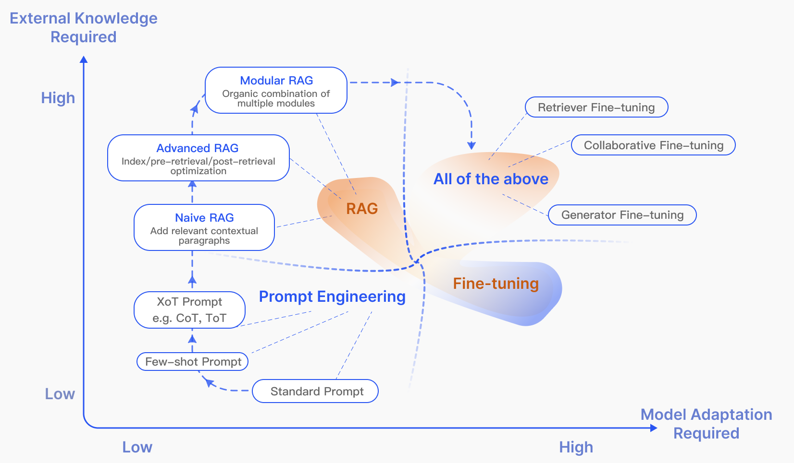

*图 1：RAG 与微调的技术选型对照光谱。横轴为 **Model Adaptation Required**（所需模型适配程度，低 → 高），纵轴为 **External Knowledge Required**（所需外部知识程度，低 → 高）。左下角起点是 **Standard Prompt**（标准提示），向上依次是 Few-shot Prompt（少样本提示）、XoT Prompt（如 CoT 思维链、ToT 思维树）——这一列属于 **Prompt Engineering**（提示词工程，蓝色标注）。左上角是 **RAG** 系列（橙色标注）：**Naive RAG**（添加相关上下文段落）→ **Advanced RAG**（索引 / 检索前 / 检索后优化）→ **Modular RAG**（多模块有机组合），三者对外部知识的需求依次升高。右下角是 **Fine-tuning**（微调，紫色标注）：Retriever Fine-tuning（检索器微调）、Generator Fine-tuning（生成器微调）、Collaborative Fine-tuning（协同微调）。右上角 **All of the above** 区域表示：当既需要大量外部知识、又需要深度模型适配时，最佳方案是 RAG 与微调叠加使用。*
*来源：Gao et al., "Retrieval-Augmented Generation for Large Language Models: A Survey", arXiv:2312.10997, Figure 4 — https://arxiv.org/html/2312.10997v5*

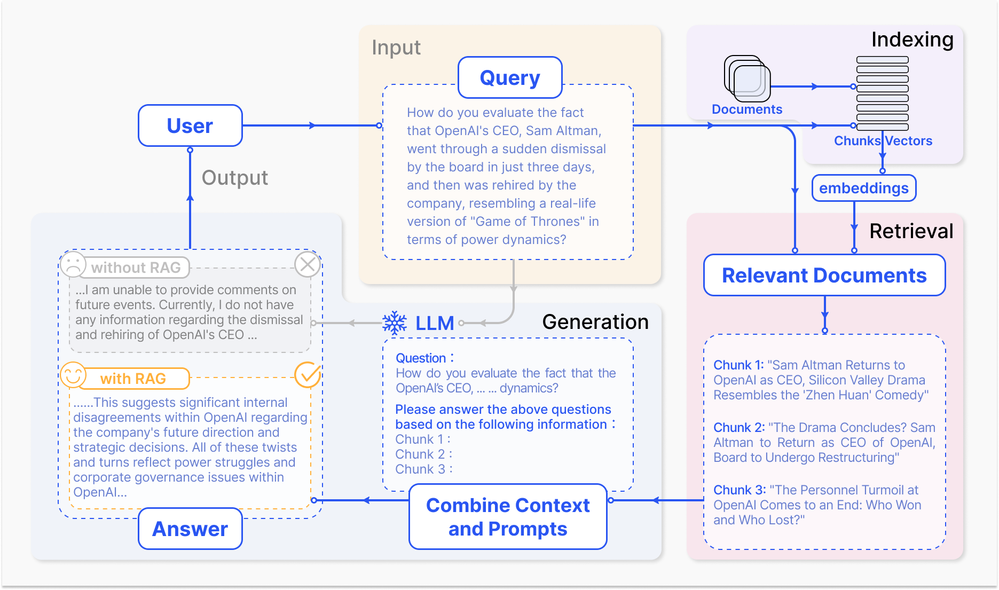

*图 2：无 RAG 与有 RAG 的效果对照，同时给出完整数据流。中部 **Input** 为原始查询（Query）——询问一个超出模型训练截止时间的事件。左下角 Output 区包含两个对照：虚线框内是**无 RAG**（without RAG）时模型的回答，模型明确声明「我无法对未来事件发表评论，我没有相关信息」；实线框内是**有 RAG**（with RAG）时的回答，基于检索到的 3 个 Chunk 给出了包含具体分析的回答。右侧展示数据流：**Indexing** 模块（Documents → Chunks/Vectors → embeddings）与 **Retrieval** 模块（Relevant Documents，含 Chunk 1–3 原文）→ 中部 **Generation** 模块（Combine Context and Prompts → LLM → Answer）。*
*来源：Gao et al., "Retrieval-Augmented Generation for Large Language Models: A Survey", arXiv:2312.10997, Figure 2 — https://arxiv.org/html/2312.10997v5*

#### 实用示例

用一段代码把「参数化记忆的局限」量化出来——**同一个问题，有无外部上下文，答案的可验证性完全不同**：

```python
# 演示：上下文注入如何把"不可验证的声称"变成"可验证的引用"
# 类比：接口测试中，没有断言的响应 = 没有断言的模型输出

# 场景：企业内部制度问答（HR 场景）
question = "公司年假有多少天？"

# --- 无 RAG：模型只能靠参数化记忆 ---
# 模型可能回答："一般企业年假为 5-15 天，具体取决于工龄。"
# 问题：这个答案对"本公司"无效；无法溯源；无法作为制度依据
answer_no_rag = {
    "text": "一般企业年假为 5-15 天，具体取决于工龄。",
    "citations": [],          # 空 —— 无法验证
    "verifiable": False,      # 不可验证
    "actionable": False,      # 员工无法据此请假
}

# --- 有 RAG：上下文被显式注入，且携带元数据 ---
retrieved_chunks = [
    {"doc_id": "hr_leave_2026", "chunk_id": "c03",
     "text": "员工累计工作满 1 年不满 10 年的，年休假 5 天；满 10 年不满 20 年的，年休假 10 天。",
     "version": "2026-05", "scope": "全员"},
]
answer_with_rag = {
    "text": "按公司现行《休假管理制度（2026 年 5 月版）》：工龄满 1 年不满 10 年可休 5 天，"
            "满 10 年不满 20 年可休 10 天。",
    "citations": ["hr_leave_2026#c03"],   # 非空 —— 可验证
    "verifiable": True,
    "actionable": True,                    # 员工可据此提交申请
}

# 测试视角：下面这行断言，正是 RAG 测试与普通 LLM 测试的分界线
assert answer_with_rag["citations"], "RAG 系统的答案必须携带引用，否则与裸模型无区别"
```

#### 测试视角（结合你的 AI+接口自动化 SKILL 项目）

你的 SKILL 项目其实**已经在做一个「简化版 RAG」**：AI 生成接口用例前，先读取项目规则、接口索引、已有用例和源码片段，再生成 pytest 用例。这本质上就是「先检索上下文，再生成」——只是检索用的是**结构化索引**（精确查 URL / 方法 / 文件路径），而不是**向量索引**（语义相似度）。

从这个项目出发，可以设计三条针对「价值层」的测试：

| 测试维度 | 用例设计 | 断言要点 |
|---------|---------|---------|
| **知识更新的时效性** | 更新知识库文档 → 同一问题再次提问 | 答案必须反映新版本；**旧答案不得残留**（这是 #020 中「知识过期」质量问题的正向验证） |
| **可溯源强制性** | 遍历一批问题，检查返回结构 | `citations` 字段非空率 100%；引用 doc_id 必须真实存在于知识库 |
| **无依据时的拒答行为** | 提问一个知识库中完全不存在的制度 | 正确行为是**明确说明「知识库中未找到」，而不是编造**（对应幻觉控制） |

> ⚠️ **这是你的明确薄弱点关联项**：错题 #020 你的首次作答（20 分）遗漏了「上下文丢失/截断」和「知识过期」两类质量问题。上面第一行测试维度就是针对「知识过期」的可执行用例——**把「知识过期」从一句概念变成一条可断言的测试，才是真正的掌握**。

---

### 1.2 范式革命：RAG 检索-增强-生成协同工作流全解析

#### 概念说明

**RAG 的经典工作流由两个阶段、三个环节组成**，这两个阶段在**时间上分离**，这是理解全部工程细节的前提：

- **离线阶段（Indexing，索引构建）**：文档 → 加载 → 清洗 → 分块 → 向量化 → 存入向量库。这条链路**只需跑一次**（或按更新频率增量跑）。
- **在线阶段（Retrieval + Generation，检索与生成）**：用户问题 → 向量化 → 相似度检索 → 重排 → 拼接上下文 → LLM 生成 → 返回答案与引用。这条链路**每次请求都要跑**，直接决定响应延迟。

> **为什么必须强调「离线/在线分离」？** 因为**绝大多数 RAG 的性能与质量优化，都发生在离线阶段**（切分策略、Embedding 模型、索引类型），而**延迟优化大多发生在在线阶段**（Top-K 大小、重排模型、上下文长度）。测试工程师如果分不清这两条链路，就无法判断「同一个问题答错了，该归因到哪一层」。

**经典三阶段数据流：**

```
① 索引（Indexing，离线）          ② 检索（Retrieval，在线）      ③ 生成（Generation，在线）
─────────────────────────       ────────────────────────      ────────────────────────
文档 Documents                   用户问题 Query                 检索结果 + 原始问题
  ↓ 加载/清洗                      ↓ Embedding                     ↓ 拼装增强提示词
Chunk 分块                       问题向量                          → LLM
  ↓ Embedding                     ↓ 相似度计算（ANN）              → 生成可溯源答案
向量 Vectors                      ↓ Top-K 召回                     → 返回引用 citations
  ↓ 写入                           ↓ （可选）Rerank 精排
向量库 Vector Store              候选上下文
```

#### 核心要点

**三阶段的职责、故障归属与典型指标：**

| 阶段 | 输入 | 输出 | 核心决策 | 这一层坏了会怎样 | 关键指标 |
|------|------|------|---------|----------------|---------|
| **Indexing** | 原始文档（PDF/Word/MD/HTML） | 向量库中的 (向量, 文本, 元数据) 三元组 | 切分粒度、Embedding 模型、索引类型 | **检索到的内容整体不对**，且很难事后补救（需重建索引） | 索引覆盖率、切分完整率 |
| **Retrieval** | 用户问题 | Top-K 候选上下文 | 相似度度量、Top-K 大小、是否重排 | **该找到的没找到 / 找到了但排在后面** | Hit Rate@K、Recall@K、MRR、Context Precision |
| **Generation** | 上下文 + 问题 | 答案 + 引用 | Prompt 约束强度、上下文拼装顺序、上下文长度 | **资料给对了但答案还是错**（幻觉、答非所问、引用与答案不匹配） | Faithfulness、Answer Relevancy、引用准确率 |

> ⚠️ **面试高频追问：「RAG 答案错了，是检索的问题还是生成的问题？」**
>
> 标准答法是**按链路顺序二分**：先看 Top-K 里有没有「应当回答这个问题的文档」——**没有 → 检索问题**（去查切分、Embedding、查询改写、元数据过滤）；**有但答案仍错 → 生成问题**（去查 Prompt 约束、上下文拼装、上下文是否被截断）。这个二分法是你错题 #020 的核心考点，务必背下来。

**RAG 三要素的「协同」关系（这是「范式革命」的实质）：**

传统检索系统（如搜索引擎）是「关键词匹配 + 返回链接」；传统生成模型是「无条件生成」；RAG 的突破在于**让检索结果成为生成的条件（Conditioning），并让两者可以在同一个目标下联合优化**：

```
p(answer | question)  =  Σ_z  p_retriever(z | question)  ×  p_generator(answer | question, z)
                          └─ 检索器分布 ─┘                └──── 生成器条件分布 ────┘
                          「z 有多可能是答案依据」          「给定 z，答案有多可能」
```

这个公式（源自 RAG 原始论文）在工程上的含义是：**检索得分高 ≠ 对生成有帮助**。一份文档可能「看起来很相关」但把模型带偏；另一份文档「相似度略低」却正好能支撑正确答案。这就是为什么现代 RAG 普遍在检索后加一层 **Rerank（重排）** —— 用更强的模型重新评估「对回答的贡献度」，而不只看向量距离。

#### 实用示例

下面用一段**完全可运行**的代码演示「离线 / 在线分离」这条最小 RAG 链路（不依赖任何外部服务，便于本地验证与单测）：

```python
# 最小可运行的 RAG 链路骨架（离线 + 在线两阶段）
# 目的：把"离线只跑一次、在线每次必跑"这条边界用代码固化下来
import hashlib
import math
from dataclasses import dataclass, field


# ========== 离线阶段：Indexing（只跑一次 / 增量跑） ==========
@dataclass
class Chunk:
    """索引中的最小单元：向量 + 原文 + 元数据"""
    chunk_id: str
    text: str
    vector: list[float] = field(default_factory=list)
    metadata: dict = field(default_factory=dict)


def naive_embed(text: str, dim: int = 64) -> list[float]:
    """
    极简确定性 Embedding：用字符哈希投影到固定维度后做 L2 归一化。
    仅为演示流程 —— 生产环境请用 bge / nomic-embed-text 等真实模型。
    """
    vec = [0.0] * dim
    for ch in text:
        h = int(hashlib.md5(ch.encode("utf-8")).hexdigest(), 16)
        vec[h % dim] += 1.0
    norm = math.sqrt(sum(v * v for v in vec)) or 1.0
    return [v / norm for v in vec]           # ← 归一化：让内积等价于余弦


def build_index(docs: list[dict]) -> list[Chunk]:
    """离线阶段：加载 → 分块 → 向量化 → 落库"""
    index = []
    for d in docs:
        for i, seg in enumerate(split_text(d["content"])):
            index.append(Chunk(
                chunk_id=f"{d['doc_id']}#c{i:02d}",
                text=seg,
                vector=naive_embed(seg),
                metadata={"doc_id": d["doc_id"], "version": d.get("version", ""),
                          "scope": d.get("scope", "全员")},
            ))
    return index


def split_text(text: str, size: int = 120, overlap: int = 20) -> list[str]:
    """按字符切分并保留 overlap（详见第 2 章：为什么必须留 overlap）"""
    out, start = [], 0
    while start < len(text):
        out.append(text[start:start + size])
        if start + size >= len(text):
            break
        start += size - overlap          # ← 重叠区间，避免答案跨边界被切断
    return out


# ========== 在线阶段：Retrieval + Generation（每次请求都跑） ==========
def dot(a: list[float], b: list[float]) -> float:
    """归一化向量的内积 == 余弦相似度"""
    return sum(x * y for x, y in zip(a, b))


def retrieve(question: str, index: list[Chunk], top_k: int = 3,
             filters: dict | None = None) -> list[Chunk]:
    """在线阶段第一步：检索。filters 对应第 2.3 节的元数据过滤"""
    qv = naive_embed(question)
    # 元数据预过滤（pre-filter）：必须发生在相似度计算之前，详见 2.3
    candidates = [c for c in index
                  if all(c.metadata.get(k) == v for k, v in (filters or {}).items())]
    ranked = sorted(candidates, key=lambda c: dot(qv, c.vector), reverse=True)
    return ranked[:top_k]


def generate(question: str, contexts: list[Chunk]) -> dict:
    """在线阶段第二步：生成。这里用模板模拟 LLM，重点是'引用与答案绑定'的结构"""
    ctx_block = "\n".join(f"[{c.chunk_id}] {c.text}" for c in contexts)
    return {
        "prompt": f"仅依据以下资料回答，并标注引用编号：\n{ctx_block}\n\n问题：{question}",
        "answer": "（由 LLM 基于上述上下文生成）",
        "citations": [c.chunk_id for c in contexts],   # ← 引用必须与上下文一一对应
    }


# ========== 串起来跑一次 ==========
docs = [
    {"doc_id": "hr_leave_2026", "version": "2026-05", "scope": "全员",
     "content": "员工累计工作满 1 年不满 10 年的，年休假 5 天；满 10 年不满 20 年的，年休假 10 天。"
                "年假需提前 3 个工作日在系统提交申请，经直属主管审批后生效。"},
]
index = build_index(docs)
print("索引规模：", len(index), "个 chunk")

ctx = retrieve("年假要提前几天申请？", index, top_k=2, filters={"scope": "全员"})
result = generate("年假要提前几天申请？", ctx)
print("命中 chunk：", [c.chunk_id for c in ctx])
print("引用：", result["citations"])
# → 输出应显示命中的 chunk_id 与引用一一对应（这是可溯源性的最小验证）
```

#### 测试视角（结合你的 SKILL 项目与错题 #020）

**关键测试点在于「离线 / 在线」这条边界本身**——它是 RAG 中最容易被测试遗漏的地方：

| 测试对象 | 测试点 | 为什么容易漏 |
|---------|--------|-------------|
| **离线链路（Indexing）** | 新文档入库后能被检索到；删除文档后**必须不可检索**（幽灵索引） | 删除往往只删了数据库记录，忘了删向量，导致「已下架的内容仍被引用」 |
| **离线 ↔ 在线一致性** | 离线用的 Embedding 模型与在线问题向量化的模型**必须是同一个** | ⚠️ **这是最隐蔽的缺陷**：换了 Embedding 模型但没重建索引，检索结果会整体劣化且不报错——你在项目里切换过模型，这条要重点回归 |
| **在线链路（Retrieval）** | 相同问题在不同并发下返回结果稳定；Top-K 数量改变时答案不突变 | 检索结果抖动往往意味着索引未收敛或存在并发写 |
| **在线链路（Generation）** | 上下文为空时**必须拒答**；引用编号与上下文严格对应 | 对应 #020「引用错误」质量问题 |

> ⚠️ **值得写进你 SKILL 项目的一条护栏**：在索引元数据里记录 `embedding_model` 与 `embedding_dim`，检索时校验在线问题向量化用的模型是否与索引一致——不一致就**直接报错而不是静默降级**。这一条能挡住「换模型没重建索引」这类静默失真，与你现有「py_compile → pytest 两步验证」的失败闭环思路完全一致。

---

### 1.3 技术演进之路：高级 RAG 的协同范式演进

#### 概念说明

RAG 并非一成不变。业界用三代范式概括它的演进：**Naive RAG（朴素 RAG）→ Advanced RAG（高级 RAG）→ Modular RAG（模块化 RAG）**。理解这三代的分界，比记住名词更重要——它对应着解决「检索质量不足」的三条不同路径。

| 范式 | 核心思路 | 新增的环节 | 解决的问题 |
|------|---------|-----------|-----------|
| **Naive RAG** | 最朴素的「检索 → 拼接 → 生成」三步流水线 | 无（就是基础链路） | 让模型能「看到」外部资料 |
| **Advanced RAG** | 在检索**前**和检索**后**各加一层优化 | **Pre-Retrieval**（查询改写/扩展/路由）+ **Post-Retrieval**（重排/摘要/融合） | 解决「原始 Query 检索不准」与「召回内容太杂」 |
| **Modular RAG** | 把 RAG 拆成可插拔模块，按需编排 | Routing / Memory / Fusion / Predict / Demonstrate 等独立模块 | 让架构适配不同任务，而非一条流水线走到底 |

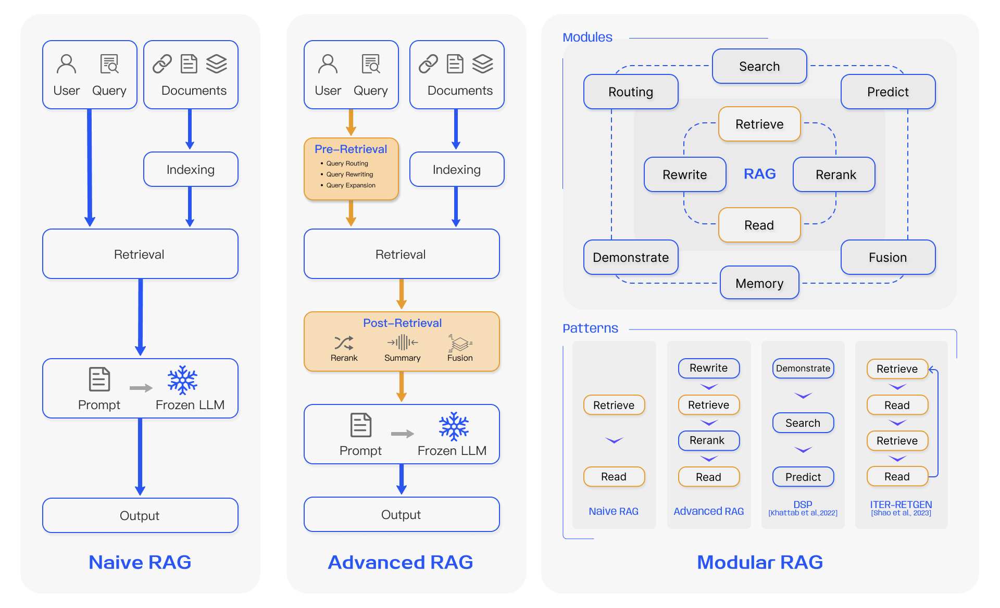

*图 3：RAG 三代范式演进。**左侧 Naive RAG**：User Query 与 Documents 分别经检索与索引后，检索结果直接拼成 Prompt 交给 Frozen LLM（冻结的 LLM，即不做微调）生成 Output，是一条直线流水线。**中间 Advanced RAG**：在检索前插入 **Pre-Retrieval** 环节（Query Routing 查询路由 / Query Rewriting 查询改写 / Query Expansion 查询扩展，橙色标注），在检索后插入 **Post-Retrieval** 环节（Rerank 重排 / Summary 摘要 / Fusion 融合），形成「检索前后各一层」的结构。**右侧 Modular RAG**：上半部展示可插拔的 **Modules**（Routing 路由 / Search 搜索 / Predict 预测 / Retrieve 检索 / Rewrite 改写 / Rerank 重排 / Read 阅读 / Demonstrate 示范 / Fusion 融合 / Memory 记忆），下半部 **Patterns** 展示这些模块编排出的四种典型形态：Naive RAG（Retrieve→Read）、Advanced RAG（Rewrite→Retrieve→Rerank→Read）、DSP（Demonstrate→Search→Predict）、ITER-RETGEN（Retrieve→Read→Retrieve→Read 的迭代模式）。*
*来源：Gao et al., "Retrieval-Augmented Generation for Large Language Models: A Survey", arXiv:2312.10997, Figure 3 — https://arxiv.org/html/2312.10997v5*

#### 核心要点

**Advanced RAG 的两个优化层，各自解决什么问题：**

| 优化层 | 技术手段 | 一句话说明 | 适用信号 |
|--------|---------|-----------|---------|
| **Pre-Retrieval** | **Query Rewriting（改写）** | 把口语化问题改写成更适合检索的形式 | 用户问得很口语：「社保现在交多少钱」 |
| | **Query Expansion（扩展）** | 补充同义词、上位词，提升召回 | 专业术语与俗称并存：「心梗」↔「急性心肌梗死」 |
| | **Query Routing（路由）** | 把问题分发到不同的知识域 | 多知识库场景：HR 制度 / 临床指南 / 合规条款 |
| **Post-Retrieval** | **Rerank（重排）** | 用 Cross-Encoder 精排，替换纯向量距离排序 | 召回没问题但排序不佳（正确文档排第 5 位） |
| | **Context Compression（压缩/摘要）** | 压缩冗余上下文，腾出窗口给更相关内容 | 上下文窗口被噪声占满，关键信息被挤掉 |
| | **Fusion（融合）** | 合并多路检索结果（如向量 + BM25） | 既有语义查询又有精确标识符（错误码、单号） |

**迭代式检索：三种高级模式（对应图 2 之后的进一步演进）**

基础 RAG 是「检索一次 → 生成一次」，而高级 RAG 引入了**迭代与自适应**机制：

| 模式 | 机制 | 终止条件 | 典型适用 |
|------|------|---------|---------|
| **Iterative（迭代式）** | Retrieve → Generate → Judge（评判）→ 不满意则带着反馈重新检索 | 达到最大迭代次数 / 评判分数阈值 | 单次检索信息不足，需补充上下文 |
| **Recursive（递归式）** | 把复杂问题拆解为子问题，逐层检索 | 达到最大递归深度 / 阈值 | 多跳问答（需串联多个事实才能回答） |
| **Adaptive（自适应）** | 由 Judge 模块动态决定「是否需要检索」「何时生成」 | 生成特殊 Token / 阈值 | 简单问题不必检索，直接生成即可 |

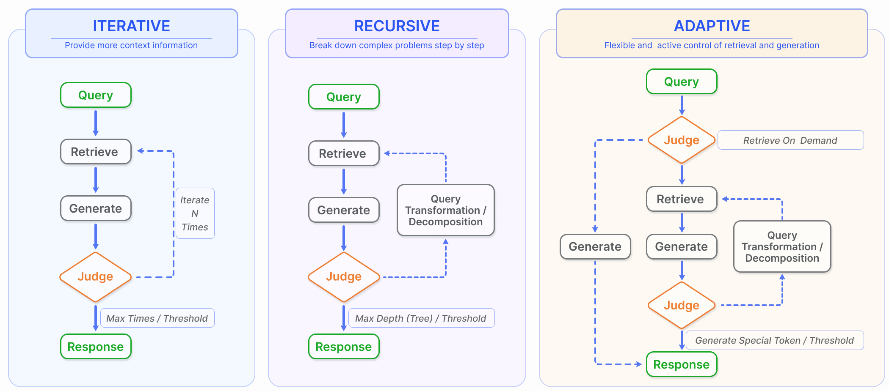

*图 4：高级 RAG 的三种迭代检索模式。**ITERATIVE（迭代式）**：Query → Retrieve → Generate → Judge（橙色菱形判断节点），不满意则沿虚线回到 Retrieve 重新检索（标注 Iterate N Times），满足条件后输出 Response；终止条件为 Max Times / Threshold。**RECURSIVE（递归式）**：在 Generate 与 Judge 之间加入 Query Transformation / Decomposition（查询变换与分解）模块，把问题拆成子问题后重新检索，终止条件为 Max Depth (Tree) / Threshold。**ADAPTIVE（自适应）**：Judge 节点前置到检索之前，通过虚线分支实现 Retrive On Demand（按需检索）——简单问题直接走 Generate，无需检索；复杂问题才进入 Retrieve 分支，并可触发查询变换后重新检索。*
*来源：Gao et al., "Retrieval-Augmented Generation for Large Language Models: A Survey", arXiv:2312.10997, Figure 5 — https://arxiv.org/html/2312.10997v5*

#### 实用示例

下面演示 **Query Rewriting + Rerank** 这两个最常用的 Advanced RAG 环节，用可运行的骨架表达：

```python
# Advanced RAG 最小实现：Pre-Retrieval（查询改写） + Post-Retrieval（重排）
# 目的：把"高级 RAG"从概念变成两个可测试的函数

import math

# ---------- Pre-Retrieval：查询改写 ----------
REWRITE_RULES = {
    # 口语 → 检索友好：这类映射在实际项目中应由 LLM 生成，此处用规则演示
    "社保交多少钱": "社会保险 缴纳基数 缴费标准 个人缴纳比例",
    "年假几天":     "年休假 天数 工龄 计算标准",
    "五险一金":     "社会保险 住房公积金 缴纳比例",
}


def rewrite_query(question: str) -> list[str]:
    """返回多个改写变体（多路召回），而非只返回一个 —— 这是 Advanced RAG 的常规做法"""
    variants = [question]
    for colloquial, formal in REWRITE_RULES.items():
        if colloquial in question:
            variants.append(formal)
            break
    return variants


# ---------- Post-Retrieval：用 Cross-Encoder 思路重排 ----------
def cross_encoder_score(question: str, chunk_text: str) -> float:
    """
    真实实现应为 Cross-Encoder 模型（如 bge-reranker），对 (query, doc) 联合编码。
    这里用『关键词共现 + 长度惩罚』模拟其行为特征：
    —— 与 query 词重叠越多分越高（模拟联合注意力）
    —— 文本过长则稀释得分（模拟相关性被无关内容摊薄）
    """
    q_terms = set(question)
    overlap = len(q_terms & set(chunk_text)) / max(len(q_terms), 1)
    length_penalty = 1.0 / (1.0 + math.log1p(len(chunk_text)) / 10)
    return overlap * length_penalty


def retrieve_with_rerank(question: str, index, top_k=3, recall_k=10):
    """
    两阶段检索：
      阶段 1 —— 向量粗召回 recall_k 个候选（快，但排序不准）
      阶段 2 —— Cross-Encoder 精排，取 top_k（慢，但准）
    这正是 HNSW 作为"粗检索器"、Cross-Encoder 作为"精排器"的标准分工（见第 5 章）
    """
    candidates = []
    for v in rewrite_query(question):                 # ← 多路召回
        candidates.extend(retrieve(v, index, top_k=recall_k))
    # 去重（同一 chunk 可能被多个改写变体命中）
    uniq = {c.chunk_id: c for c in candidates}.values()
    reranked = sorted(uniq, key=lambda c: cross_encoder_score(question, c.text), reverse=True)
    return reranked[:top_k]


# 示例输出解读：
# 粗召回可能把"长但泛"的文档排在前面（向量距离近），
# 精排后"短而准"的文档上位 —— 这就是 Rerank 的价值
```

#### 测试视角（结合错题 #020）

Advanced RAG 引入的新环节，同时也是**新的缺陷来源**。下表把每个新环节映射成可执行的测试点：

| 新增环节 | 风险 | 测试用例设计 |
|---------|------|-------------|
| **Query Rewriting** | 改写引入语义漂移（把「年假」改成「请假」） | 构造一批问题，断言改写后**仍命中原始期望文档**；对比改写前后的 Hit Rate@K，劣化超阈值则告警 |
| **Query Routing** | 路由错域（HR 问题被路由到临床指南） | 准备跨域问题集，断言路由结果与期望知识域一致；覆盖「边界模糊问题」（既涉 HR 又涉合规） |
| **Rerank** | 重排把正确文档挤下去（Cross-Encoder 误判） | **同一候选集**分别跑「纯向量排序」与「重排后排序」，断言关键问题的 Top-1 不得劣化 |
| **Context Compression** | 压缩时把答案依据删掉 | 断言压缩前后「关键句覆盖率」；构造答案位于被压缩段落的用例 |
| **Fusion（多路融合）** | 权重失衡导致某一路完全失效 | 单独关闭某一路检索，观察指标下降幅度，确认无「僵尸通道」（贡献恒为 0 的检索路径） |
| **Iterative / Recursive** | 迭代不收敛（死循环）、递归深度爆炸 | 断言迭代次数上限生效；构造无解问题，验证能在有限步内终止并返回「未找到」 |

> ⚠️ **可写进你 SKILL 项目的一条经验**：Advanced RAG 的每个优化环节都增加了「不确定性」。你在 SKILL 项目里用过「失败重试 3 次后转人工」的护栏思路——**RAG 的迭代检索同样需要次数上限与降级策略**，否则线上会出现请求长时间挂起。这条护栏的测试断言是：**给定一个知识库中无解的问题，系统必须在 N 次迭代内返回明确结论，且总耗时不超过 SLA**。

---

### 1.4 RAG 生态全景与技术栈总览

#### 概念说明

RAG 已经从「一种技术」长成「一个生态」：上游是数据与任务，中游是编排框架与技术组件，下游是评估与监控。**对测试工程师来说，这张全景图的价值是：它就是你的测试范围清单** —— 每一个方框都是一个需要被验证的组件或接口。

#### 核心要点

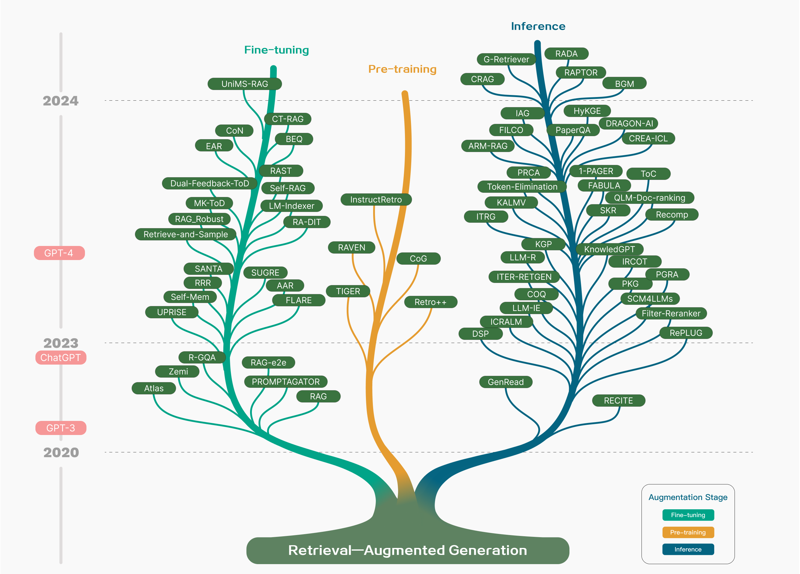

*图 5：Modular RAG 的技术树。顶层为三类技术方向：**Enhancement（增强）**——通过 Query Enhancement、Retriever Enhancement、Generator Enhancement 提升各环节能力；**Module Addition（模块新增）**——引入 Search、Memory、Routing、Predict、Task Adapter 等可插拔模块；**Alignment（对齐）**——Training、Ranking、Self-Reflection 等训练与自反思机制。下方列出 **The Most Advanced RAG Systems** 的模块组合，展示不同先进系统如何拼装这些模块；底部为 **Related Techniques and Tasks**（相关技术与任务，如 Fine-tuning、RLHF、Chain-of-Thought 等）与 **Popular RAG Works**（代表性工作）。*
*来源：Gao et al., "Retrieval-Augmented Generation for Large Language Models: A Survey", arXiv:2312.10997, Figure 1 — https://arxiv.org/html/2312.10997v5*

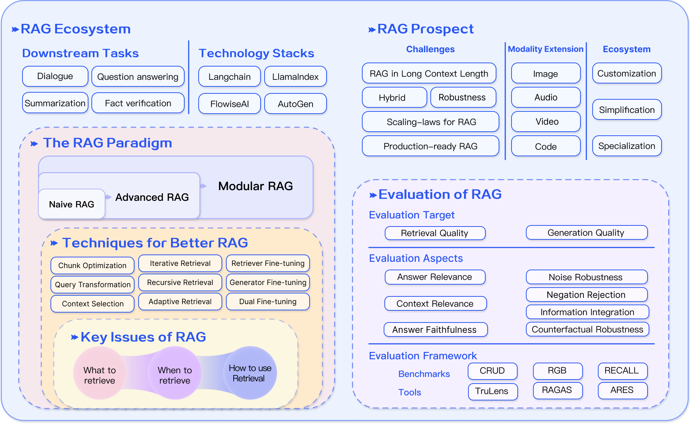

*图 6：RAG 生态全景与评估框架。左上 **RAG Ecosystem**：Downstream Tasks（下游任务：Dialogue 对话 / Question answering 问答 / Summarization 摘要 / Fact verification 事实核查）与 Technology Stacks（技术栈：LangChain、LlamaIndex、FlowiseAI、AutoGen）。中间 **The RAG Paradigm**：Naive RAG → Advanced RAG → Modular RAG 的范式递进；Techniques for Better RAG 列出 Chunk Optimization（分块优化）、Query Transformation（查询变换）、Context Selection（上下文选择）、Iterative Retrieval（迭代检索）、Recursive Retrieval（递归检索）、Adaptive Retrieval（自适应检索）、Retriever/Generator/Dual Fine-tuning（三类微调）；Key Issues of RAG 归结为三问：What to retrieve（检索什么）、When to retrieve（何时检索）、How to use Retrieval（如何使用检索结果）。右上 **RAG Prospect**：Challenges（长上下文、混合检索、鲁棒性、扩展定律、生产可用）与 Modality Extension（图像/音频/视频/代码多模态扩展）。右下 **Evaluation of RAG**：Evaluation Target（Retrieval Quality 检索质量 / Generation Quality 生成质量）→ Evaluation Aspects（Answer Relevance、Context Relevance、Answer Faithfulness、Noise Robustness、Negation Rejection、Information Integration、Counterfactual Robustness）→ Evaluation Framework（Benchmarks: CRUD/RGB/RECALL；Tools: TruLens/RAGAS/ARES）。*
*来源：Gao et al., "Retrieval-Augmented Generation for Large Language Models: A Survey", arXiv:2312.10997, Figure 6 — https://arxiv.org/html/2312.10997v5*

#### 实用示例

把图 5 的「Key Issues of RAG 三问」落成一个**项目立项前的架构决策模板**——这是你在实际工作中真正会用到的：

```python
from dataclasses import dataclass
from enum import Enum


class RetrievalStrategy(Enum):
    DENSE = "向量检索"          # 纯语义
    SPARSE = "关键词检索"        # BM25 等
    HYBRID = "混合检索"          # 两者融合
    NONE = "不检索"              # 直接生成（Adaptive 模式）


@dataclass
class RAGDesignDecision:
    """RAG 架构决策表 —— 对应图 5 的 Key Issues 三问"""
    what_to_retrieve: str      # 检索什么：文档 / 表格 / 代码 / 图
    when_to_retrieve: str      # 何时检索：总是 / 按需（路由或判断）
    how_to_use: str            # 如何使用：直接拼接 / 摘要压缩 / 重排后拼接
    strategy: RetrievalStrategy
    rerank: bool
    # 决策依据（必须写，否则无法评审）
    rationale: str


# 示例：HR 制度问答系统的决策
design = RAGDesignDecision(
    what_to_retrieve="制度文档段落 + 条款编号（结构化字段）",
    when_to_retrieve="总是检索（HR 问题几乎都需要制度依据，无按需必要）",
    how_to_use="重排后拼接，强制要求模型输出条款引用",
    strategy=RetrievalStrategy.HYBRID,        # ← 既有语义问法又有精确条款号
    rerank=True,
    rationale=("员工提问口语化严重（'五险一金交多少'），纯关键词召不回；"
               "但制度条款号、部门名又需要精确匹配，故必须混合检索。"
               "条款引用是合规要求，不可省略，故必须 rerank 保证 Top-1 命中率。"),
)

print(design.strategy.value, "| rerank =", design.rerank)
# → 输出：混合检索 | rerank = True
```

#### 测试视角（把全景图当作测试范围清单）

图 5 的每一个方框都是测试对象。下表把它转成一份**可直接用于项目的 RAG 测试范围清单**：

| 生态组件 | 测试类型 | 核心断言 |
|---------|---------|---------|
| **Technology Stacks（LangChain / LlamaIndex 等）** | 集成测试 | 框架升级后检索结果不劣化；版本变更需回归完整评测集 |
| **Downstream Tasks（问答/摘要/事实核查）** | 场景测试 | 不同任务类型对 Top-K 与上下文的敏感度不同，需分任务设定阈值 |
| **Chunk Optimization** | 参数化测试 | 见第 2.2 节：切分参数扫描 |
| **Query Transformation** | 回归测试 | 改写后 Hit Rate 不下降（见 1.3） |
| **Retrieval Strategy（Dense/Sparse/Hybrid）** | 对比测试 | 混合检索需证明优于单路，否则增加复杂度无收益 |
| **Evaluation Aspects（Faithfulness 等）** | 质量测试 | 见第 6.3 节的验收清单 |
| **Modality Extension（多模态）** | 扩展性测试 | 图像/音频检索的向量维度与度量需与文本分开管理 |
| **Challenges：长上下文** | 边界测试 | 上下文增长时答案质量是否衰减（Lost-in-the-middle 现象） |

> ⚠️ **一个面试加分点**：图 5 把评估目标明确分为 **Retrieval Quality** 与 **Generation Quality** 两个 Evaluation Target，这与你在错题 #020 中已掌握的「检索 + 生成双维度」完全一致——**你可以直接用这张官方图作为面试回答的框架依据**，说明「业界主流综述（arXiv:2312.10997）把 RAG 评估明确拆为检索质量与生成质量两个目标」，比单纯说「我分两层测」更有说服力。

---

## 第 2 章 智能知识库构建与数据工程

> **本章定位**：这是 RAG 的**第一道也是最容易出错的一道工序**。业界经验反复验证同一结论——**RAG 效果不好的第一原因不是模型不够强，而是文档处理得不够好**。错题 #020 你首次作答遗漏的「上下文丢失/截断」，根源就在本章。

### 2.1 数据源的高效集成与预处理：文档加载与读取

#### 概念说明

**文档加载（Document Loading）是把异构数据源统一成「标准化文档对象」的过程**。企业知识库的输入从来不是干净的纯文本，而是 PDF、Word、Excel、Markdown、HTML、数据库记录、甚至扫描件混在一起。

标准化的目标产物是一个统一结构：

```
Document = {
    content:  str,        # 正文文本（已清洗）
    metadata: dict,       # 来源、版本、权限、时间、部门……
}
```

> **为什么必须统一？** 因为下游的**切分、向量化、元数据过滤、引用溯源**全都依赖这个结构。如果加载阶段丢掉了「这段文字来自哪个文件、哪一页、哪个章节」，后续就不可能输出可信的引用——而引用能力恰恰是 RAG 相对裸模型的核心优势。

#### 核心要点

**不同格式的加载要点与常见陷阱：**

| 格式 | 加载要点 | 常见陷阱 |
|------|---------|---------|
| **PDF** | 优先用可提取文本层的解析器；区分「文本 PDF」与「扫描 PDF」 | ⚠️ 扫描件其实无文本层，直接解析得到空字符串或乱码——**必须先判断再走 OCR** |
| **Word / DOCX** | 保留标题层级（Heading 1/2/3），这是后续分块的天然边界 | 表格与文本框内容容易丢失 |
| **Excel** | 每行/每个 Sheet 转成结构化文本，**保留列语义** | 纯拼接会丢失「这一列是什么含义」，需人为补表格头 |
| **Markdown** | 按标题层级直接切分，是分块最友好的格式 | 代码块可能被切断 |
| **HTML** | 先剥离导航、页脚、广告等噪声，再提正文 | 不去噪会把全站菜单当正文入库，严重稀释检索质量 |
| **扫描件 / 图片** | 需 OCR，且 OCR 错误率直接影响检索 | OCR 噪声（错别字）会导致向量化后语义偏移 |

**清洗（Cleaning）必须做的四件事：**

| 步骤 | 目的 | 具体动作 |
|------|------|---------|
| **去噪** | 剔除与知识无关的内容 | 去页眉页脚、页码、水印、广告、导航 |
| **规范化** | 统一表达形式 | 全半角统一、多余空白压缩、换行归一 |
| **脱敏** | 合规要求（尤其医疗/HR） | 身份证、手机号、病历号、银行账号等 PHI/PII 替换 |
| **去重** | 避免同一内容被多次召回占位 | 按内容哈希去重（保留版本号最新的一份） |

> ⚠️ **面试常问：「为什么必须去重？」** 因为重复内容会**同时占据 Top-K 的多个槽位**——一个文档在库里存了 3 份，检索时 Top-5 可能被同一内容占掉 3 个名额，导致真实有效的其他候选被挤出，直接劣化召回多样性。这是「召回率看起来不低、可用信息却很少」的典型原因。

#### 实用示例

下面是一段**可直接运行**的加载与清洗流水线（含脱敏与去重）：

```python
import hashlib
import re
from dataclasses import dataclass, field


@dataclass
class Document:
    content: str
    metadata: dict = field(default_factory=dict)


# ---------- 1. 清洗 ----------
def normalize_text(text: str) -> str:
    """规范化：全角转半角、压缩空白"""
    # 全角字符转半角（中文标点保留，避免破坏句子边界）
    trans = {ord(c): ord(c) - 0xFEE0 for c in
             "０１２３４５６７８９ＡＢＣＤＥＦＧＨＩＪＫＬＭＮＯＰＱＲＳＴＵＶＷＸＹＺａｂｃｄｅｆｇｈｉｊｋｌｍｎｏｐｑｒｓｔｕｖｗｘｙｚ"}
    text = text.translate(trans)
    text = re.sub(r"[ \t\u3000]+", " ", text)      # 压缩水平空白
    text = re.sub(r"\n{3,}", "\n\n", text)          # 压缩连续空行
    return text.strip()


def remove_noise(text: str) -> str:
    """去噪：剔除页码行、页眉页脚等典型噪声"""
    lines = []
    for line in text.split("\n"):
        s = line.strip()
        if not s:
            lines.append("")
            continue
        if re.fullmatch(r"[-—\s]*\d{1,3}\s*[-—]*", s):     # 纯页码
            continue
        if "版权所有" in s or "机密" in s and len(s) < 20:  # 页脚标语
            continue
        lines.append(s)
    return "\n".join(lines)


def desensitize(text: str) -> str:
    """
    脱敏：医疗/HR 场景的强制步骤（对应第 6.2 节的医疗实战）
    ⚠️ 顺序很重要：先长后短，避免身份证被手机号规则部分命中
    """
    text = re.sub(r"\b\d{17}[\dXx]\b", "***身份证***", text)   # 18 位身份证
    text = re.sub(r"\b\d{15}\b", "***证件号***", text)          # 15 位证件号
    text = re.sub(r"\b1[3-9]\d{9}\b", "***手机号***", text)     # 手机号
    text = re.sub(r"\b\d{16,19}\b", "***银行卡***", text)       # 银行卡
    text = re.sub(r"(病历号|住院号|门诊号)[:：]?\s*\w+", r"\1:***", text)
    return text


# ---------- 2. 去重 ----------
def dedup_documents(docs: list[Document]) -> list[Document]:
    """
    按内容哈希去重：同一内容只保留【版本最新】的一份
    ⚠️ 必须按版本排序后再去重，否则可能保留旧版
    """
    docs_sorted = sorted(docs, key=lambda d: d.metadata.get("version", ""), reverse=True)
    seen, unique = set(), []
    for d in docs_sorted:
        h = hashlib.md5(d.content.encode("utf-8")).hexdigest()
        if h not in seen:
            seen.add(h)
            unique.append(d)
    return unique


# ---------- 3. 加载统一入口 ----------
def load_document(name: str, raw: str, version: str = "", scope: str = "全员") -> Document:
    """把任意来源的原始文本，统一成标准 Document"""
    content = desensitize(remove_noise(normalize_text(raw)))
    return Document(
        content=content,
        metadata={"source": name, "version": version, "scope": scope,
                  "char_len": len(content)},   # ← 字符数纳入元数据，便于后续质量统计
    )


# ---------- 实际跑一遍 ----------
raw = """
   2026年5月修订版                    第 1 页
员工累计工作满 1 年不满 10 年的，年休假 5 天。
联系电话：13812345678，身份证：110101199001011234
                                - 2 -
   本公司版权所有
"""
doc = load_document("休假管理制度.pdf", raw, version="2026-05", scope="全员")
print(doc.content)
print(doc.metadata)
# → 输出验证三点：页码与页脚已被剔除；手机号/身份证已脱敏；元数据齐备
```

#### 测试视角（结合你的 SKILL 项目）

加载与清洗阶段是**最适合做自动化回归的环节**——因为它的输入输出都是确定性的文本，不像生成阶段那样难以断言。

| 测试维度 | 用例设计 | 断言 |
|---------|---------|------|
| **格式覆盖** | 对每种支持格式各准备 1 份样例文档 | 加载后 `content` 非空且长度合理（**空字符串是最常见的静默失败**） |
| **扫描件识别** | 准备一份图片型 PDF | 系统应识别出「无文本层」并走 OCR 或明确报错，**不得静默入库空内容** |
| **脱敏完整性** | 构造含各类 PII/PHI 的文档 | 用正则反向扫描入库内容，**断言零命中**（对应第 6.2 节的脱敏测试） |
| **去重有效性** | 同一内容的不同版本入库 | 库中只保留最新版；旧版本不可被检索到 |
| **噪声剔除** | 含页眉页脚页码的文档 | 入库内容中不含导航文本；断言关键词不出现 |
| **元数据完整性** | 遍历全部入库文档 | `source` / `version` 字段非空率 100%（**缺失元数据 → 后续无法做引用溯源与权限过滤**） |

> ⚠️ **关联你的教训**：你在错题 #020 中提到「测试数据是基础」——**文档加载阶段的测试，本质就是为 RAG 准备「可信的测试基线数据」**。如果输入数据本身就带着噪声和重复，后续无论怎么调参都无法得到可信的评测结论。建议在你的评测集里**固定一份「已校验的干净语料」**，作为所有指标回归的基准。

---

### 2.2 兼顾语义完整性与检索效率：文档分块策略

#### 概念说明

**分块（Chunking）是把长文档切成语义相对完整的片段（Chunk）的过程**，每个 Chunk 会独立被向量化并成为检索的最小单位。

分块之所以是 RAG 中最关键的参数决策，原因有三：

1. **上下文窗口限制**：整本书不可能塞进一次请求，必须切分。
2. **向量语义聚焦**：长文本向量化会**稀释语义**——一篇 5000 字的文章用一个向量表示，其中某个具体条款的语义会被整体主题淹没。
3. **检索噪声控制**：只返回相关片段，避免无关内容干扰 LLM 判断。

> **一句话类比**：分块就像**给书做索引卡片**。切得太粗（一章一张卡），查询时返回一大堆无关内容；切得太细（一句一张卡），卡片失去上下文、读起来不知所云。**目标是切到「一个完整意思」的粒度**。

#### 核心要点

**主流分块策略对照：**

| 策略 | 做法 | 优势 | 局限 | 适用 |
|------|------|------|------|------|
| **固定长度切分** | 按固定字符/Token 数硬切 | 实现最简单、块大小一致 | ⚠️ **会在句子中间切断**，破坏语义 | 仅用于快速验证 |
| **递归切分（Recursive）** | 按分隔符优先级递归下降：段落 → 换行 → 句子 → 空格 | **保留语义边界**，是官方推荐的通用首选 | 仍可能切断超长单段 | 绝大多数场景的默认选择 |
| **结构感知切分（Structure-aware）** | 按 Markdown 标题 / HTML 标签 / 代码函数边界切 | 块与文档逻辑结构对齐，可携带标题路径 | 依赖文档本身结构良好 | 技术文档、法规条文、代码 |
| **语义切分（Semantic）** | 先算相邻句向量相似度，在相似度骤降处切 | 切点最贴合真实语义边界 | **成本高**（需先向量化）、不稳定 | 对质量要求极高的场景 |
| **父子分块（Parent-Child）** | 用小块检索，但返回其父块（更大上下文） | **兼顾检索精度与上下文完整** | 需维护两级索引 | 长文档问答（LlamaIndex 主推） |
| **句子窗口（Sentence Window）** | 用单句检索，返回前后 N 句 | 精度高、实现简单 | 窗口大小需调参 | 事实型问答 |

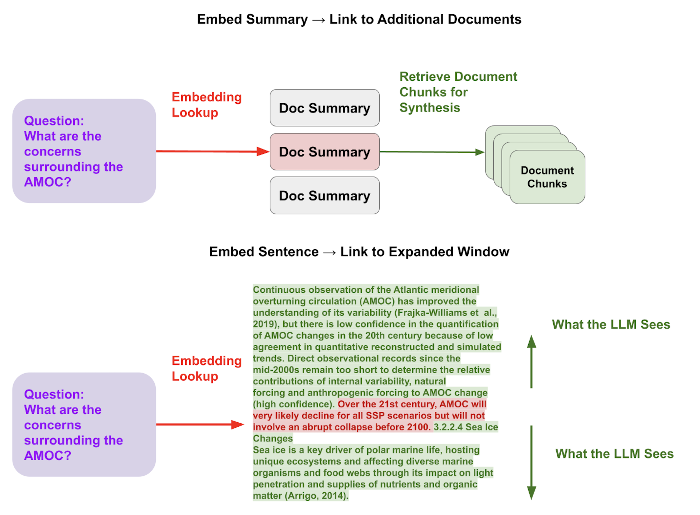

*图 7：文档分块解耦策略——把「用于检索的粒度」与「用于生成的粒度」解耦。上半部 **Embed Summary → Link to Additional Documents**：对文档做摘要（Doc Summary）并只对摘要向量化，检索时命中摘要后，再通过链接取回该文档的完整 Document Chunks 供生成使用——这样**检索用的是「语义浓缩版」，生成用的是「完整原文」**。下半部 **Embed Sentence → Link to Expanded Window**：只对句子向量化（命中精度高），但检索命中后把该句所在的**扩展窗口**（前后文）一并交给 LLM——图中用绿色标注了「What the LLM Sees」的范围，左侧深绿为命中的句子，上下浅绿为一起送入的前后文。这两种策略对应正文表格中的「父子分块」与「句子窗口」，共同目标是**兼顾检索精度与上下文完整性**。*
*来源：LlamaIndex 官方文档, "Optimizing RAG" — https://developers.llamaindex.ai/python/framework/optimizing/production_rag/*

**必须掌握的两个参数：**

| 参数 | 含义 | 经验范围 | 调大的后果 | 调小的后果 |
|------|------|---------|-----------|-----------|
| **chunk_size** | 单个块的最大长度 | 200–500 Token（中文约 300–800 字符） | 语义被稀释、噪声增多、Token 成本上升 | 语义断裂、答案跨块被切碎、上下文不足 |
| **chunk_overlap** | 相邻块的重叠长度 | **chunk_size 的 10%–20%** | 索引膨胀、检索成本上升；超过 30% 收益递减 | ⚠️ **答案正好跨边界时会同时被两块切断**，两块相似度都不高 → 检索失败 |

> ⚠️ **这是你错题 #020 的直接失分点**：「上下文丢失/截断」这类质量问题的根因，就是 **chunk_size 过大导致关键信息被切在两块之间，或 overlap 缺失导致边界信息两边都不完整**。实测结论：**overlap 不是可选项，是必需项**——因为没有任何切分策略能保证语义永不跨边界。

**中文分块的特殊处理（容易被忽略）**：

LangChain 的默认分隔符列表是 `["\n\n", "\n", " ", ""]`，这套规则是为英文（有空格分词）设计的。**中文没有词间空格**，直接用默认配置会把句子从中间切断。

官方文档明确给出的解法是**自定义分隔符列表，加入中文标点**：

```python
separators = [
    "\n\n", "\n", " ",            # 段落 → 换行 → 空格
    ".", ",",                     # 英文句号、逗号
    "\u200b",                     # 零宽空格（泰语/缅甸语等无词边界语言）
    "\uff0c",                     # 全角逗号 ，
    "\u3001",                     # 顿号 、
    "\uff0e",                     # 全角句号 ．
    "\u3002",                     # 中文句号 。
    "",                           # 兜底：逐字符
]
```

#### 实用示例

下面用**不依赖 LangChain 的纯 Python 实现**递归切分，便于理解原理并直接用于单测：

```python
# 递归字符切分：中文友好的实现（理解原理，避免只会调库）


def recursive_split(text: str, chunk_size: int = 300, chunk_overlap: int = 50,
                    separators: list[str] | None = None) -> list[str]:
    """
    按分隔符优先级递归切分：
      1) 先用最高优先级分隔符（段落）切
      2) 若某段仍超长，对其用下一优先级分隔符继续切
      3) 直到所有片段都不超过 chunk_size，或分隔符用尽
    最后统一合并碎片并施加 overlap。
    """
    seps = separators or ["\n\n", "\n", "。", "！", "？", "；", "，", " "]

    def _split(seg: str, level: int) -> list[str]:
        if len(seg) <= chunk_size or level >= len(seps):
            return [seg]
        sep = seps[level]
        parts = seg.split(sep)
        # 把分隔符补回（避免语义断裂、丢失标点）
        parts = [p + sep for p in parts[:-1]] + [parts[-1]]
        out = []
        for p in parts:
            if len(p) > chunk_size:
                out.extend(_split(p, level + 1))   # 递归下降
            else:
                out.append(p)
        return [p for p in out if p.strip()]

    raw_chunks = _split(text, 0)

    # 合并过短碎片（避免出现单句碎块）
    merged, buf = [], ""
    for c in raw_chunks:
        if len(buf) + len(c) <= chunk_size:
            buf += c
        else:
            if buf:
                merged.append(buf)
            buf = c
    if buf:
        merged.append(buf)

    # 施加 overlap：把前一块的尾部拼到当前块前面
    if chunk_overlap <= 0:
        return merged
    result = [merged[0]] if merged else []
    for i in range(1, len(merged)):
        tail = result[-1][-chunk_overlap:]
        result.append(tail + merged[i])
    return result


# ---------- 参数扫描：观察不同配置对块数的影响 ----------
sample = ("公司年休假制度如下。员工累计工作满1年不满10年的，年休假5天。"
          "满10年不满20年的，年休假10天。满20年的，年休假15天。\n\n"
          "年假申请需提前3个工作日提交。经直属主管审批后生效。"
          "跨年度年假应在次年3月31日前休完。") * 8

for size, ov in [(200, 0), (200, 40), (400, 0), (400, 80)]:
    chunks = recursive_split(sample, chunk_size=size, chunk_overlap=ov)
    lens = [len(c) for c in chunks]
    print(f"chunk_size={size:>3} overlap={ov:>2} → 块数={len(chunks):>2} "
          f"最大块长={max(lens)} 平均块长={sum(lens)//len(lens)}")
# 观察结论：
#   overlap=0 时块数更少但存在"答案跨边界被切断"的风险
#   overlap=40（20%）时块数约增 15-25%，换来边界信息的语义完整性
```

#### 测试视角（结合错题 #020）

分块是**最适合做参数化测试**的环节——因为它有明确的数值参数与可量化的结果指标。

**测试方案：切分参数扫描 + 边界用例**

```python
# 分块质量自动化测试：核心思路是"答案跨边界"这个最坏情况
import pytest


def test_chunk_never_orphans_answer():
    """
    最关键的用例：把答案埋在文档中间，让它恰好跨越切分边界，
    断言：至少有一个 chunk 完整包含答案句。
    —— 这正是错题 #020 中"上下文丢失/截断"的正向回归
    """
    answer_sentence = "年假申请需提前3个工作日提交"
    filler = "无关内容。" * 30
    # 构造：让 answer_sentence 恰好落在 size 边界附近
    doc = filler + answer_sentence + filler

    for size in (100, 150, 200, 256, 300, 400):
        chunks = recursive_split(doc, chunk_size=size, chunk_overlap=max(1, size // 5))
        assert any(answer_sentence in c for c in chunks), (
            f"chunk_size={size} 时答案句被切断，overlap 未能兜住"
        )


def test_overlap_zero_is_risky():
    """反例：overlap=0 时应能复现'答案被切断'，用于证明 overlap 的必要性"""
    answer = "年假申请需提前3个工作日提交"
    doc = "无关" * 45 + answer + "无关" * 45      # 让答案落在边界
    chunks = recursive_split(doc, chunk_size=100, chunk_overlap=0)
    # 这一断言是"预期会失败"的对照组——用于量化 overlap 的收益
    covered = any(answer in c for c in chunks)
    print(f"overlap=0 时答案完整覆盖：{covered}")   # 实测常为 False


def test_chunk_size_distribution():
    """块长分布测试：防止出现极短碎片（语义不完整）或超长块（超过模型窗口）"""
    chunks = recursive_split(sample, chunk_size=300, chunk_overlap=50)
    lens = [len(c) for c in chunks]
    assert max(lens) <= 300 * 1.2, "存在超长块，可能导致上下文超限"
    assert sum(1 for L in lens if L < 30) / len(lens) < 0.1, "短碎片占比过高，语义不完整"
```

| 测试维度 | 断言要点 |
|---------|---------|
| **答案边界完整性** | 答案句至少被一个 chunk 完整包含（overlap 生效） |
| **块长分布** | 无超长块（不超模型窗口）；短碎片占比 < 10% |
| **块数膨胀率** | overlap 带来的块数增长应与 overlap 比例大致相符，异常增长说明切分逻辑有 bug |
| **元数据继承** | 每个 chunk 必须继承 source / version / 章节路径（用于后续引用与过滤） |
| **中文标点** | 断言块边界不落在「，」之后却无下文这类断裂位置 |

> ⚠️ **给你的可执行建议**：把「答案边界完整性」这条用例加进你 SKILL 项目的回归集。它是一条**低成本、高收益**的护栏——只需准备几份已知答案的文档，就能在每次调参后自动验证分块策略没有退化。这也直接补齐了错题 #020 中你遗漏的那一类质量问题。

---

### 2.3 元数据与结构化检索：给语义搜索加上精确约束

#### 概念说明

**元数据（Metadata）是附加在每个 Chunk 上的结构化字段**，它不参与语义计算，但可以用来**过滤、加权与溯源**。

向量检索擅长「语义相似」，但它有一个先天缺陷：**它不理解精确标识符，也不理解业务权限**。下面三类需求，纯向量检索全都做不好：

| 需求 | 纯向量检索的问题 | 元数据方案 |
|------|----------------|-----------|
| **权限隔离** | 语义相似度**不是访问控制机制**——无权限文档与问题语义上同样相似 | 按租户/部门/角色过滤 |
| **时效性** | 旧版本制度与新版语义几乎相同，无法区分 | 按 version / effective_date 过滤 |
| **范围限定** | 「销售部的考勤规则」与「行政部的考勤规则」语义高度重叠 | 按 dept / scope 过滤 |

> ⚠️ **企业 RAG 的安全底线（必背）**：**权限过滤必须在检索之前完成（Pre-filter），而不是检索之后再筛（Post-filter）**。原因很直接：Post-filter 意味着无权限内容**已经进入模型上下文**，即使最终没输出，也存在被模型间接泄露的风险（例如通过摘要或推理暴露）。这是企业 RAG 中零容忍的合规红线。

#### 核心要点

**元数据的四个典型用途与设计要点：**

| 用途 | 典型字段 | 设计要点 |
|------|---------|---------|
| **权限控制** | `tenant_id` / `dept` / `acl` / `scope` | 必须 Pre-filter；字段值需与账号体系打通 |
| **版本与时效** | `version` / `effective_date` / `expire_date` | 检索时默认只召回「当前生效」版本 |
| **溯源与引用** | `source` / `page` / `section` / `url` | 引用输出的必要字段，缺了就无法溯源 |
| **检索增强** | `doc_type` / `category` / `keywords` | 可用于路由、加权、混合检索的稀疏侧 |

**预过滤 vs 后过滤（面试高频对比）：**

| 方式 | 执行时机 | 安全性 | 检索质量 | 实现难度 |
|------|---------|--------|---------|---------|
| **预过滤 Pre-filter** | 在相似度计算**之前**缩小候选集 | ✅ 安全 | 候选集变小，可能漏召回（过滤过严） | 需底层引擎支持带过滤的 ANN 检索 |
| **后过滤 Post-filter** | 先检索 Top-K，再筛掉无权限的 | ❌ **有泄露风险** | 可能筛完只剩 1–2 条（Top-K 被无效结果占满） | 简单 |
| **过滤中 In-filter** | 在 ANN 图遍历过程中应用约束 | ✅ 安全 | 兼顾安全与召回 | 引擎特性，少数支持 |

> **工程结论**：企业场景**只能用 Pre-filter 或 In-filter**。你已有的知识是「语义相似度不是访问控制机制」——这句话的工程含义就是「权限必须前置」。

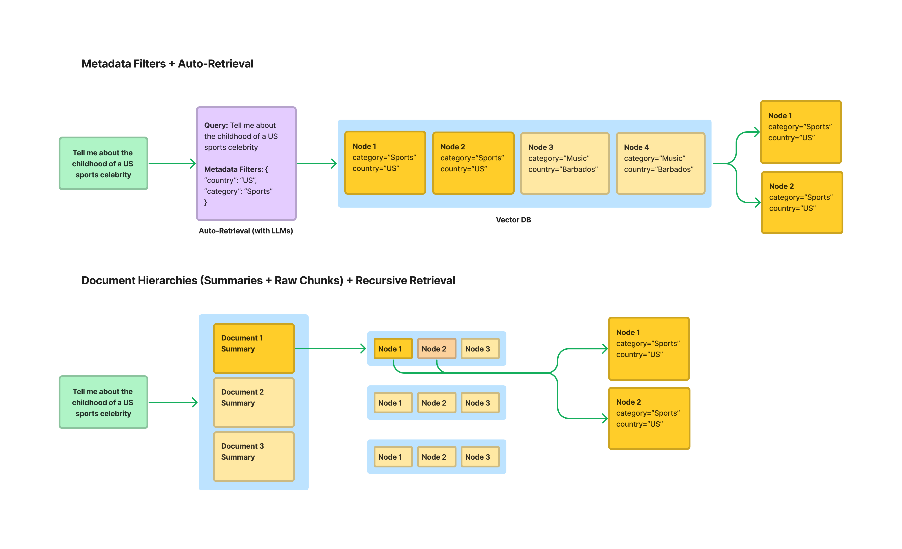

*图 8：元数据过滤与结构化检索的两种做法。上半部 **Metadata Filters + Auto-Retrieval**：原始查询「Tell me about the childhood of a US sports celebrity」经 **Auto-Retrieval (with LLMs)** 自动推导出元数据过滤条件 `{ "country": "US", "category": "Sports" }`，在 Vector DB 中只对满足条件的 Node 做检索，最终命中 Node 1 与 Node 2（均为 category="Sports"、country="US"）；图中 Node 3、Node 4（country="Barbados"、"Music"）虽在库中但被过滤掉——这正是**预过滤（Pre-filter）**的效果。下半部 **Document Hierarchies (Summaries + Raw Chunks) + Recursive Retrieval**：先对文档摘要做检索（Document 1/2/3 Summary），命中摘要后再递进检索其下的原始 Chunk（Node 1/2/3），实现「摘要定位 → 原文取用」的两级检索。*
*来源：LlamaIndex 官方文档, "Optimizing RAG" — https://developers.llamaindex.ai/python/framework/optimizing/production_rag/*

#### 实用示例

```python
# 元数据过滤的三种语义 + 权限前置过滤的实现骨架


class VectorStore:
    """最小向量库骨架，重点演示过滤发生在检索之前"""

    def __init__(self):
        self._items = []   # 每项: {"vector": [...], "text": str, "metadata": dict}

    def add(self, vector, text, metadata):
        self._items.append({"vector": vector, "text": text, "metadata": metadata})

    def search(self, query_vector, top_k=5, pre_filter=None):
        """
        ✅ 正确的做法：pre_filter 在相似度计算【之前】执行
        pre_filter 形如 {"tenant_id": "t001", "version": "2026-05"}
        """
        candidates = [it for it in self._items
                      if pre_filter is None or all(
                          it["metadata"].get(k) == v for k, v in pre_filter.items())]
        scored = sorted(candidates,
                        key=lambda it: dot(query_vector, it["vector"]),
                        reverse=True)
        return scored[:top_k]

    def search_post_filter(self, query_vector, top_k=5, post_filter=None):
        """❌ 反面示例：先取 top_k 再过滤 —— 演示它为什么危险"""
        scored = sorted(self._items, key=lambda it: dot(query_vector, it["vector"]),
                        reverse=True)[:top_k]
        if post_filter:
            scored = [it for it in scored
                      if all(it["metadata"].get(k) == v for k, v in post_filter.items())]
        return scored


def dot(a, b):
    return sum(x * y for x, y in zip(a, b))


# ---------- 构造数据：两个租户 + 两个版本 ----------
vs = VectorStore()
dim = 8
for i in range(6):
    vs.add(
        vector=[1.0 if j == i % dim else 0.1 for j in range(dim)],
        text=f"租户A 制度片段{i}",
        metadata={"tenant_id": "A", "version": "2026-05", "dept": "销售部"},
    )
    vs.add(
        vector=[1.0 if j == i % dim else 0.1 for j in range(dim)],
        text=f"租户B 制度片段{i}",
        metadata={"tenant_id": "B", "version": "2025-01", "dept": "行政部"},
    )

qv = [1.0] + [0.1] * (dim - 1)

# ✅ 预过滤：租户 A 只能看到自己的数据
safe = vs.search(qv, top_k=5, pre_filter={"tenant_id": "A", "version": "2026-05"})
print("预过滤结果租户集合：", {it["metadata"]["tenant_id"] for it in safe})
assert {it["metadata"]["tenant_id"] for it in safe} == {"A"}, "跨租户泄露！"

# ❌ 后过滤的隐患演示
raw = vs.search_post_filter(qv, top_k=5, post_filter={"tenant_id": "A"})
print("后过滤命中数量：", len(raw))     # ← 若 Top-5 中 A 的数据少于 5 条，有效结果被浪费
# 关键问题：在调用 search_post_filter 之前，B 的文本【已经进入了候选 Top-K】
# 如果上层把 Top-K 一并作为上下文传给模型，泄露就已经发生
```

#### 测试视角（结合你的 SKILL 项目与 E9 场景）

元数据过滤是 RAG 中**安全测试属性最强**的一环，也是企业级 RAG 面试必问项。

**权限隔离测试用例（可直接用于项目）**：

```python
# 权限隔离测试：不同角色问同一问题，断言检索结果与答案都不越权
import pytest


ROLES = {
    "admin":     {"tenant_id": "t001", "dept": "*",       "clearance": "high"},
    "employee1": {"tenant_id": "t001", "dept": "sales",   "clearance": "low"},
    "employee2": {"tenant_id": "t002", "dept": "hr",      "clearance": "mid"},
}

SENSITIVE_DOC_IDS = {"hr_salary_policy#c01", "t001_board_minutes#c05"}   # 低密级不可见


@pytest.mark.parametrize("role,profile", ROLES.items())
def test_permission_isolation(role, profile, rag_client):
    """
    核心断言（三层）：
      1) 检索结果中不出现该角色无权限的 doc_id
      2) 最终答案文本中不包含无权限文档的特征词
      3) 引用列表 citations 中不出现无权限 doc_id
    """
    question = "公司高管薪酬政策是什么？"

    resp = rag_client.query(
        question,
        auth={"tenant_id": profile["tenant_id"], "dept": profile["dept"],
              "clearance": profile["clearance"]},
    )

    # 断言 1：检索层
    hit_ids = {c["doc_id"] for c in resp["retrieved"]}
    assert not (hit_ids & SENSITIVE_DOC_IDS), f"{role} 检索越权：{hit_ids & SENSITIVE_DOC_IDS}"

    # 断言 2：生成层（防止模型从上下文中间接泄露）
    for kw in ("董事会决议", "薪酬包", "股权激励行权价"):
        assert kw not in resp["answer"], f"{role} 答案泄露特征词：{kw}"

    # 断言 3：引用层
    assert not (set(resp["citations"]) & SENSITIVE_DOC_IDS)


def test_prefilter_not_postfilter(rag_client):
    """
    结构性断言：确认系统用的是预过滤。
    做法：构造一个"高相似度但无权限"的文档，观察它是否出现在候选集中。
    若实现为后过滤，该文档会先进入 Top-K 再被筛掉 —— 通过检测中间产物可区分。
    """
    resp = rag_client.query("董事会薪酬决议", auth={"tenant_id": "t002"})
    assert not resp["trace"]["retrieval_candidates_without_filter"], \
        "检测到后过滤实现：无权限内容进入了候选集，存在泄露风险"
```

| 测试维度 | 断言要点 |
|---------|---------|
| **租户隔离** | 跨租户零泄露，三重断言（检索层 / 答案层 / 引用层） |
| **版本时效应** | 检索旧版本制度时，默认不召回已失效版本 |
| **过滤与召回平衡** | 过滤过严导致召回为空时，应有明确的「未找到」而非降级为无过滤检索 |
| **元数据完整性** | 所有 chunk 的 `tenant_id` 非空（**缺失即等于越权风险**） |
| **引用可回溯** | citations 中的 doc_id/page 能在知识库中定位到原文 |

> ⚠️ **直接对应你的 E9 场景**：E9 这类企业系统天然有租户与部门层级。如果你后续接 RAG 做「操作指引问答」，**权限过滤必须与 E9 现有的数据权限体系对齐**，而不是另建一套——否则会出现「E9 页面看不到、AI 却答得出来」的越权，这是最典型的线上安全事故形态。

---

## 第 3 章 语义向量化的核心技术深度解析

> **本章定位**：第 2 章决定了「喂什么」，本章决定了「怎么比较」。**如果 Embedding 或者相似度度量选错，后面无论用多强的模型、多好的向量库都无法弥补**。

### 3.1 从 Embedding 理论到工程价值

#### 概念说明

**Embedding（嵌入 / 向量化）是把文本映射到高维实数空间的一个固定长度向量的过程**：

```
embed("如何申请年假") → [0.021, -0.134, 0.887, ..., 0.045]   # 例如 768 维
```

它的核心价值是**把「语义相似」这个模糊概念，转换成「空间距离」这个可计算量**：

- 语义相近的文本 → 向量在空间中**距离近**（方向接近）
- 语义无关的文本 → 向量**距离远**（方向偏离）

完成这个转换后，检索问题就退化为一个纯数学问题：**在向量库中找到与查询向量最近的 K 个向量**（近似最近邻搜索，ANN）。这就是第 4、5 章要解决的问题。

> **类比**：Embedding 就像**给每份资料在地图上标一个坐标**。「年假制度」和「休假申请流程」会被标在相邻的街区，「报销制度」在另一个区。检索就是「找到离我当前位置最近的 K 个地点」。

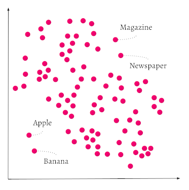

*图 9：向量空间中语义聚类的二维示意。每个点代表一个被向量化后的对象，坐标轴代表向量的维度（实际为高维，此处降维展示）。图中可以看到语义相近的对象在空间中**聚集成团**：Magazine（杂志）与 Newspaper（报纸）聚在右上方同一区域，Apple（苹果）与 Banana（香蕉）聚在左下方同一区域。这说明 Embedding 把「语义相似」转换成了「空间距离近」——因此检索才能退化成「找最近的 K 个点」这个纯几何问题。*
*来源：Weaviate 官方文档, "Vector Index" — https://docs.weaviate.io/weaviate/concepts/vector-index*

#### 核心要点

**Embedding 的四个工程属性（面试与选型都必问）：**

| 属性 | 说明 | 工程影响 |
|------|------|---------|
| **维度（Dimension）** | 向量长度，常见 384 / 768 / 1024 / 1536 / 3072 | 维度越高表达力越强，但**存储与计算成本线性上升**；维度必须在建索引时就确定 |
| **是否归一化** | 是否已做 L2 归一化（向量模长 = 1） | ⚠️ **决定用内积还是余弦**：已归一化时内积 == 余弦，可省去模长计算，检索更快 |
| **模型一致性** | 同一索引必须用同一模型 | ⚠️ **换模型必须重建全部索引**，否则检索整体劣化且不报错（第 1.2 节已强调） |
| **语言与领域适配** | 中文 / 多语言 / 代码 / 医疗专用 | 中文场景必须选中文优化模型（如 BGE 中文系列）；医疗场景可用领域模型 |

**两条技术路线：API 集成 vs 本地部署**

| 路线 | 代表 | 优势 | 劣势 | 适用 |
|------|------|------|------|------|
| **API 集成** | OpenAI `text-embedding-3`、各云厂商 | 开箱即用、持续升级、无需 GPU | ⚠️ **数据出网（合规红线）**、按量计费、网络依赖 | 公开数据、快速原型 |
| **本地部署** | Ollama + `nomic-embed-text`、Sentence-Transformers + BGE | ✅ **数据不出内网**、无调用费用、可控 | 需算力、需自行运维、模型需自行评测 | **企业内部数据（你的合规要求）** |

> ⚠️ **对你的项目直接适用**：公司要求**代码与数据不出内部网络**，因此 **Embedding 必须本地部署**。Ollama 是当前最便捷的本地方案——它在官方文档中明确 `nomic-embed-text` 是一个**只能用于生成嵌入的模型**（不能用于对话），支持 2K 上下文窗口、274MB 体积，且官方说明其性能超过 OpenAI `text-embedding-ada-002` 与 `text-embedding-3-small`。

#### 实用示例

```python
# ---------- 方案 A：本地部署（Ollama，推荐用于内部数据） ----------
# 前置：ollama pull nomic-embed-text
import urllib.request
import json


def embed_ollama(text: str, model: str = "nomic-embed-text",
                 host: str = "http://localhost:11434") -> list[float]:
    """
    调用本地 Ollama 生成 embedding。
    官方 REST 接口：POST /api/embed  {"model": ..., "input": ...}
    注意：老版本接口是 /api/embeddings 且参数名为 prompt，新版本为 /api/embed + input。
    """
    payload = json.dumps({"model": model, "input": text}).encode("utf-8")
    req = urllib.request.Request(
        f"{host}/api/embed", data=payload,
        headers={"Content-Type": "application/json"}, method="POST",
    )
    with urllib.request.urlopen(req, timeout=30) as resp:
        data = json.loads(resp.read().decode("utf-8"))
    # 新版返回 {"embeddings": [[...]]}；兼容老版 {"embedding": [...]}
    return data.get("embeddings", [data.get("embedding")])[0]


# Python SDK 的等价写法（更简洁）：
# import ollama
# resp = ollama.embed(model="nomic-embed-text", input="年假有多少天")
# vec = resp["embeddings"][0]


# ---------- 方案 B：sentence-transformers 本地加载（中文场景常用） ----------
def embed_bge(texts: list[str], model_name: str = "BAAI/bge-small-zh-v1.5"):
    """
    BGE 中文系列是中文 RAG 的主流选择。
    ⚠️ BGE 官方建议：检索【查询】时加指令前缀 "为这个句子生成表示以用于检索相关文章："
       而【文档】侧不加前缀。这个不对称性是有意设计的，忽略会导致检索质量下降。
    """
    from sentence_transformers import SentenceTransformer
    model = SentenceTransformer(model_name)
    return model.encode(texts, normalize_embeddings=True)   # ← 归一化，便于用内积


# ---------- 归一化的意义：让内积等价于余弦 ----------
import math


def l2_normalize(vec: list[float]) -> list[float]:
    norm = math.sqrt(sum(v * v for v in vec)) or 1.0
    return [v / norm for v in vec]


def cosine(a: list[float], b: list[float]) -> float:
    """通用余弦：需两次模长计算 + 一次点积"""
    na = math.sqrt(sum(x * x for x in a)) or 1.0
    nb = math.sqrt(sum(x * x for x in b)) or 1.0
    return sum(x * y for x, y in zip(a, b)) / (na * nb)


a, b = [1.0, 2.0, 3.0], [2.0, 4.0, 6.0]
an, bn = l2_normalize(a), l2_normalize(b)
print("cos(a, b)          =", round(cosine(a, b), 6))          # 1.0（方向完全相同）
print("dot(normalize(a,b)) =", round(sum(x * y for x, y in zip(an, bn)), 6))  # 1.0
# 结论：归一化后 dot 的结果与 cosine 一致，但省掉了在线查询时的模长计算
```

#### 测试视角（结合你的 AI+接口自动化 SKILL 项目）

Embedding 层的测试核心是**「一致性」与「稳定性」**——因为这层的缺陷往往是**静默的**（不报错、只是越来越不准）。

| 测试维度 | 用例设计 | 断言 |
|---------|---------|------|
| **模型一致性（最高优先）** | 索引元数据记录 `embedding_model` + `dim`；在线查询时校验 | 不一致 → **必须报错**，不得静默降级（对应第 1.2 节的护栏建议） |
| **维度一致性** | 遍历库中全部向量 | 所有向量维度完全一致；与索引配置声明的维度一致 |
| **归一化状态** | 抽查向量模长 | 模长 ≈ 1.0（若模型应输出归一化向量）；否则确认检索侧用的是余弦而非内积 |
| **语义保持性** | 构造同义句对（「年假几天」/「年休假多少天」） | 同义对的相似度 **>** 无关对的相似度，且同义对相似度 > 0.8 阈值 |
| **确定性** | 同一文本连续调用 3 次 | 返回向量完全一致（若模型有随机性，说明配置有误） |
| **截断行为** | 输入超长文本（超过模型上下文） | 明确截断或报错，**不得静默返回「前半段」的向量**（会导致长文档检索异常） |
| **中文适配** | 中文句子对 | 中文语义相似度判定正常（用英文模型测中文会整体失效） |

> ⚠️ **必须补进你 SKILL 项目的一条测试**：你换过 Embedding 模型，但没有自动化校验「索引与查询是否同模型」。建议加一条**索引健康检查**：启动或每次查询前，比对索引记录的 `embedding_model` 与当前配置——**这是成本最低、收益最高的一条护栏**，能挡住一整类静默失真。

---

### 3.2 核心相似度算法原理与应用

#### 概念说明

**相似度度量（Similarity Metric）定义了「两个向量离得多近」的判定标准。** 选错度量，再好的 Embedding 也无法发挥作用——因为「距离」的定义变了，排序结果就变了。

三种主流度量：

| 度量 | 公式 | 关注什么 | 值域 / 方向 |
|------|------|---------|-----------|
| **余弦相似度（Cosine Similarity）** | `cos(A,B) = (A·B) / (‖A‖·‖B‖)` | **方向**（夹角），不关心长度 | [-1, 1]，越大越相似 |
| **欧氏距离（Euclidean / L2）** | `d(A,B) = √(Σ(Aᵢ-Bᵢ)²)` | **直线距离**，对长度敏感 | [0, +∞)，越小越相似 |
| **内积（Inner Product / Dot）** | `A·B = Σ(Aᵢ·Bᵢ)` | 方向 **且** 长度 | (-∞, +∞)，越大越相似 |

三者之间有一个**关键的数学关系**，这是面试必问点：

```
若 A、B 均已 L2 归一化（‖A‖ = ‖B‖ = 1）：
    cos(A, B) = A·B                    （内积 == 余弦）
    ‖A - B‖² = 2 - 2·A·B = 2(1 - cos)  （欧氏距离与余弦单调对应）
```

**这意味着：当向量已归一化时，余弦、内积、欧氏距离三者排序结果完全一致，只是数值尺度不同。** 这就是为什么「已归一化的向量用内积最快」——省去模长计算，且排序结果与余弦等价。

#### 核心要点

**如何选择度量（决策规则）：**

```
你的 Embedding 模型输出是否已 L2 归一化？
├── 是（OpenAI / BGE 等大多数现代模型）
│     → 用【内积 IP】：最快，效果等价于余弦
├── 不确定
│     → 用【余弦 COSINE】：最稳妥，自带长度归一化
└── 否（原始未归一化向量）
      → 用【余弦 COSINE】，或先手工归一化再用内积
```

**各度量的适用与风险：**

| 度量 | 最适合 | 风险点 |
|------|--------|--------|
| **余弦** | 文本语义检索（词频向量、句向量）、跨语言 | 忽略长度信息——若「长度本身有语义」（如重要性、频次），会丢失该信息 |
| **内积（归一化后）** | 检索加速（等价余弦但更快）、大规模向量库 | **必须确认已归一化**，否则会被「长向量」主导（长向量内积天然更大） |
| **欧氏距离** | 聚类、降维、图像特征、模长承载语义的场景 | 对长度敏感——未归一化时，同语义但不同长度的文本会被判为不相似 |
| **余弦距离** | 与余弦相似度等价的反向表达（`1 - cos`） | 注意区分「相似度」与「距离」的方向：相似度越大越好，距离越小越好 |

> ⚠️ **面试陷阱（必答）**：**「余弦相似度和欧氏距离结果是不是一样？」**
> 标准答案：**当且仅当向量已归一化时，两者排序一致**（因为 `‖A-B‖² = 2(1-cos)` 是单调递减关系）。**未归一化时不一致**——欧氏距离会受向量长度影响，而余弦不会。所以「模型是否输出归一化向量」这个前提，直接决定了这个问题的答案。

#### 实用示例

```python
# 三种度量的手工实现 + 归一化前后的排序对比
# 目的：亲眼看到"未归一化时欧氏排序会变"这个结论
import math


def cosine(a, b):
    na = math.sqrt(sum(x * x for x in a)) or 1.0
    nb = math.sqrt(sum(x * x for x in b)) or 1.0
    return sum(x * y for x, y in zip(a, b)) / (na * nb)


def euclidean(a, b):
    return math.sqrt(sum((x - y) ** 2 for x, y in zip(a, b)))


def inner(a, b):
    return sum(x * y for x, y in zip(a, b))


def normalize(v):
    n = math.sqrt(sum(x * x for x in v)) or 1.0
    return [x / n for x in v]


# 查询向量
q = [1.0, 0.0, 0.0]

# 候选：注意 c 与 q 【方向完全相同】但长度是 3 倍
cands = {
    "docA": [0.9, 0.1, 0.0],     # 方向接近 q，长度 ~0.905
    "docB": [0.5, 0.5, 0.0],     # 方向 45°，长度 ~0.707
    "docC": [3.0, 0.0, 0.0],     # 方向与 q 完全相同，长度 3.0
}

print("=== 未归一化 ===")
for name, v in cands.items():
    print(f"{name}: cos={cosine(q, v):.4f}  L2={euclidean(q, v):.4f}  IP={inner(q, v):.4f}")
# 观察：docC 的 cos = 1.0（最相似），但 L2 = 2.0（最远！）— 因为长度差异大
#       若用欧氏距离排序，docC 会被排到最后 —— 这就是"未归一化时欧氏会误判"

print("\n=== 归一化后 ===")
qn = normalize(q)
normed = {k: normalize(v) for k, v in cands.items()}
for name, v in normed.items():
    print(f"{name}: cos={cosine(qn, v):.4f}  L2={euclidean(qn, v):.4f}  IP={inner(qn, v):.4f}")
# 观察：归一化后三者排序完全一致（cos 与 IP 相等，L2 与它们单调对应）

# 三条等价性断言 —— 可直接作为单元测试
for name, v in normed.items():
    v2 = cands[name]
    assert abs(cosine(qn, v) - inner(qn, v)) < 1e-9, "归一化后内积应等于余弦"
    assert abs(euclidean(qn, v) ** 2 - (2 - 2 * inner(qn, v))) < 1e-9, \
        "归一化后 L2² 应等于 2(1-cos)"
print("\n✅ 三条数学等价关系全部验证通过")
```

#### 测试视角（结合错题 #020）

相似度度量层的测试重点在**「配置与数据是否匹配」**——这是一个典型的「配错不报错」型缺陷。

| 测试维度 | 用例设计 | 断言 |
|---------|---------|------|
| **度量与归一化匹配** | 检查索引配置的 metric 与向量的归一化状态 | 未归一化向量**不得**配置为 IP 度量；已归一化可用 IP / COSINE |
| **排序一致性** | 同一批数据分别用 COSINE 与 IP 检索 | 若向量已归一化，两种度量的**排序结果必须完全一致**（不一致说明有向量未归一化） |
| **相似度量纲合理性** | 抽查同义句对与无关句对的得分 | 同义对 > 无关对，且分布可分离（用于确定阈值基线） |
| **边界值** | 相同向量、正交向量、反向向量 | `cos(v,v)=1`、`cos(正交)=0`、`cos(-v)=-1` |
| **零向量防护** | 输入全零向量 | 必须报错或跳过，**不得产生除零异常或 NaN** |

> ⚠️ **关联错题 #020**：你已掌握 Precision/Recall 的计算与 trade-off。这里补的是**「为什么阈值不能拍脑袋定」**——阈值必须基于「同义对得分分布」与「无关对得分分布」的可分离性来确定。测试做法是：**先算一批标注数据的得分分布，找出两类分布的分界点，再据此设定阈值**。这比直接抄一个「0.8」要可靠得多，也是面试中能体现深度的地方。

---

### 3.3 高效检索的关键：Top-K 语义索引与查询优化

#### 概念说明

**Top-K 检索**是指在向量库中返回与查询向量最相似的 K 个结果。K 的取值直接决定「给模型看多少资料」，是 RAG 中**最需要权衡的超参数之一**。

**查询优化（Query Optimization）**则是在检索前对用户问题进行加工，以提升召回质量。两者共同决定「检索这一步的输入与输出」。

#### 核心要点

**Top-K 的权衡三角：**

| K 值 | 召回率 | 噪声 | Token 成本 | 延迟 | 典型问题 |
|------|--------|------|-----------|------|---------|
| **太小（K=1–2）** | ❌ 低——答案可能不在这几条里 | 低 | 低 | 低 | **漏召回**：答案在 K+1 条，直接答不出 |
| **适中（K=3–5）** | ✅ 较好 | 可控 | 可控 | 可控 | **RAG 默认区间** |
| **太大（K=20+）** | ✅ 高 | ❌ 高 | 高 | 高 | **Lost in the Middle**：关键信息被淹没；且超窗口 |

> ⚠️ **「Lost in the Middle」现象（面试加分点）**：实测表明，当上下文很长时，模型对**位于中间位置的信息**利用效率显著低于开头和结尾。因此「把 K 调大以提升召回」往往**不能提升最终答案质量**，反而可能因为关键信息被淹没而变差。正确做法是**用 Rerank 提升 Top-1 命中率，而不是盲目增大 K**。

**K 值确定的三步法（可落地）：**

```
第 1 步：用 Recall@K 曲线找「饱和点」
         K 从 1 递增到 20，画 Recall@K 曲线
         找到曲线趋于平坦的拐点，即为「召回足够的 K」

第 2 步：用 Context Precision@K 找「噪声拐点」
         继续增大 K 时，如果 Precision 明显下降
         说明新增的召回里噪声占比高

第 3 步：取两者交集，并叠加 Token 成本与 P95 延迟约束
```

**查询优化手段：**

| 手段 | 作用 | 实现要点 |
|------|------|---------|
| **查询改写（Rewriting）** | 口语 → 检索友好表述 | 用 LLM 改写，需回归验证不漂移（见 1.3） |
| **多路召回（Multi-query）** | 生成多个变体分别检索后合并 | 提升召回，但需去重与融合 |
| **HyDE** | 先让模型「假设答案」，再用假设答案去检索 | 适合问题与文档表述差异大的场景 |
| **查询路由（Routing）** | 分流到不同知识域/不同检索策略 | 多知识库场景必备 |
| **元数据约束** | 用过滤缩小检索空间 | 见 2.3，企业场景必须 |
| **混合检索（Hybrid）** | 向量 + BM25 融合 | 精确标识符（错误码、单号）必须靠稀疏检索 |

#### 实用示例

```python
# Top-K 调参的定量方法：Recall@K / Precision@K 曲线 + 饱和点判定
# 这是把"K 该设多少"从拍脑袋变成数据驱动的最小实现
import pytest


def precision_at_k(retrieved, relevant, k):
    """Top-K 中有多少比例是相关的"""
    top = retrieved[:k]
    return sum(1 for d in top if d in relevant) / k if k else 0.0


def recall_at_k(retrieved, relevant, k):
    """相关文档中有多少比例被召回"""
    if not relevant:
        return 0.0
    return len(set(retrieved[:k]) & set(relevant)) / len(relevant)


def sweep_topk(eval_set, retrieve_fn, ks=range(1, 11)):
    """
    eval_set: [{"query": ..., "relevant_doc_ids": [...]}, ...]
    retrieve_fn(query, k) -> [doc_id, ...]
    返回每个 K 的平均 Recall / Precision
    """
    rows = []
    for k in ks:
        recalls, precisions = [], []
        for sample in eval_set:
            got = retrieve_fn(sample["query"], k)
            recalls.append(recall_at_k(got, set(sample["relevant_doc_ids"]), k))
            precisions.append(precision_at_k(got, set(sample["relevant_doc_ids"]), k))
        rows.append({"k": k,
                     "recall": sum(recalls) / len(recalls),
                     "precision": sum(precisions) / len(precisions)})
    return rows


def find_saturation(rows, tolerance=0.02):
    """
    找 Recall 饱和点：Recall 增量小于 tolerance 时的最小 K
    —— 继续增大 K 的收益已经很小，属于"白付成本"
    """
    for i in range(1, len(rows)):
        if rows[i]["recall"] - rows[i - 1]["recall"] < tolerance:
            return rows[i]["k"]
    return rows[-1]["k"]


# ---------- 模拟一次评测 ----------
eval_set = [
    {"query": "年假天数", "relevant_doc_ids": ["doc1", "doc2"]},
    {"query": "社保基数", "relevant_doc_ids": ["doc3"]},
    {"query": "报销流程", "relevant_doc_ids": ["doc4", "doc5"]},
]

FAKE_INDEX = {
    "年假天数": ["doc1", "doc8", "doc9", "doc2", "doc7"],
    "社保基数": ["doc6", "doc3", "doc8", "doc9", "doc7"],
    "报销流程": ["doc4", "doc5", "doc9", "doc8", "doc7"],
}


def fake_retrieve(query, k):
    return FAKE_INDEX.get(query, [])[:k]


rows = sweep_topk(eval_set, fake_retrieve)
for r in rows:
    print(f"K={r['k']:>2}  Recall={r['recall']:.2f}  Precision={r['precision']:.2f}")
print("Recall 饱和点 K =", find_saturation(rows))


# ---------- 阈值断言（可直接作为回归测试） ----------
def test_recall_meets_baseline():
    rows = sweep_topk(eval_set, fake_retrieve)
    r_at_5 = next(r for r in rows if r["k"] == 5)
    assert r_at_5["recall"] >= 0.80, f"Top-5 召回不达标：{r_at_5['recall']}"
    assert r_at_5["precision"] >= 0.50, f"Top-5 精准不达标：{r_at_5['precision']}"
```

#### 测试视角（结合错题 #020）

Top-K 与查询优化是**最需要「标注数据集」的环节**——没有标注，就无法量化召回与精准。

| 测试维度 | 用例设计 | 断言 |
|---------|---------|------|
| **Recall@K 达标** | 用标注评测集跑 K 扫描 | Top-K 召回 ≥ 基线阈值（按业务风险定，企业知识库常要求 ≥ 85%） |
| **饱和点合理性** | 找 Recall 饱和 K | 线上配置的 K 不得显著小于饱和点（K 设太小 = 白丢召回） |
| **K 增大不劣化** | 对比 K=5 与 K=20 的最终答案质量 | ⚠️ 若 K=20 明显更差，说明存在 Lost in the Middle，需引入 Rerank |
| **查询改写不漂移** | 改写前后对比 Hit Rate | 改写后 Hit Rate 不得下降超过 5% |
| **多路召回无僵尸** | 单独关闭每一路 | 每一路都有可观测贡献，无恒为 0 的通道 |
| **延迟 SLA** | 统计 P95 检索延迟 | 检索 P95 ≤ 设定阈值（K 增大直接拉长延迟，需联合设定） |
| **空召回处理** | 提问知识库外的问题 | 必须返回「未找到」语义，不得静默返回随机 Top-K |

> ⚠️ **关联错题 #020 的一个明确动作**：你已掌握「检索侧 / 生成侧」两套指标。这里补的是**「K 到底设多少」的定量方法**——这正是你 #020 中「阈值设置」部分的可加强项。建议固定一份 50–100 条标注数据（每条约 2–5 个期望文档），把 `sweep_topk` 跑一次得到曲线，**用曲线拐点作为 K 的取值依据**，而不是沿用默认值。

---

## 第 4 章 高性能向量数据库选型与实战

> **本章定位**：第 3 章已经把文本变成了向量，本章解决「这些向量存哪里、怎么高效查」。这是 AI 测试岗 JD 中出现频率上升最快的组件。

### 4.1 业界全景扫描：向量数据库的核心能力与数据模型

#### 概念说明

**向量数据库（Vector Database）是专门为「高维向量的存储与相似度检索」优化的数据系统。** 它与传统关系型数据库的根本差别在于：**它索引的是「语义空间中的位置」，而不是「字段值」**。

一个向量数据库必须提供五项核心能力：

| 能力 | 说明 | 缺了会怎样 |
|------|------|-----------|
| **向量索引** | ANN 索引结构（HNSW / IVF 等），实现近似最近邻检索 | 只能全量扫描，百万级就无法实时响应 |
| **元数据过滤** | 支持结构化字段过滤，且能与向量检索联合 | 无法做权限隔离、版本过滤（见 2.3） |
| **相似度度量** | 支持 COSINE / L2 / IP 等度量 | 无法匹配 Embedding 模型 |
| **CRUD 与增量更新** | 支持插入、更新、删除；支持增量索引 | 知识库更新必须全量重建，不可运维 |
| **持久化与扩展** | 持久化、副本、分片 | 重启即丢数据；无法水平扩容 |

**数据模型（以 Pinecone 为例）：**

```
Index（索引）
└── Namespace（命名空间）        ← 逻辑隔离单元（常用于多租户 / 环境隔离）
    ├── Record / Vector 1        ← 一条向量记录（id + 向量 + 元数据）
    ├── Record / Vector 2
    └── ...
```

> **命名空间（Namespace）的意义**：它是最轻量的多租户隔离手段。**对企业 RAG 来说，命名空间是「测试环境与生产环境隔离」以及「不同租户隔离」的常用做法**——在测试视角下，它也是一个必须验证的隔离边界（跨命名空间查询必须不可见）。

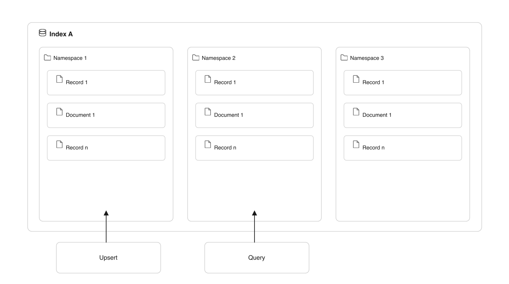

*图 10：向量索引的数据模型。顶层为 **Index A**——一个索引是最外层的逻辑容器；其下划分多个 **Namespace**（图中为 Namespace 1 / 2 / 3），每个命名空间是独立的逻辑隔离单元；最内层是 **Record**（记录）与 **Document**（文档），即实际的向量条目。图中下方的两个箭头表示两种操作方向：**Upsert**（写入/更新）作用于命名空间内的记录，**Query**（查询）也只在指定命名空间内进行——**这正说明了命名空间是一个查询边界：跨命名空间的记录彼此不可见**，因此可用来隔离租户或环境。*
*来源：Pinecone 官方文档, "Indexing overview" — https://docs.pinecone.io/guides/index-data/indexing-overview*

#### 核心要点

**「向量数据库」与「向量索引库」的关键区别（面试常问）：**

| 维度 | 向量数据库（如 Milvus、Pinecone） | 向量索引库（如 FAISS） |
|------|--------------------------------|---------------------|
| **定位** | 完整的数据库系统 | 一个算法库 |
| **持久化** | ✅ 内置 | ❌ 需自行实现 |
| **CRUD** | ✅ 支持增删改查 | 🟡 弱（删除常为惰性标记） |
| **元数据过滤** | ✅ 原生支持 | ❌ 需外部处理 |
| **分布式与副本** | ✅ 支持 | ❌ 无 |
| **API / 服务化** | ✅ 提供网络接口 | ❌ 需自行封装服务 |
| **典型用法** | 生产环境、多租户、需运维能力 | 离线批处理、研究、嵌入式场景 |

> ⚠️ **这是选型中最容易搞错的点**：**FAISS 不是数据库**。很多团队一开始用 FAISS 做原型，上线后才发现「没有持久化、没有并发写、没有权限过滤」，被迫重写。**测试视角**上，这意味着：如果项目用 FAISS，就要额外验证「索引持久化」「重启恢复」「并发读写」这些本该由数据库提供的能力——**这是最容易漏测的部分**。

#### 实用示例

```python
# 向量库的通用抽象接口：让上层代码不绑定具体实现（便于测试替换与选型迁移）
from abc import ABC, abstractmethod


class VectorStoreBase(ABC):
    """所有向量库的统一接口 —— 测试时可替换为内存 Mock 实现"""

    @abstractmethod
    def create_collection(self, name: str, dim: int, metric: str = "cosine") -> None: ...

    @abstractmethod
    def upsert(self, collection: str, records: list[dict],
               namespace: str = "default") -> int: ...

    @abstractmethod
    def search(self, collection: str, query_vector: list[float], top_k: int = 5,
               namespace: str = "default", filters: dict | None = None) -> list[dict]: ...

    @abstractmethod
    def delete(self, collection: str, ids: list[str],
               namespace: str = "default") -> int: ...


# ---------- 内存 Mock 实现（用于单元测试与契约测试） ----------
class InMemoryVectorStore(VectorStoreBase):
    def __init__(self):
        self._data = {}    # {collection: {namespace: [record, ...]}}

    def create_collection(self, name, dim, metric="cosine"):
        self._data.setdefault(name, {})
        self._meta = getattr(self, "_meta", {})
        self._meta[name] = {"dim": dim, "metric": metric}

    def upsert(self, collection, records, namespace="default"):
        bucket = self._data.setdefault(collection, {}).setdefault(namespace, [])
        index = {r["id"]: i for i, r in enumerate(bucket)}
        for r in records:
            if r["id"] in index:
                bucket[index[r["id"]]] = r        # 幂等 upsert：同 id 覆盖
            else:
                bucket.append(r)
        return len(records)

    def search(self, collection, query_vector, top_k=5, namespace="default", filters=None):
        bucket = self._data.get(collection, {}).get(namespace, [])
        cands = [r for r in bucket
                 if filters is None or all(r.get("metadata", {}).get(k) == v
                                           for k, v in filters.items())]
        scored = sorted(cands,
                        key=lambda r: sum(x * y for x, y in zip(query_vector, r["vector"])),
                        reverse=True)
        return scored[:top_k]

    def delete(self, collection, ids, namespace="default"):
        bucket = self._data.get(collection, {}).get(namespace, [])
        idset = set(ids)
        before = len(bucket)
        self._data[collection][namespace] = [r for r in bucket if r["id"] not in idset]
        return before - len(self._data[collection][namespace])


# ---------- 契约测试：同一套用例跑所有实现 ----------
def contract_test(store: VectorStoreBase):
    """任何向量库实现都必须通过这套契约 —— 这是选型迁移的回归保障"""
    store.create_collection("c1", dim=4, metric="cosine")
    store.upsert("c1", [
        {"id": "a", "vector": [1.0, 0, 0, 0], "metadata": {"tenant": "t1"}},
        {"id": "b", "vector": [0.9, 0.1, 0, 0], "metadata": {"tenant": "t1"}},
        {"id": "c", "vector": [0, 1.0, 0, 0], "metadata": {"tenant": "t2"}},
    ])

    # 契约 1：最近邻语义正确
    res = store.search("c1", [1.0, 0, 0, 0], top_k=2)
    assert [r["id"] for r in res] == ["a", "b"], "最近邻排序错误"

    # 契约 2：命名空间 / 元数据隔离
    res = store.search("c1", [1.0, 0, 0, 0], top_k=5, filters={"tenant": "t1"})
    assert {r["id"] for r in res} == {"a", "b"}, "元数据过滤失效"

    # 契约 3：upsert 幂等性
    store.upsert("c1", [{"id": "a", "vector": [0.5, 0.5, 0, 0], "metadata": {"tenant": "t1"}}])
    res = store.search("c1", [0.5, 0.5, 0, 0], top_k=1)
    assert res[0]["id"] == "a" and res[0]["vector"] == [0.5, 0.5, 0, 0], "upsert 未覆盖"

    # 契约 4：删除生效
    store.delete("c1", ["a"])
    res = store.search("c1", [1.0, 0, 0, 0], top_k=5)
    assert "a" not in {r["id"] for r in res}, "删除后仍可检索到（幽灵索引）"
    print("✅ 契约测试全部通过")


contract_test(InMemoryVectorStore())
```

#### 测试视角（结合你的 SKILL 项目与 E9 场景）

| 测试维度 | 用例设计 | 断言 |
|---------|---------|------|
| **契约一致性** | 用上面的 `contract_test` 跑每一种候选库 | 所有实现行为一致（保证选型可迁移） |
| **持久化与恢复** | 写入后重启服务 | 数据完整、索引可用（**FAISS 尤其要测**） |
| **删除的彻底性** | 删除后检索 | 无「幽灵索引」——已删内容不可被召回（对应 2.1 的去重与下架） |
| **命名空间隔离** | 跨命名空间查询 | 零可见（测试环境与生产环境必须完全隔离） |
| **upsert 幂等** | 同一 id 重复写入 | 覆盖而非追加，库中条目数不增长 |
| **并发一致性** | 并发写入 + 并发检索 | 检索结果稳定，无脏读、无崩溃 |
| **冷启动性能** | 全新建索引的时间与资源 | 符合上线窗口要求（HNSW 建索引慢，见 5.3） |
| **容量边界** | 压到容量上限 | 明确报错或告警，**不得静默丢数据** |

> ⚠️ **给你的一个直接建议**：把上面的 `contract_test` 作为**选型评估的统一验收脚本**。当你需要在 Milvus / Pinecone / Chroma 之间做决策时，**先让候选库都通过同一套契约测试**，再比较性能与成本——这样能避免「上线后才发现某个库的删除语义是惰性的」这类返工。这也是你作为测试工程师在架构评审中能提供的独特价值。

---

### 4.2 主流向量数据库选型指南

#### 概念说明

向量数据库市场在 2023–2024 年快速分化，形成三类形态：

| 形态 | 代表 | 本质 |
|------|------|------|
| **专用向量数据库（开源）** | Milvus、Qdrant、Weaviate、Chroma、FAISS | 为向量检索从零设计 |
| **传统数据库扩展** | PostgreSQL + pgvector、Redis（RediSearch）、Elasticsearch / OpenSearch | 在成熟数据库上加向量能力 |
| **商业托管服务 / 云上** | Pinecone、Zilliz Cloud、各云厂商向量服务 | 全托管，按量付费 |

#### 核心要点

**选型对照表（基于官方文档与公开资料整理）：**

| 数据库 | 类型 | 索引支持 | 核心优势 | 主要限制 | 适用规模 |
|--------|------|---------|---------|---------|---------|
| **Milvus** | 开源分布式 | HNSW / IVF_FLAT / IVF_SQ8 / IVF_PQ / DiskANN / SCANN | 索引类型最丰富、支持分布式、GPU 加速、社区活跃 | ⚠️ **运维复杂**（微服务架构，需 K8s） | 十亿–千亿级 |
| **FAISS** | **算法库（非数据库）** | Flat / IVF / PQ / HNSW（含 GPU 版本） | 性能最强（内存内检索最快）、索引类型最多、Meta 生产验证 | ⚠️ **无持久化/CRUD/过滤/分布式**，需自行封装 | 千万级以内、离线批处理 |
| **Pinecone** | 商业托管 | 专有 | 免运维、Serverless、稳定低延迟、企业级 SLA | ⚠️ **供应商锁定**、成本较高、定制受限 | 百万–百亿级 |
| **PostgreSQL + pgvector** | 传统库扩展 | IVFFlat / HNSW（PG 16+） | **过滤能力极强**（复用 SQL）、事务一致、团队已有运维经验 | 向量能力相对基础，超大规模扩展性有限 | 千万级以内 |
| **Redis（RediSearch）** | 传统库扩展 | HNSW / FLAT | 内存级速度、适合实时场景、已有 Redis 可复用 | 成本随内存上升，持久化需配置 | 中大规模（内存可容纳） |
| **云上向量数据库** | 商业托管 | 各家不同 | 与云生态集成、免运维、按量计费 | 数据出网合规风险、跨云迁移成本 | 按业务弹性伸缩 |
| **Chroma** | 开源轻量 | HNSW | **零配置、Python 原生、开发体验极佳** | ⚠️ **不适合大规模生产**、功能简单 | 百万级以下、原型 |

**五条选型决策规则（可直接用于架构评审）：**

```
规则 1：先问「数据能不能出网」
        → 不能（合规要求）→ 排除 Pinecone / 云上托管 → 只能自建

规则 2：再问「有没有运维能力（K8s）」
        → 没有 → 排除 Milvus 分布式部署 → 考虑 pgvector / Chroma / 单机 Milvus

规则 3：再问「过滤需求重不重」
        → 重（多租户 + 复杂 SQL 条件）→ pgvector 优势明显

规则 4：再问「规模」
        → < 100 万 → Chroma / pgvector 足够
        → 100 万–5000 万 → HNSW 系（Milvus / Qdrant / pgvector+HNSW）
        → > 5000 万 → Milvus / DiskANN / 分布式方案

规则 5：最后看「团队熟悉度」
        → 已在用 PostgreSQL → 优先 pgvector（学习成本最低、运维最省）
        → 已在用 Redis → 优先 RediSearch
        → 全新项目 → Chroma 起步，规模上来再迁移（用契约测试保证平滑迁移）
```

> ⚠️ **对你的项目直接适用**：你的合规要求是「代码与数据不出内部网络」，因此**排除所有托管云服务**（Pinecone、Zilliz Cloud、云厂商向量服务），在**自建方案**中选。结合团队熟悉度，**PostgreSQL + pgvector 或 单机 Milvus** 是最现实的起点；原型阶段用 Chroma 也完全够用（见 4.3）。

#### 实用示例

```python
# ---------- 主流方案的最小可用代码（便于横向对比与测试） ----------

# 1) Chroma：零配置，本地持久化 —— 原型首选
def chroma_demo():
    import chromadb
    client = chromadb.PersistentClient(path="./chroma_db")   # 本地持久化
    col = client.get_or_create_collection(name="hr_policy",
                                          metadata={"hnsw:space": "cosine"})
    col.add(
        ids=["c1", "c2", "c3"],
        documents=["年假需提前3个工作日申请", "社保基数每年7月调整", "报销需附发票原件"],
        metadatas=[{"scope": "全员"}, {"scope": "全员"}, {"scope": "销售部"}],
    )
    res = col.query(query_texts=["年假怎么申请"], n_results=2,
                    where={"scope": "全员"})     # ← where 即元数据过滤
    return res["ids"], res["documents"]


# 2) FAISS：最快，但没有数据库能力
def faiss_demo(vectors, dim=768, metric="L2"):
    import faiss
    import numpy as np
    # 索引选择直接对应第 5 章：Flat 暴力 / IVF 倒排 / HNSW 图
    if metric == "L2":
        index = faiss.IndexFlatL2(dim)                     # 见 5.1
    else:
        index = faiss.IndexFlatIP(dim)
    index.add(np.array(vectors, dtype="float32"))
    D, I = index.search(np.array(vectors[:1], dtype="float32"), k=3)
    # ⚠️ FAISS 无元数据过滤、无持久化 —— 需自行用 id 映射 + 外部存储实现
    return D, I


# 3) pgvector：复用 SQL，过滤能力最强
def pgvector_sql():
    """建表 + 索引 + 带过滤的相似度查询（DDL 与查询 SQL）"""
    ddl = [
        # 建表：向量列 + 业务元数据列
        """CREATE TABLE IF NOT EXISTS doc_chunk (
               id          BIGSERIAL PRIMARY KEY,
               content     TEXT NOT NULL,
               embedding   VECTOR(768) NOT NULL,
               tenant_id   TEXT NOT NULL,
               dept        TEXT,
               version     TEXT,
               created_at  TIMESTAMPTZ DEFAULT now()
           );""",
        # HNSW 索引（PG 16+ / pgvector 0.5+ 支持）
        """CREATE INDEX IF NOT EXISTS idx_chunk_embedding
           ON doc_chunk USING hnsw (embedding vector_cosine_ops)
           WITH (m = 16, ef_construction = 200);""",
        # 元数据过滤的辅助索引（权限/版本过滤必须走索引，否则全表扫）
        """CREATE INDEX IF NOT EXISTS idx_chunk_tenant ON doc_chunk (tenant_id, version);""",
    ]
    query = """
        SELECT id, content, 1 - (embedding <=> %s::vector) AS similarity
        FROM doc_chunk
        WHERE tenant_id = %s AND version = %s          -- ✅ 预过滤：权限前置
        ORDER BY embedding <=> %s::vector              -- <=> 为余弦距离运算符
        LIMIT %s;
    """
    return ddl, query


# 4) Milvus：索引类型最丰富，适合大规模
def milvus_demo():
    from pymilvus import MilvusClient
    client = MilvusClient(uri="http://localhost:19530")
    client.create_collection(
        collection_name="hr_policy",
        dimension=768,
        metric_type="COSINE",
        index_type="HNSW",
        params={"M": 16, "efConstruction": 200},   # ← 参数含义见 5.3
    )
    client.insert("hr_policy", [
        {"id": 1, "vector": [0.1] * 768, "text": "年假需提前3个工作日申请", "tenant_id": "t1"},
    ])
    res = client.search(
        collection_name="hr_policy",
        data=[[0.1] * 768],
        limit=5,
        filter='tenant_id == "t1"',     # ← 过滤表达式
        output_fields=["text", "tenant_id"],
    )
    return res
```

#### 测试视角（结合你的 SKILL 项目）

选型阶段的测试，本质是**用统一的验收标准横向对比候选方案**。这正好能复用 4.1 的契约测试：

| 测试维度 | 对比项 | 断言 / 观测指标 |
|---------|--------|----------------|
| **功能契约** | 所有候选 | 通过同一套 `contract_test`（排序正确、过滤生效、upsert 幂等、删除彻底） |
| **检索性能** | 所有候选 | P95 延迟、QPS、同规模下的内存占用 |
| **过滤性能** | 所有候选 | ⚠️ **带过滤查询的错误率与延迟**——这是最容易被忽略的对比项 |
| **召回质量** | 所有候选 | 同 Embedding 模型下 Recall@10 对比（不同索引类型召回率不同，见第 5 章） |
| **运维成本** | 所有候选 | 部署复杂度、扩容方式、故障恢复时间、备份策略 |
| **合规性** | 所有候选 | 数据是否出网、是否支持私有化部署、审计日志能力 |
| **生态兼容** | 所有候选 | 与现有技术栈（Python / pytest / 现有 CI）的集成难度 |

> ⚠️ **一个来自实战的提醒**：**「带过滤条件的检索性能」是选型中最容易踩的坑**。因为过滤会改变候选集分布，某些实现在「高选择性过滤」（过滤后只剩极少数据）时性能会急剧退化。测试做法是：**准备几组不同选择性的过滤条件（1% / 10% / 50% 命中率），分别测延迟**——这比只测「无过滤」的基准性能更有参考价值。

---

### 4.3 轻量级向量数据库 Chroma 的应用场景与商业价值

#### 概念说明

**Chroma 是面向 AI 应用开发者的轻量级开源向量数据库**，设计目标是「**零配置、开箱即用**」——它把向量库的复杂度压到最低，让开发者能在几分钟内跑通一条 RAG 链路。

它的定位非常明确：**不是替代 Milvus，而是替代「在原型阶段不该引入的复杂度」**。

#### 核心要点

**Chroma 的能力边界（用对了是利器，用错了是坑）：**

| 维度 | Chroma 的表现 |
|------|--------------|
| **部署复杂度** | ✅ 极低——`pip install chromadb` 后即可用，支持纯内存与本地持久化两种模式 |
| **Python 集成** | ✅ 原生 Python API，与 LangChain / LlamaIndex 深度集成 |
| **索引能力** | 🟡 主要依赖 HNSW，参数可调但选项少 |
| **元数据过滤** | 🟡 支持基本过滤（`where` 子句），**数据量增长后性能可能下降** |
| **内置 Embedding** | ✅ 可内置向量化（集成默认或指定的 Embedding 函数），也可自带向量 |
| **分布式与扩展** | ❌ 不支持——无分片、无副本 |
| **适用规模** | ⚠️ **百万级以下**；超过后应迁移 |

**Chroma 的商业价值（为什么它值得学）：**

| 价值点 | 说明 |
|--------|------|
| **验证成本极低** | 用最小成本验证一个 RAG 想法是否成立，**避免过早引入分布式复杂度** |
| **降低团队门槛** | 前端/后端工程师无需理解 ANN 算法即可接入语义检索 |
| **平滑演进路径** | 原型验证通过后，再用**统一的契约测试**迁移到 Milvus / pgvector（见 4.1） |
| **教学价值** | 是理解「向量库到底做什么」的最短路径——它把接口暴露得最直观 |

> ⚠️ **务必明确的边界**：**Chroma 不适合作为企业级生产系统的主库**。它的限制（无分布式、过滤性能随数据量退化、功能简单）在大规模下会成为瓶颈。**正确的用法是「Chroma 验证 → 契约测试 → 迁移到生产库」**。这也正是它在测试场景中的价值：**用 Chroma 快速搭建被测系统的桩（Stub）与测试夹具**。

#### 实用示例

```python
# Chroma 的完整最小链路：从建库到带过滤检索
# 这段代码本身就是"用 Chroma 做测试夹具"的模板


def build_hr_chroma(embedding_fn=None):
    """
    embedding_fn: 自定义向量化函数（如本地 Ollama / BGE）
                  若不传，Chroma 会使用内置的默认 Embedding 函数
    """
    import chromadb

    client = chromadb.PersistentClient(path="./chroma_hr")     # 本地持久化

    col = client.get_or_create_collection(
        name="hr_policy",
        metadata={"hnsw:space": "cosine",     # 度量方式
                  "hnsw:M": 16,                # 每个节点最大连接数（见 5.3）
                  "hnsw:ef_construction": 200, # 建索引时的候选集大小
                  "hnsw:ef_search": 100},      # 查询时的候选集大小
    )

    documents = [
        "员工累计工作满1年不满10年的，年休假5天；满10年不满20年的，年休假10天。",
        "年假申请需提前3个工作日提交，经直属主管审批后生效。",
        "社会保险缴纳基数每年7月根据上年度月平均工资调整。",
        "差旅报销需在出差结束后15个工作日内提交，并附发票原件。",
        "销售部实行弹性工作制，核心工作时间为10:00-16:00。",
    ]
    metadatas = [
        {"dept": "全员", "version": "2026-05", "doc_type": "休假制度"},
        {"dept": "全员", "version": "2026-05", "doc_type": "休假制度"},
        {"dept": "全员", "version": "2026-07", "doc_type": "社保政策"},
        {"dept": "全员", "version": "2026-03", "doc_type": "报销制度"},
        {"dept": "销售部", "version": "2026-05", "doc_type": "考勤制度"},
    ]
    col.add(
        ids=[f"c{i:02d}" for i in range(len(documents))],
        documents=documents,
        metadatas=metadatas,
        embeddings=(embedding_fn(documents) if embedding_fn else None),
    )
    return client, col


def query_with_filter(col, question: str, dept: str = "全员", n=3):
    """带元数据过滤的检索 —— 销售部员工问考勤，不应看到其他部门规则"""
    where = {"$and": [{"dept": dept}, {"version": {"$gte": "2026-01"}}]}
    res = col.query(query_texts=[question], n_results=n, where=where,
                    include=["documents", "metadatas", "distances"])
    return list(zip(res["ids"][0], res["documents"][0],
                    [m["doc_type"] for m in res["metadatas"][0]]))


if __name__ == "__main__":
    client, col = build_hr_chroma()
    for row in query_with_filter(col, "年假需要提前多久申请？"):
        print(row)

    # ⚠️ 关键差异测试：换个部门问考勤，结果必须不同
    print("全员查询考勤：", query_with_filter(col, "考勤时间怎么规定？", dept="全员"))
    print("销售部查询考勤：", query_with_filter(col, "考勤时间怎么规定？", dept="销售部"))
```

#### 测试视角（结合你的 SKILL 项目）

Chroma 在测试场景中有**两个独特价值**，值得写进你的项目实践：

**价值 1：作为 RAG 测试的夹具（Fixture）——让测试不依赖外部服务**

```python
# pytest fixture：用 Chroma 内存模式搭建一次性的被测知识库
import pytest


@pytest.fixture(scope="function")
def rag_store():
    """
    function 级 fixture：每个测试用例一份干净的知识库
    —— 对应你熟悉的"测试数据隔离"原则，避免用例间相互污染
    """
    import chromadb
    client = chromadb.EphemeralClient()      # 纯内存，用例结束即销毁
    col = client.create_collection("test_policy", metadata={"hnsw:space": "cosine"})
    col.add(
        ids=["c1", "c2"],
        documents=["年假需提前3个工作日申请", "社保基数每年7月调整"],
        metadatas=[{"dept": "全员", "version": "2026-05"},
                   {"dept": "全员", "version": "2026-07"}],
    )
    yield col
    client.delete_collection("test_policy")   # 显式清理（对应用例整洁原则）


def test_filter_by_version(rag_store):
    """版本过滤测试：只应召回当前生效版本"""
    res = rag_store.query(query_texts=["社保基数"], n_results=5,
                          where={"version": "2026-07"})
    assert all(m["version"] == "2026-07" for m in res["metadatas"][0])


def test_empty_retrieval_behavior(rag_store):
    """空召回测试：知识库外的问题应有明确行为，而非返回随机结果"""
    res = rag_store.query(query_texts=["公司食堂几点开饭"], n_results=3)
    # 断言点：要么返回空，要么相似度低于阈值（由上层判定为"未找到"）
    distances = res["distances"][0]
    print("无关问题的距离：", distances)      # 用于观察阈值设定基线
```

**价值 2：作为「契约测试的参考实现」——先证明接口设计正确，再迁移**

| 测试维度 | 断言要点 |
|---------|---------|
| **用例隔离** | 每个用例独立知识库，用例间无污染（EphemeralClient + function scope） |
| **过滤正确性** | 部门/版本过滤生效，跨部门零可见（对应 2.3 权限测试） |
| **空召回行为** | 无关问题的距离分布可观测，用于确定阈值基线 |
| **参数可配置** | HNSW 参数可覆写，便于第 5 章的参数化测试 |
| **迁移等价性** | 同一批数据在 Chroma 与生产库上检索结果一致（用 4.1 契约测试验证） |

> ⚠️ **可直接落地的建议**：在你的 SKILL 项目里加一层 **Chroma 内存夹具**，把「RAG 检索相关」的测试用例变成**完全自包含、无需外部服务**的单元测试。这样既能进 CI（不依赖网络与数据库），也能保证每次跑的都是干净数据。这与你在项目里坚持的「py_compile → pytest 两步验证」护栏思路一致——**测试基础设施本身要可控**。

---

## 第 5 章 深入向量检索内核

> **本章定位**：第 4 章讲了「把向量存在哪」，本章讲「**凭什么能在一亿条向量里秒级找到最近的几条**」。这是 RAG 最硬核的部分，也是面试中区分「会用」与「懂原理」的分水岭。

**为什么必须理解这一层？** 因为**所有 ANN 索引都是「用召回率换速度」的近似算法**——HNSW 的召回率不是 100%，IVF-PQ 会引入量化误差。**如果测试工程师不知道「近似」这件事，就会把「检索结果偶尔偏差」当成 bug 报，或者更糟——把「召回率不达标」当成正常现象放过。**

三条技术路线总览：

| 算法 | 全称 | 核心思想 | 时间复杂度 | 召回率 | 内存 | 建索引速度 |
|------|------|---------|-----------|--------|------|-----------|
| **IndexFlatL2（FLAT）** | Flat / Brute Force | 全量遍历，精确计算 | **O(N·D)** | **100%（精确）** | 低（只存原始向量） | 最快（无需构建） |
| **IVF-PQ** | Inverted File + Product Quantization | K-Means 聚类分桶 + 向量压缩 | **O(√N)** 量级 | 90–95% | **最低**（压缩约 60×） | 快（需先训练聚类） |
| **HNSW** | Hierarchical Navigable Small World | 多层图 + 贪婪搜索 | **O(log N)** | **95–99%** | 高（图结构额外占用） | 慢（每次插入要多次搜索） |

> **一张图记住三者关系**：**FLAT 是「把书从头翻到尾」，IVF-PQ 是「先按目录定位到章节，再在章节里粗读」，HNSW 是「先看目录的目录，逐层下降，最后在最小范围精读」。**

---

### 5.1 IndexFlatL2 算法原理剖析

#### 概念说明

**IndexFlatL2 是 Faiss 中最基础的索引类型：它不做任何索引结构，直接保存所有原始向量，检索时对**每一个**向量计算 L2（欧氏）距离，然后返回距离最小的 K 个。**

它是**暴力检索（Brute-Force Search）**的实现，也叫**精确检索（Exact Search）**——因为它不会漏掉任何一个向量，**召回率恒为 100%**。

`Flat` 指的是「向量平铺存储，无压缩、无分桶」，`L2` 指的是使用欧氏距离作为度量。

#### 核心要点

**IndexFlatL2 的三个关键特性：**

| 特性 | 说明 | 工程意义 |
|------|------|---------|
| **精确性（100% 召回）** | 遍历全部向量，结果就是真实最近邻 | ✅ **它是所有 ANN 算法的「正确性基准（Ground Truth）」** |
| **无训练阶段** | 无需 K-Means 训练，直接 `add` 即可用 | ✅ 适合动态增删数据的场景 |
| **复杂度 O(N·D)** | 时间随向量数**线性增长** | ❌ **10 万条尚可，1000 万条就无法实时响应** |

**为什么它仍然重要？** 三个不可替代的用途：

1. **作为正确性基准（Ground Truth）**：评估 HNSW / IVF-PQ 的召回率时，必须拿 FLAT 的结果作为「正确答案」来比对。**没有 FLAT，就无法量化 ANN 的召回率。**
2. **作为小规模场景的最终方案**：数据量在 10 万条以内时，FLAT 的延迟完全可以接受，且**零近似误差**——没必要引入 ANN 的复杂度。
3. **作为回归测试的基准实现**：在你的测试代码里，用 FLAT 实现一个「参考检索器」，用它与线上 ANN 检索器对比结果差异，可以**持续监控召回率是否劣化**。

**与 L2 距离相关的工程细节**：Faiss 官方明确说明，当选择 L2 作为度量时，**Faiss 只计算平方根之前的距离值**（即省略开方）——因为开方是单调变换，不影响排序结果，省去它可以提升性能。这在测试断言时需要注意：**取到的距离值是平方距离，不是真实欧氏距离。**

#### 实用示例

```python
# IndexFlatL2 的三个用途：暴力检索、正确性基准、ANN 召回率评估
import numpy as np


# ---------- 用途 1：最朴素的暴力检索（无 Faiss 依赖，便于理解原理） ----------
def brute_force_search(vectors: np.ndarray, query: np.ndarray, k: int = 5):
    """
    IndexFlatL2 的等价实现：
      1) 对每个向量算 L2 距离
      2) 排序取前 k
    复杂度 O(N·D) —— 这就是 Flat 的本质
    """
    # 向量化计算：||q - v||² = ||q||² - 2q·v + ||v||²
    diff = vectors - query                      # shape: (N, D)
    dist_sq = np.einsum("ij,ij->i", diff, diff)  # 每行的平方和 → (N,)
    idx = np.argsort(dist_sq)[:k]
    return idx, dist_sq[idx]                    # 注意：返回的是平方距离


# ---------- 用途 2：用 Faiss 的 IndexFlatL2 ----------
def faiss_flat_demo(n=10000, dim=128, k=5):
    import faiss

    rng = np.random.default_rng(42)
    base = rng.random((n, dim), dtype=np.float32)
    query = rng.random((1, dim), dtype=np.float32)

    index = faiss.IndexFlatL2(dim)     # ← 无训练、无参数
    index.add(base)                     # 直接写入即可检索
    D, I = index.search(query, k)       # D 为平方 L2 距离

    print(f"n={n} dim={dim} → 检索 {k} 个最近邻")
    print("索引中的向量数：", index.ntotal)
    print("返回的索引：", I[0])
    print("平方距离：", D[0].round(4))
    return base, query, index, D, I


# ---------- 用途 3：用 FLAT 作为基准，量化 ANN 的召回率 ----------
def recall_of_ann_vs_flat(n=20000, dim=64, k=10):
    """
    关键测试工具：ANN 的召回率 = (ANN 找到的 ∩ FLAT 找到的) / k
    —— 这是评估 HNSW / IVF-PQ 质量的标准方法（第 5.2、5.3 节都要用）
    """
    import faiss

    rng = np.random.default_rng(7)
    base = rng.random((n, dim), dtype=np.float32)
    queries = rng.random((50, dim), dtype=np.float32)

    # 基准：精确检索
    flat = faiss.IndexFlatL2(dim)
    flat.add(base)
    _, gt = flat.search(queries, k)              # ground truth

    # 被测：HNSW（近似检索）
    hnsw = faiss.IndexHNSWFlat(dim, 16)          # M=16
    hnsw.hnsw.efConstruction = 200
    hnsw.add(base)
    hnsw.hnsw.efSearch = 64
    _, approx = hnsw.search(queries, k)

    # 逐条计算召回率后取均值
    recalls = [len(set(gt[i]) & set(approx[i])) / k for i in range(len(queries))]
    print(f"FLAT 基准 vs HNSW：平均 Recall@{k} = {np.mean(recalls):.4f}")
    print(f"  最低单条召回：{np.min(recalls):.2f}  最高：{np.max(recalls):.2f}")
    return np.mean(recalls)


# ---------- 复杂度实测：证明"线性增长"这件事 ----------
def benchmark_complexity():
    """FLAT 的检索耗时随 N 线性增长 —— 这是它无法用于大规模的根本原因"""
    import time
    import faiss

    dim = 128
    rng = np.random.default_rng(0)
    for n in (10_000, 50_000, 100_000, 500_000):
        base = rng.random((n, dim), dtype=np.float32)
        q = rng.random((1, dim), dtype=np.float32)
        idx = faiss.IndexFlatL2(dim)
        idx.add(base)
        t0 = time.perf_counter()
        idx.search(q, 10)
        dt = (time.perf_counter() - t0) * 1000
        print(f"N={n:>8,}  单次检索 {dt:>7.2f} ms")
    # 观察：耗时随 N 大致线性上升 → 百万级以上即不可接受


if __name__ == "__main__":
    faiss_flat_demo()
    recall_of_ann_vs_flat()
    # benchmark_complexity()   # 需要安装 faiss-cpu，耗时约数十秒
```

#### 测试视角（结合你的 SKILL 项目）

IndexFlatL2 在测试中扮演**「裁判」**角色——它的价值不在于上线，而在于**提供可信的对照基准**。

| 测试维度 | 用例设计 | 断言 |
|---------|---------|------|
| **作为 ANN 的召回基准** | 同一批数据，FLAT 结果 vs 线上索引结果 | 线上召回率 = 交集/ K，**必须 ≥ 设定阈值（如 95%）** |
| **距离值语义** | 检查返回的距离 | 确认是**平方距离**还是真实欧氏距离（Faiss 返回平方值）——断言时不要混淆 |
| **精确性验证** | 小规模数据下对比两种实现 | 暴力实现与 FLAT 结果**完全一致**（验证自己的实现正确） |
| **规模边界** | 压数据量观察延迟曲线 | 延迟随 N 线性增长的拐点即「必须换 ANN 的规模阈值」 |
| **回归监控** | 定期跑 FLAT vs 线上索引 | 召回率下降超阈值即告警（**这是持续监控 RAG 检索质量的唯一可靠手段**） |

> ⚠️ **这是可以直接落进你 SKILL 项目的实用工具**：把 `recall_of_ann_vs_flat` 改造成**每周跑的检索质量巡检**。因为你无法在上线后用人工方式判断「检索是不是变差了」——**只有拿精确基准做对比，才能把「检索质量」变成一个可监控、可告警的数值指标**。这正是测试工程师在 AI 系统中最能体现价值的地方：**把不可观测的质量，变成可观测的指标**。

---

### 5.2 IVF-PQ 算法原理剖析

#### 概念说明

**IVF-PQ 是两个技术的组合**，各自解决一个问题：

- **IVF（Inverted File，倒排文件）**：解决「**不用遍历全部向量**」的问题。用 K-Means 把所有向量聚成 `nlist` 个簇（Clusters），每个簇有一个中心点（Centroid）。检索时**只搜索离查询最近的 `nprobe` 个簇**，而不是全部。
- **PQ（Product Quantization，乘积量化）**：解决「**内存占用太大**」的问题。把高维向量切成 M 个子向量，每个子向量用一个「码本（Codebook）编号」表示，实现有损压缩。

两者组合后，**存储可以压缩到原始的 1/60 左右，同时只在少量簇内检索**，因此能支撑十亿级向量。

#### 核心要点

**IVF 的工作机制与关键参数：**

```
建索引阶段（离线）：
  1) 用 K-Means 把所有向量聚成 nlist 个簇，得到 nlist 个中心点
  2) 每个向量归入最近的簇 → 形成"倒排列表"（簇 → 属于它的向量 id 列表）

检索阶段（在线）：
  1) 计算查询向量到所有中心点的距离，选出最近的 nprobe 个簇
  2) 只在这 nprobe 个簇内，逐个计算距离，返回 Top-K
```

| 参数 | 含义 | 经验取值 | 调大 | 调小 |
|------|------|---------|------|------|
| **nlist** | 簇的数量 | **≈ √N**（N 为向量总数） | 簇更细，精度略升但训练变慢 | 簇太粗，单簇内向量过多，检索变慢 |
| **nprobe** | 每次检索探测的簇数 | 起始 1–16，按召回率调大 | ✅ 召回率上升，但延迟上升 | 召回率下降（可能错过正确簇） |

> ⚠️ **IVF 的核心风险（面试必答）**：**如果正确的向量所在簇没被选中，就永远找不回来**。这是 IVF 召回率低于 HNSW 的根本原因。`nprobe` 就是「多探几个簇以提高容错」的调节旋钮。另外，**IVF 需要「训练」阶段**（K-Means），且**数据分布变化后需要重新训练**——这是它与 HNSW 的重要工程差异。

**PQ 的工作机制与压缩率：**

```
原始向量：768 维 float32 = 768 × 4 字节 = 3072 字节
                        ↓ 切成 M=96 个子向量，每个 8 维
                        ↓ 每个子向量用 1 字节表示（在 256 个码本项中选一个）
压缩后：  96 字节         → 压缩比约 32×；若用更激进的配置可达 60×

距离计算：不在原始空间算，而是在"码本编号"上查表（查表法）
          → 大幅加速，代价是引入量化误差
```

| 参数 | 含义 | 影响 |
|------|------|------|
| **M（子向量数）** | 把向量切成几段 | M 越大压缩后越长、精度越高、内存越多 |
| **nbits** | 每段的编码位数 | 通常 8（即每段 256 个码本项）；减少可进一步压缩但精度下降 |

**IVF-PQ 的三种常见变体（对应不同精度/内存权衡）：**

| 变体 | 做法 | 内存 | 精度 | 适用 |
|------|------|------|------|------|
| **IVF_FLAT** | 只用 IVF，簇内保留原始向量（不压缩） | 中 | 高 | 百万级、需较高精度 |
| **IVF_SQ8** | 簇内用 8bit 标量量化 | 比 FLAT 省约 75% | 中高 | 百万级、内存受限 |
| **IVF_PQ** | 簇内用乘积量化 | **最低** | 中 | 千万级、内存严格受限 |
| **IVFADC-R / IndexIVFPQR** | 三级量化 + 残差重排 | 低 | 高（重排补偿） | 十亿级、需高精度 |

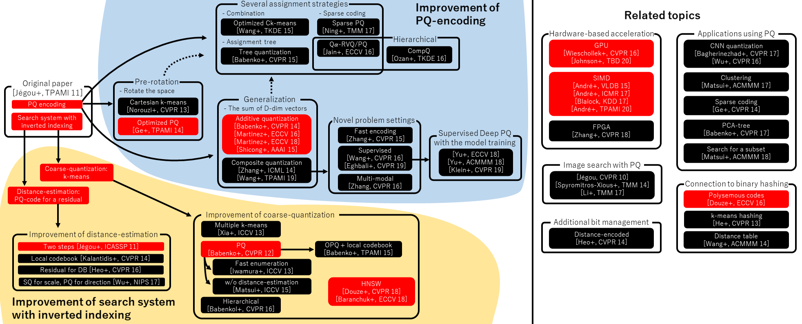

*图 11：乘积量化（PQ）技术族谱与衍生方法。图中以原始论文（Original paper）「Jégou et al., TPAMI 11」为起点，向上、向下延伸出多条技术改进路线；**在 Faiss 中已实现的方法用红色高亮标注**（这是该图最重要的读法）。主要分支包括：**Improvement of PQ-encoding**（PQ 编码改进，如 Optimized PQ / OPQ、Sparse PQ、Qz-RVQ/PQ、CompQ 等）；**Improvement of search system with inverted indexing**（倒排索引检索系统改进，如 IVFADC / IVFPQR、Polysemous codes、NSG 等）；以及右半部分的 **Related topics**——**Hardware-based acceleration**（GPU / SIMD / FPGA 加速）、**Image search with PQ**、**Applications using PQ**（CNN quantization、Clustering、Sparse coding、PCA-free 等）、**Connection to binary hashing** 与 **Additional bit management**。这张图说明了 PQ 不是一个孤立算法，而是一个包含编码优化、检索系统优化、硬件加速与二进制哈希关联的**技术族谱**——理解它有助于在选型时判断「某个库声称的 PQ 支持」实际对应哪一代方法。*
*来源：Faiss 官方文档（Site Home）— https://faiss.ai/index.html（原图引自 Matsui et al., "A Survey of Product Quantization"）*

#### 实用示例

```python
# IVF-PQ 完整演示：训练 → 建索引 → 检索 → 与精确结果对比召回率
import numpy as np


def ivfpq_demo(n=100_000, dim=128, k=10):
    import faiss

    rng = np.random.default_rng(123)
    base = rng.random((n, dim), dtype=np.float32)
    queries = rng.random((20, dim), dtype=np.float32)

    # ---------- 精确基准 ----------
    flat = faiss.IndexFlatL2(dim)
    flat.add(base)
    _, gt = flat.search(queries, k)

    # ---------- IVF-PQ ----------
    nlist = int(np.sqrt(n))          # 经验规则：√N
    m = 16                            # 切成 16 个子向量（dim 需能被 m 整除）
    quantizer = faiss.IndexFlatL2(dim)                # 簇中心点用的量化器
    index = faiss.IndexIVFPQ(quantizer, dim, nlist, m, 8)   # 最后一参 = nbits

    # ⚠️ IVF 必须"训练"：先用一批数据学出簇中心与 PQ 码本
    assert not index.is_trained
    index.train(base)
    print(f"训练完成：nlist={nlist}, M={m}, 是否已训练={index.is_trained}")

    index.add(base)
    print("索引向量数：", index.ntotal)

    # ---------- 扫描 nprobe，观察召回率与耗时 ----------
    print(f"\n{'nprobe':>7} {'Recall@10':>10} {'耗时(ms)':>10}")
    for nprobe in (1, 4, 8, 16, 32, 64):
        index.nprobe = nprobe
        import time
        t0 = time.perf_counter()
        _, approx = index.search(queries, k)
        dt = (time.perf_counter() - t0) * 1000 / len(queries)
        rec = np.mean([len(set(gt[i]) & set(approx[i])) / k for i in range(len(queries))])
        print(f"{nprobe:>7} {rec:>10.4f} {dt:>10.3f}")
    # 观察：nprobe 增大 → 召回率上升、耗时可观上升（经典的精度-速度权衡）

    return index


# ---------- 内存占用计算：PQ 到底省了多少 ----------
def pq_memory_compare(n=1_000_000, dim=768, m=96):
    """量化对比：原始存储 vs PQ 压缩后"""
    raw_bytes = n * dim * 4                      # float32 = 4 字节
    pq_bytes = n * m                             # 每段 1 字节（nbits=8）
    print(f"\n向量数 {n:,}，维度 {dim}，M={m}")
    print(f"  原始存储：{raw_bytes / 1024**3:.2f} GB")
    print(f"  PQ 压缩后：{pq_bytes / 1024**2:.2f} MB")
    print(f"  压缩比：{raw_bytes / pq_bytes:.1f}×")
    # 典型结果：约 32×（M=96 时）；M 更小则压缩比更高但精度更低


if __name__ == "__main__":
    ivfpq_demo(n=50_000)
    pq_memory_compare()
```

#### 测试视角（结合错题 #020）

IVF-PQ 引入的新风险是**「两级近似叠加」**——IVF 可能漏簇，PQ 可能量化失真。测试必须**分层定位**：

| 测试维度 | 用例设计 | 断言 |
|---------|---------|------|
| **簇覆盖率** | 扫描 nprobe，画 Recall-nprobe 曲线 | 找到召回率达标的最小 nprobe（性能与质量的平衡点） |
| **簇边界风险** | 构造「查询向量位于两个簇中间」的用例 | 该向量属于的簇必须被探到——**这是 IVF 特有的失败模式** |
| **量化误差** | 对比 PQ 压缩前后的距离值 | 误差在可接受范围；⚠️ **误差不应导致排序翻转**（Top-1 被换掉） |
| **训练集代表性** | 用不同数据分布训练后再检索 | ⚠️ **分布漂移后召回率会下降**——需定期重训的触发器 |
| **未训练即检索** | 跳过 train 直接 add/search | 必须明确报错（**不得静默返回随机结果**） |
| **重排补偿** | IVF-PQ 粗召回 + 原始向量精排 | 重排后召回率应显著回升（验证重排环节有效） |
| **内存声明一致性** | 实测内存 vs 公式估算 | 偏差在合理范围（防止配置误解导致 OOM） |

> ⚠️ **一个隐蔽但重要的测试点**：**IVF 的「训练集」与「实际数据」分布不一致时，召回率会静默下降**。这在企业场景中很常见——例如用去年的制度文档训练聚类，今年制度大改后，簇分布已经偏移。**测试做法是：定期用一批标注数据跑召回率巡检，一旦发现下降，触发重新训练**。这条与 5.1 的 FLAT 基准巡检可以合并成同一个监控任务。

---

### 5.3 HNSW 算法原理剖析

#### 概念说明

**HNSW（Hierarchical Navigable Small World，分层可导航小世界图）是当前 RAG 场景最主流的 ANN 索引**。它用一个**多层图结构**实现 O(log N) 的检索复杂度。

它的核心思想来自两个直觉：

1. **小世界网络（Small World）**：在图里，只要每个节点连几条「远距离」的边，任意两点之间就只需很少的跳数。
2. **跳表式分层（Skip List）**：像跳表用多层索引加速链表查找一样，HNSW 用多层图加速近邻查找。

**分层结构：**

```
Layer 2（最稀疏）：  ● ─────────────────── ●        少量节点 + 长距离连接
                                    ↓
Layer 1（中等密度）：● ── ● ───────────── ●        中等数量节点 + 中距离连接
                          ↓
Layer 0（最底层）：  ● ─ ● ─ ● ─ ● ─ ● ─ ● ─ ●    全部节点 + 短距离局部连接
```

> **导航类比（官方文档的经典比喻）**：像用地图找一家店——**不会在全国地图上直接找门牌号**。先在省级地图上找到大概的城市，再切到市级地图缩小范围，最后在街区地图上精确定位。**上层负责「快速跨越」，下层负责「精确落点」。**

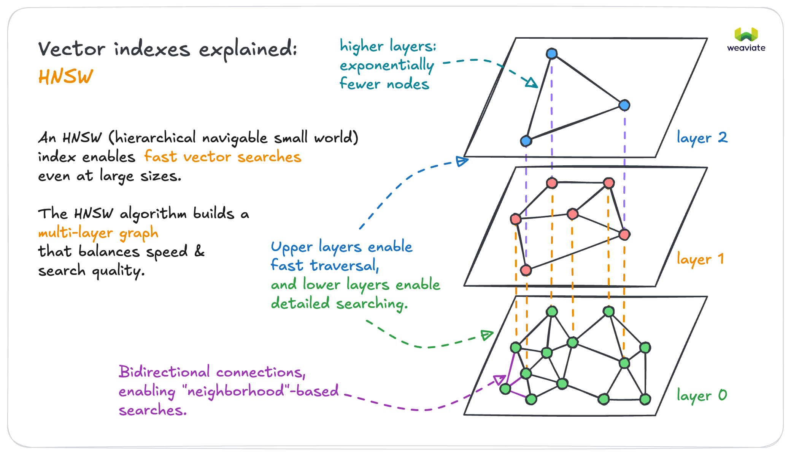

*图 12：HNSW 多层图结构。图中展示三个平面：**layer 2**（最上层，节点数量最少，虚线标注 "higher layers: exponentially fewer nodes" 即层数越高节点数指数级减少，节点间为长距离连接）、**layer 1**（中间层，节点数量中等，图中标注 "Upper layers enable fast traversal" 上层用于快速跨越）、**layer 0**（最底层，包含全部节点，节点间为短距离局部连接，图中标注 "lower layers enable detailed searching" 下层用于精细搜索）。三个平面之间有垂直虚线连接同一个节点在不同层的副本——**同一个数据点可能同时出现在多层，也可能只出现在底层**。底部标注 "Bidirectional connections, enabling 'neighborhood'-based searches"，即连接是双向的。图中还标注 "The HNSW algorithm builds a multi-layer graph that balances speed & search quality"，点明分层结构的目的就是在速度与检索质量之间取得平衡。*
*来源：Weaviate 官方文档, "Vector Index" — https://docs.weaviate.io/weaviate/concepts/vector-index*

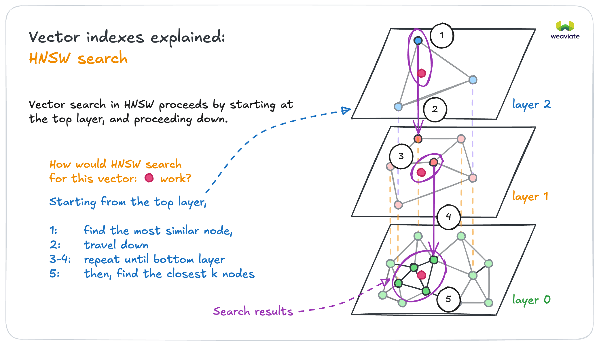

*图 13：HNSW 的搜索过程。目标是在图中找到离查询向量（图中洋红色圆点）最近的节点。搜索流程（图中①–⑤标注）：**①** 从最上层的入口点开始，在 layer 2 中做贪婪搜索，找到该层最相似的节点；**②** 带着这个结果**下降到下一层**；**③–④** 在 layer 1 中重复「找最相似节点 → 下降」的过程，搜索范围逐层收窄（图中紫色圈的范围越来越小）；**⑤** 到达 layer 0 后，找到最近的 K 个节点，即为检索结果（图中标注 "Search results"）。图中文字概括为："Starting from the top layer: 1 find the most similar node, 2 travel down, 3-4 repeat until bottom layer, 5 then find the closest k nodes"。*
*来源：Weaviate 官方文档, "Vector Index" — https://docs.weaviate.io/weaviate/concepts/vector-index*

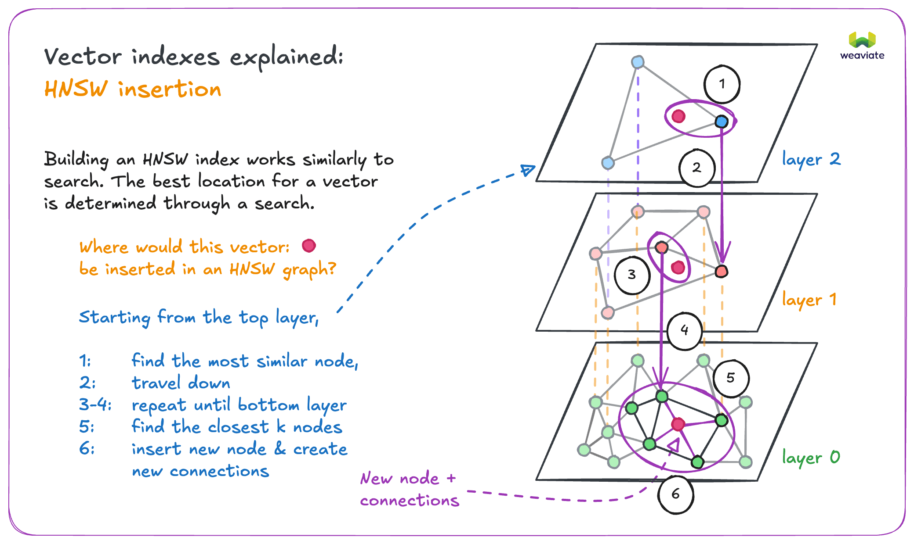

*图 14：HNSW 的节点插入过程。图中文字点明关键："Building an HNSW index works similarly to search. The best location for a vector is determined through a search."——**插入与搜索的流程高度相似，都是先"搜索"找到合适位置**。流程（图中①–⑥标注）：**①** 从顶层开始搜索并找到最相似节点；**②** 下降；**③–④** 逐层重复；**⑤** 在 layer 0 找到最近的 K 个节点；**⑥** 插入新节点并与这些邻居建立新连接（图中标注 "New node + connections"）。这解释了为什么 HNSW 的建索引比 IVF 慢——**每插入一个节点都要跑多次贪婪搜索**，而 IVF 只需要一次 K-Means 训练。*
*来源：Weaviate 官方文档, "Vector Index" — https://docs.weaviate.io/weaviate/concepts/vector-index*

#### 核心要点

**搜索与插入的过程（两个过程高度相似）：**

```
搜索（Search）：
  1) 从最上层的入口点（Entry Point）开始
  2) 在当前层做贪婪搜索，找到离目标最近的节点
  3) 带着这个节点下降到下一层，重复步骤 2
  4) 到达 Layer 0 后，返回最近的 K 个节点

插入（Insertion）：
  1) 先做一次同样的搜索，找到「该插入哪个位置」
  2) 按照指数分布随机决定新节点出现在哪些层
     level = floor(-ln(uniform(0,1)) · mL)
  3) 在它出现的每一层，与最近的若干节点建立双向连接
```

> ⚠️ **注意「层数随机分配」这件事**：节点出现在哪几层**不是人为指定的，而是按指数分布随机抽的**（与跳表的层数分配机制同源）。这个随机性带来一个重要工程后果——**建索引结果不可复现**，同样的数据建两次索引，图结构不同、检索结果可能有微小差异。**测试时不能假设「同样的输入必然得到完全相同的检索结果」。**

**四个关键参数（必背）：**

| 参数 | 阶段 | 含义 | 调大 | 调小 | 常用值 |
|------|------|------|------|------|--------|
| **M（maxConnections）** | 建索引 | 每个节点最多连接多少邻居 | ✅ 召回率上升、✅ 内存上升 | 召回率下降 | 16–32（底层通常为 2×M） |
| **efConstruction** | 建索引 | 建索引时保留的候选集大小 | ✅ 索引质量上升、❌ 建索引更慢 | 索引质量下降 | 100–200 |
| **efSearch（ef）** | 查询 | 查询时保留的候选集大小 | ✅ 召回率上升、❌ 查询更慢 | 召回率下降、✅ 更快 | 50–200 |
| **distance** | 配置 | 距离度量（cosine / dot / L2） | — | — | 与 Embedding 归一化状态匹配 |

> **参数调优的一句话口诀**：**「M 和 efConstruction 决定索引有多好，efSearch 决定你用多大力气去找」**。前者是一次性投入（建索引时决定），后者是每次查询都可调的旋钮——所以**召回率不够时，先调 efSearch**（可在线调整，无需重建索引）。

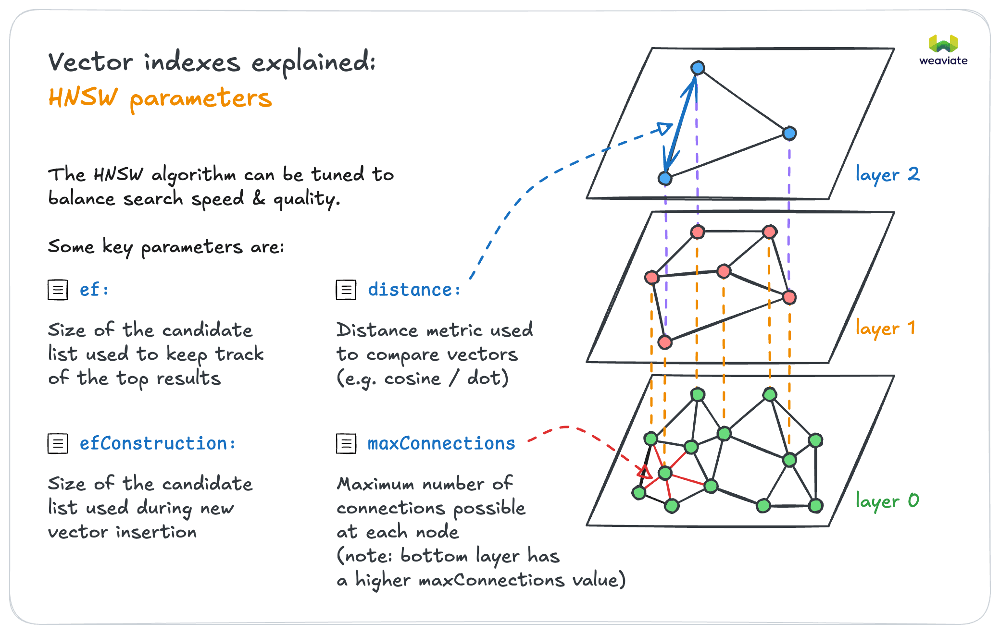

*图 15：HNSW 的四个关键参数。图中文字点明目的："The HNSW algorithm can be tuned to balance search speed & quality"，即这些参数用于平衡检索速度与质量。四个参数分别为：**ef** —— "Size of the candidate list used to keep track of the top results"（查询时用于跟踪最优结果的候选集大小，对应正文的 efSearch）；**efConstruction** —— "Size of the candidate list used during new vector insertion"（插入新向量时使用的候选集大小，**只在建索引阶段生效**）；**distance** —— "Distance metric used to compare vectors (e.g. cosine / dot)"（用于比较向量的距离度量，如余弦或内积）；**maxConnections** —— "Maximum number of connections possible at each node"，并特别注明 "bottom layer has a higher maxConnections value"（底层节点的最大连接数更高，对应正文的 M，底层通常为上层 2 倍）。*
*来源：Weaviate 官方文档, "Vector Index" — https://docs.weaviate.io/weaviate/concepts/vector-index*

**HNSW 的三个已知局限（面试必答）：**

| 局限 | 说明 | 应对 |
|------|------|------|
| **内存占用高** | 图结构额外占用大量内存（不只是原始向量） | 结合 PQ 量化（HNSW+PQ）；或分布到多节点 |
| **建索引慢** | 每次插入都要跑多次贪婪搜索找连接位置 | 批量构建；或接受较长的建索引窗口 |
| **删除困难** | ⚠️ 通常只能**惰性删除**（标记删除，查询时过滤），节点仍占图空间 | 定期重建索引；或用支持真删除的实现 |
| **建索引不可复现** | 层数随机分配，图结构不确定 | 测试时**不假设结果完全一致**，用召回率而非精确匹配断言 |

> ⚠️ **「惰性删除」是 HNSW 最容易被测试遗漏的坑**：删除一个向量后，它**仍在图里占位**，只是被标记过滤掉。因此会出现「删除了 10 万条数据，内存几乎没下降」的现象。**测试断言应该是：删除后不可被召回（功能正确）+ 内存不会立即释放（符合预期）**——把这两点都写成明确的测试意图，而不是把「内存没降」当 bug。

#### 实用示例

```python
# HNSW 完整演示：参数扫描 + 召回率评估 + 惰性删除验证
import numpy as np
import time


def hnsw_param_sweep(n=50_000, dim=64, k=10):
    """系统扫描 M / efConstruction / efSearch 对召回率与耗时的影响"""
    import faiss

    rng = np.random.default_rng(2024)
    base = rng.random((n, dim), dtype=np.float32)
    queries = rng.random((30, dim), dtype=np.float32)

    # 精确基准
    flat = faiss.IndexFlatL2(dim)
    flat.add(base)
    _, gt = flat.search(queries, k)

    print(f"{'M':>4} {'efC':>5} {'efS':>5} {'Recall@10':>10} {'查询(ms)':>10} {'建索引(s)':>10}")
    for M in (8, 16, 32):
        for ef_c in (100, 200):
            for ef_s in (32, 64, 128):
                idx = faiss.IndexHNSWFlat(dim, M)
                idx.hnsw.efConstruction = ef_c
                t0 = time.perf_counter()
                idx.add(base)
                build_s = time.perf_counter() - t0

                idx.hnsw.efSearch = ef_s
                t0 = time.perf_counter()
                _, approx = idx.search(queries, k)
                q_ms = (time.perf_counter() - t0) * 1000 / len(queries)

                rec = np.mean([len(set(gt[i]) & set(approx[i])) / k
                               for i in range(len(queries))])
                print(f"{M:>4} {ef_c:>5} {ef_s:>5} {rec:>10.4f} {q_ms:>10.3f} {build_s:>10.2f}")
    # 典型观察：
    #   M 从 8→32，召回率明显上升，内存与建索引时间同步上升
    #   efSearch 从 32→128，召回率上升、查询变慢（可在线调）
    #   efConstruction 从 100→200，召回率小幅上升、建索引明显变慢


# ---------- 惰性删除验证 ----------
def hnsw_lazy_delete():
    """
    HNSW 的删除通常是惰性的：标记删除 + 查询时过滤
    测试要区分两件事：
      ① 功能：删除后不可被召回（必须通过）
      ② 资源：内存不会立即释放（符合预期，不是 bug）
    """
    import faiss

    dim = 32
    rng = np.random.default_rng(1)
    base = rng.random((10_000, dim), dtype=np.float32)

    idx = faiss.IndexHNSWFlat(dim, 16)
    idx.add(base)
    before = idx.ntotal

    # Faiss 需用 IDMap 包装才支持带 id 的删除
    idmap = faiss.IndexIDMap(faiss.IndexHNSWFlat(dim, 16))
    idmap.add_with_ids(base, np.arange(10_000, dtype=np.int64))
    # 删除前 1000 条
    idmap.remove_ids(np.arange(1000, dtype=np.int64))

    print(f"原始 {before} 条，删除 1000 条后 ntotal={idmap.ntotal}")
    _, I = idmap.search(base[:1], 5)
    print("删除后检索返回的 id（应不含 <1000 的 id）：", I[0])
    # 断言：功能正确性 —— 已删除的 id 不应出现
    assert not any(0 <= i < 1000 for i in I[0] if i >= 0), "已删除向量的 id 仍被召回！"
    print("✅ 删除的功能正确性通过")


# ---------- 用 hnswlib 做同样的实验（更轻量） ----------
def hnswlib_demo():
    """
    hnswlib 是 HNSW 的独立实现，API 更直观。
    ⚠️ 官方 FAQ 明确：mark_deleted 后节点仍占用图空间，要真正释放必须重建索引。
    """
    import hnswlib

    dim, n = 32, 5000
    rng = np.random.default_rng(3)
    data = rng.random((n, dim), dtype=np.float32)

    # space 可选 "l2" / "cosine" / "ip"
    # ⚠️ 若模型优化的是余弦相似度，应使用 space="cosine"，或先归一化再用 "ip"
    index = hnswlib.Index(space="l2", dim=dim)
    index.init_index(max_elements=n, ef_construction=200, M=16)
    index.add_items(data, np.arange(n))
    index.set_ef(50)

    labels, distances = index.knn_query(data[:1], k=5)
    print("hnswlib 检索结果：", labels[0], distances[0].round(4))

    # 惰性删除
    index.mark_deleted(np.arange(100))
    labels2, _ = index.knn_query(data[:1], k=5)
    print("mark_deleted 后：", labels2[0])
    assert not any(l < 100 for l in labels2[0]), "已标记删除的仍被召回"
    print("✅ mark_deleted 生效（但元素仍占图空间，需重建才能真正释放）")


if __name__ == "__main__":
    # hnsw_param_sweep(n=20_000)    # 参数扫描（需 faiss，耗时较长）
    # hnsw_lazy_delete()
    # hnswlib_demo()                # 需 pip install hnswlib
    pass
```

#### 测试视角（结合你的 SKILL 项目）

HNSW 是**最需要「参数化测试 + 召回率巡检」**的组件。

| 测试维度 | 用例设计 | 断言 |
|---------|---------|------|
| **召回率达标** | 用 FLAT 基准对比 | Recall@K ≥ 设定阈值（生产常要求 ≥ 95%） |
| **efSearch 调优生效** | 扫描 efSearch | 召回率随 efSearch 单调上升；不出现异常跳变 |
| **参数配置与规模匹配** | 不同 N 下测同一组参数 | 大数据量下召回率不应显著下降（否则需调大 M） |
| **删除正确性** | 删除后检索 | 已删 id 不可召回（功能层面） |
| **删除后内存** | 大量删除后观测内存 | **内存不立即释放属预期**，需在文档中明确，避免误报 bug |
| **删除后重建** | 重建索引后检索 | 召回率恢复；内存真正释放 |
| **结果不可复现性** | 同数据建两次索引，检索同一批查询 | ⚠️ **允许结果有微小差异**（层数随机分配），断言用「召回率一致」而非「结果完全一致」 |
| **度量匹配** | 检查 `space` 配置与向量归一化状态 | 归一化向量不得配 `l2` 却期望余弦效果（见 3.2） |
| **建索引时间窗口** | 全量建索引耗时 | 在可接受的维护窗口内；超时需分片或降低 efConstruction |
| **并发检索稳定性** | 并发查询 | 结果稳定、无崩溃（HNSW 查询是只读的，应天然安全） |

> ⚠️ **三条最值得写进项目文档的 HNSW 测试结论**：
>
> 1. **「召回率巡检」应成为常态化任务**：用 FLAT 做基准，每周跑一次 Recall@K。这是唯一能发现「索引质量静默劣化」的手段（例如数据分布漂移、参数被误改）。
> 2. **「结果不可复现」要写进测试基线**：HNSW 的层数随机分配导致建索引不确定，**测试断言必须用「召回率区间」而非「结果精确匹配」**——否则会产出大量假失败。
> 3. **「惰性删除」是文档问题不是 bug**：把它写成明确的「已知行为」，配合「定期重建索引」的运维动作，而不是让每个新人重新踩一遍。

---

## 第 6 章 应用实战

> **本章定位**：把前五章的组件串成两个可运行的端到端系统。两个案例刻意选择了不同的技术侧重：**HR 问答侧重「数据工程 + 权限 + 意图理解」，医疗实体命名侧重「混合检索 + 脱敏 + 专业术语」**。

### 6.1 实战一：向量检索驱动的 HR 制度智能问答系统

#### 概念说明

**场景痛点**：HR 团队 80% 的时间在处理高度重复的制度咨询——「年假几天」「社保怎么交」「报销要什么材料」。员工则在几十上百页的员工手册里找不到答案，制度更新后又继续按旧规则问。

**为什么这个场景特别适合 RAG（而不是微调）**：

| 特征 | 对 RAG 的适配性 |
|------|---------------|
| **制度频繁更新** | RAG 改索引即可，无需重训（微调无法快速跟进） |
| **必须可溯源** | 员工需要「依据哪一条」，RAG 天然支持引用 |
| **权限分层** | 不同部门/职级看到的制度不同，元数据过滤可精确控制 |
| **表述口语化** | 需要语义检索（关键词匹配做不好「五险一金」↔「社会保险」） |
| **答案必须准确** | 制度问答错答有实际后果（对应幻觉零容忍） |

#### 核心要点

**系统架构（五层）：**

```
┌─────────────────────────────────────────────────────────────┐
│ ① 数据层：制度文档（PDF/Word/MD）→ 加载 → 清洗脱敏 → 去重    │
│            按章节切分（制度天然有「章-条」结构，优先结构感知切分）│
├─────────────────────────────────────────────────────────────┤
│ ② 元数据层：dept / version / effective_date / level / doc_type│
│             ← 权限过滤与版本过滤的依据                        │
├─────────────────────────────────────────────────────────────┤
│ ③ 向量层：本地 Embedding（合规要求数据不出网）→ 归一化        │
│            同时保留 BM25 稀疏索引（条款号、部门名需精确匹配）  │
├─────────────────────────────────────────────────────────────┤
│ ④ 检索层：意图识别 → 混合检索（向量 + 关键词）→ Rerank        │
│            预过滤（dept + version）必须在相似度计算之前        │
├─────────────────────────────────────────────────────────────┤
│ ⑤ 生成层：Prompt 强制引用条款号 → 输出答案 + 溯源链接          │
│            无法回答时必须明示「制度中未找到」                  │
└─────────────────────────────────────────────────────────────┘
```

**三个设计决策（都是被真实痛点逼出来的）：**

| 决策 | 为什么 | 不这么做会怎样 |
|------|-------|--------------|
| **必须混合检索** | 员工问「五险一金」是语义问题；问「第 3.2 条」是精确问题 | 纯向量检索找不回条款号；纯关键词找不回口语问法 |
| **必须做意图识别** | 员工问法极度口语化，且同一意图有许多变体 | 检索到的知识域不对，答案跑偏 |
| **必须强制引用** | 制度问答的信任基础是「有据可查」 | 员工无法验证，不会真正使用 |

#### 实用示例

```python
# HR 制度智能问答：端到端最小实现
# 说明：Embedding 用可替换的接口，本地部署时接 Ollama（见 3.1）
import re
from dataclasses import dataclass, field


# ============ ① 数据层：结构感知切分 ============
@dataclass
class HRChunk:
    chunk_id: str
    text: str
    section: str                       # 章节路径（如 "第3章/3.2 年休假"）
    metadata: dict = field(default_factory=dict)


def split_hr_policy(text: str, doc_id: str) -> list[HRChunk]:
    """
    HR 制度天然有「章 / 条」结构，优先按结构切分（对应 2.2 的结构感知切分）
    —— 比按字数硬切更能保证「一条制度完整落在一个 chunk 里」
    """
    chunks, chapter, article = [], "", ""
    for line in text.split("\n"):
        s = line.strip()
        if not s:
            continue
        if re.match(r"^第[一二三四五六七八九十]+章", s):
            chapter = s
            continue
        if re.match(r"^第?\d+(\.\d+)*\s*[条、]", s) or re.match(r"^\d+(\.\d+)+\s", s):
            article = s
        # 以「条」为最小切分单位（一条制度通常 50-300 字，粒度合适）
        chunks.append(HRChunk(
            chunk_id=f"{doc_id}#c{len(chunks):03d}",
            text=article + " " + s if article and not s.startswith(article[:4]) else s,
            section=f"{chapter}/{article[:20]}",
        ))
    return chunks


# ============ ③ 检索层：意图识别 + 混合检索 ============
INTENT_KEYWORDS = {
    "休假制度": ["年假", "休假", "请假", "病假", "事假", "调休", "产假", "陪产假"],
    "薪酬福利": ["工资", "薪资", "社保", "五险一金", "公积金", "年终奖", "补贴", "报销"],
    "考勤制度": ["考勤", "打卡", "迟到", "加班", "弹性", "工作时间"],
    "离职流程": ["离职", "辞职", "交接", "离职证明"],
}

# 口语 → 检索友好的改写映射（对应 1.3 的 Query Rewriting）
COLLOQUIAL_MAP = {
    "五险一金": "社会保险 住房公积金 缴纳比例 缴费基数",
    "年假": "年休假 天数 工龄 计算标准",
    "报销": "费用报销 发票 流程 时限",
}


def classify_intent(question: str) -> str:
    """意图识别：用于选择知识域与过滤条件（对应 1.3 的 Query Routing）"""
    scores = {intent: sum(1 for kw in kws if kw in question)
              for intent, kws in INTENT_KEYWORDS.items()}
    best = max(scores, key=scores.get)
    return best if scores[best] > 0 else "通用"


def rewrite_query(question: str) -> list[str]:
    """查询改写：生成多个检索变体（多路召回）"""
    variants = [question]
    for colloquial, formal in COLLOQUIAL_MAP.items():
        if colloquial in question:
            variants.append(formal)
    return variants


def bm25_like_score(query: str, text: str) -> float:
    """简化的关键词打分（真实项目用 BM25，此处演示混合检索的融合逻辑）"""
    terms = [t for t in re.split(r"[\s，。、]+", query) if t]
    if not terms:
        return 0.0
    return sum(1 for t in terms if t in text) / len(terms)


def hybrid_search(question: str, index: list[HRChunk], embed_fn,
                  dept: str = "全员", version: str | None = None,
                  alpha: float = 0.6, top_k: int = 3) -> list[HRChunk]:
    """
    混合检索：向量得分与关键词得分加权融合
      alpha: 向量检索权重（0-1）；alpha 越高越依赖语义
      企业 HR 场景建议 0.5-0.6：既懂口语问法，又不丢条款号精确匹配
    """
    # ✅ 预过滤：权限与版本必须在打分之前（对应 2.3）
    cands = [c for c in index
             if c.metadata.get("dept") in (dept, "全员")
             and (version is None or c.metadata.get("version") == version)]

    scored = []
    for variant in rewrite_query(question):          # ← 多路召回
        qv = embed_fn(variant)
        for c in cands:
            vec_s = sum(x * y for x, y in zip(qv, embed_fn(c.text)))   # 归一化后内积
            kw_s = bm25_like_score(question, c.text)
            scored.append((c, alpha * vec_s + (1 - alpha) * kw_s))

    # 同一 chunk 被多路命中时取最高分
    best = {}
    for c, s in scored:
        best[c.chunk_id] = (c, max(s, best.get(c.chunk_id, (None, -1))[1]))
    ranked = sorted(best.values(), key=lambda x: x[1], reverse=True)
    return [c for c, _ in ranked[:top_k]]


# ============ ⑤ 生成层：强制引用 ============
PROMPT_TEMPLATE = """你是公司 HR 制度助手。请【严格依据】以下制度原文回答，并标注引用编号。

规则：
1. 只使用下方提供的制度原文，不得补充任何外部知识或推测。
2. 若原文不足以回答，必须明确回复「现行制度中未找到相关规定」，不得编造。
3. 回答末尾必须列出引用来源（含章节路径）。

【制度原文】
{context}

【员工问题】
{question}
"""


def build_prompt(question: str, contexts: list[HRChunk]) -> str:
    ctx = "\n".join(f"[{c.chunk_id}] （{c.section}）{c.text}" for c in contexts)
    return PROMPT_TEMPLATE.format(context=ctx, question=question)


def answer(question: str, index, embed_fn, dept="全员", version=None) -> dict:
    intent = classify_intent(question)
    contexts = hybrid_search(question, index, embed_fn, dept=dept,
                             version=version, top_k=3)
    if not contexts:
        return {"answer": "现行制度中未找到相关规定，建议联系 HR 确认。",
                "citations": [], "intent": intent, "retrieved": []}
    return {
        "prompt": build_prompt(question, contexts),
        "answer": "（由 LLM 基于上述原文生成）",
        "citations": [{"chunk_id": c.chunk_id, "section": c.section} for c in contexts],
        "intent": intent,
        "retrieved": [c.chunk_id for c in contexts],
    }


# ============ 跑一遍 ============
policy_text = """
第一章 休假制度
第1条 员工累计工作满1年不满10年的，年休假5天；满10年不满20年的，年休假10天；满20年的，年休假15天。
第2条 年休假需提前3个工作日通过 OA 系统提交申请，经直属主管审批后方可休假。
第3条 当年度年休假应在次年3月31日前休完，逾期视为自动放弃。
第二章 薪酬福利
第4条 社会保险缴纳基数每年7月根据上年度月平均工资调整。
第5条 差旅费用报销应在出差结束后15个工作日内提交，需附发票原件及行程单。
"""

chunks = split_hr_policy(policy_text, "hr_policy_2026")
for c in chunks:
    c.metadata = {"dept": "全员", "version": "2026-05"}


# 简易确定性 embedding（生产替换为 Ollama/BGE）
def fake_embed(t: str, dim: int = 64):
    import hashlib
    v = [0.0] * dim
    for ch in t:
        v[int(hashlib.md5(ch.encode()).hexdigest(), 16) % dim] += 1.0
    n = sum(x * x for x in v) ** 0.5 or 1.0
    return [x / n for x in v]


if __name__ == "__main__":
    r = answer("五险一金怎么算的？", chunks, fake_embed)
    print("意图识别：", r["intent"])
    print("引用：", r["citations"])

    r2 = answer("公司食堂几点开饭？", chunks, fake_embed)
    print("\n知识库外问题 →", r2["answer"])
    # ✅ 关键：必须返回"未找到"，而不是编造或返回随机制度
```

#### 测试视角（结合错题 #020）

**这是错题 #020 的正面攻坚场景**。下表把 #020 中要求的「6 种质量问题 + 检测方案」全部映射到 HR 场景的具体测试：

| 质量问题 | 在本场景的表现 | 测试用例 |
|---------|--------------|---------|
| **检索结果不相关** | 问「年假」返回「报销制度」 | 断言 Top-3 的 doc_type 与意图匹配率 ≥ 90% |
| **关键信息遗漏（召回率低）** | 制度有 3 条关于年假的规定，只召回 1 条 | 标注「每问期望命中的 chunk 集合」，断言 Recall@3 ≥ 0.85 |
| **噪声过多（精准率低）** | Top-5 中只有 1 条真正相关 | 断言 Context Precision@5 ≥ 0.8 |
| **幻觉** | 制度没写「年假可以折算工资」，AI 却答出折算比例 | **Faithfulness 测试**：逐句断言答案中每个论断都能在上下文中找到依据 |
| **上下文丢失/截断** | 「提前 3 个工作日」被切在两个 chunk 之间 | 用 2.2 的「答案边界完整性」用例覆盖 |
| **排序不合理** | 正确条款排在第 5 位，泛泛的制度总述排第 1 | 断言关键问题的 MRR ≥ 0.8（正确结果平均排前 2） |
| **知识过期** | 制度已改版，仍答旧版天数 | 断言只召回当前生效版本；构造新旧版本并存的用例 |
| **权限泄露** | 普通员工问到高管薪酬制度 | 见 2.3 的三重断言权限测试 |
| **引用不支撑答案** | 引用的是第 1 条，答案是第 3 条的内容 | **引用-答案对齐测试**：断言答案中每个数字/事实都能在引用 chunk 中找到 |

```python
# 幻觉与引用对齐测试（HR 场景最关键的两条护栏）
import pytest


def test_no_hallucination_when_context_insufficient(rag_client):
    """
    幻觉测试：故意问一个制度里没写的问题，断言模型拒答而非编造。
    —— 对应 RAGAS 的 Faithfulness 指标思路（答案必须忠实于上下文）
    """
    # 制度里没有"年假折算工资"的规定
    resp = rag_client.query("年假没休完可以折算成工资吗？")

    forbidden = ["折算比例", "按日工资", "2倍", "300%", "3倍"]
    if resp["answer"] != "未找到":
        for kw in forbidden:
            assert kw not in resp["answer"], f"检测到幻觉：{kw}（上下文中无此依据）"


def test_citation_supports_answer(rag_client):
    """
    引用对齐测试：答案中的关键事实必须能在 citations 指向的 chunk 中找到。
    —— 对应 #020 的"引用错误"质量问题
    """
    resp = rag_client.query("年假要提前几天申请？")
    assert "3 个工作日" in resp["answer"]

    cited_text = "".join(c["text"] for c in resp["citations_detail"])
    assert "3 个工作日" in cited_text, "答案中的关键事实不在引用内容中 → 引用不支撑答案"


def test_version_filter_prevents_stale_answer(rag_client):
    """
    知识过期测试：库中同时存在新旧版本，断言只召回当前生效版本。
    —— 直接补齐错题 #020 中遗漏的"知识过期"质量问题
    """
    resp = rag_client.query("年假有几天？", version="2026-05")
    assert all(c["version"] == "2026-05" for c in resp["citations_detail"]), \
        "召回了已失效的旧版本制度"


@pytest.mark.parametrize("question,expected_intent", [
    ("年假几天", "休假制度"),
    ("社保怎么交", "薪酬福利"),
    ("五险一金比例", "薪酬福利"),
    ("陪产假多少天", "休假制度"),
])
def test_intent_routing(rag_client, question, expected_intent):
    """意图路由测试：口语化问法必须被正确路由"""
    assert rag_client.classify_intent(question) == expected_intent
```

> ⚠️ **给你的提醒**：这个 HR 场景与你未来可能做的 **E9 操作指引问答**结构高度相似（都是「制度/文档 + 口语化提问 + 权限分层 + 必须可溯源」）。**建议直接把 6.1 的架构与测试用例改造成 E9 场景的模板**——这能把你已有的企业系统经验直接转化为 AI 测试岗的面试素材。

---

### 6.2 实战二：混合检索在医疗实体命名中的实战

#### 概念说明

**场景痛点**：医疗数据分散在 HIS（医院信息系统）、LIS（检验系统）、PACS（影像系统）等多个系统中；一份病历同时包含结构化检查报告、半结构化出院小结、非结构化影像描述。医生想查「某类药物在某类患者身上的不良反应」，需要在多个系统间反复检索，且**检索精度要求极高——医疗场景的错误代价是患者安全**。

**与 HR 场景的三个关键差异：**

| 差异 | 医疗场景 | 对 RAG 的影响 |
|------|---------|--------------|
| **术语体系复杂** | 「心梗」/「急性心肌梗死」/「AMI」是同一实体 | ⚠️ **必须语义检索**，否则同义表达全部漏召回 |
| **精确标识符必须精确匹配** | 药品名、ICD 编码、检验项目代码 | ⚠️ **必须关键词检索**，向量检索对代码类标识符不可靠 |
| **合规要求最严** | PHI（受保护健康信息）不得出网、不得泄露 | ⚠️ **脱敏必须彻底 + 数据必须本地部署** |

**两个「必须」并存，所以结论是：医疗场景必须用混合检索。**

#### 核心要点

**混合检索（Hybrid Search）的融合策略：**

| 策略 | 做法 | 优势 | 局限 |
|------|------|------|------|
| **加权求和** | `score = α·向量分 + (1-α)·关键词分` | 实现简单、可解释 | α 需调参；两路分数量纲不同需归一化 |
| **RRF（Reciprocal Rank Fusion）** | `score = Σ 1/(k + rank_i)`，按排名融合而非分数 | ✅ **无需归一化**、鲁棒、工业界常用 | 丢弃了分数绝对大小信息 |
| **级联（先稀疏后稠密 / 反之）** | 一路先粗筛，另一路精排 | 性能好 | 前置路的召回上限决定整体效果 |

> ⚠️ **面试加分点**：**RRF 比加权求和更常用**，原因是它**只用排名、不用分数**，从而回避了「向量相似度（0–1）」与「BM25 分数（无上界）」量纲不可比的问题。如果面试官追问「两种检索分数怎么融合」，答「优先 RRF，因为无需归一化且对异常分数鲁棒」是加分回答。

**医疗场景的实体识别增强（Entity-aware Retrieval）：**

```
普通 RAG 检索：查询 "心梗" → 向量检索可能召回"心衰"相关文档（语义接近但实体不同）
实体增强检索：查询 "心梗"
  → 实体识别 → 归一化为标准实体 "急性心肌梗死"（ICD: I21）
  → 实体扩展 → ["急性心肌梗死", "AMI", "心肌梗塞", "心梗"]
  → 多路检索 → 合并结果 → 精排
  → ✅ 同义表达全部覆盖，且不与"心衰"混淆
```

**医疗数据脱敏的严苛要求（合规红线）：**

| 信息类型 | 示例 | 脱敏要点 |
|---------|------|---------|
| **身份标识** | 身份证、姓名、病案号 | 正则 + 命名实体识别双重过滤 |
| **联系方式** | 手机号、住址、家属电话 | ⚠️ 仅替换显式手机号不够——**病历正文里的「患者丈夫电话 138…」也要覆盖** |
| **医疗标识** | 住院号、门诊号、检验单号 | 与业务系统编码规则对齐 |
| **时间与地点** | 精确到日的就诊时间、具体科室 | 按合规要求做粒度粗化 |

> ⚠️ **一个真实教训**：**「只替换身份证号」是远远不够的**。病历文本中大量存在「患者丈夫电话」「其母亲身份证」这类间接标识，以及穿插在病情描述里的联系方式。正确做法是**正则规则库 + 命名实体识别（NER）双重过滤**，并且**用反向扫描测试来验证脱敏彻底性**。

#### 实用示例

```python
# 医疗混合检索：脱敏 + 实体归一化 + RRF 融合
import re
from dataclasses import dataclass


# ============ ① 脱敏：正则 + 多重规则（对应 2.1 的清洗） ============
PHI_PATTERNS = [
    (r"\b\d{17}[\dXx]\b", "***身份证***"),
    (r"\b1[3-9]\d{9}\b", "***手机号***"),
    (r"\b\d{4}[-/]?\d{2}[-/]?\d{2}\b", "***日期***"),        # 精确日期（按合规要求粗化）
    (r"(病历号|病案号|住院号|门诊号|检验单号)[:：]?\s*\w+", r"\1:***"),
    (r"(患者|病人)(的)?(丈夫|妻子|父亲|母亲|儿子|女儿|家属)(电话|手机|联系方式)[:：]?\s*\S+",
     r"\1\2\3\4:***"),                                        # ← 间接标识也必须覆盖
    (r"\b[A-Z]\d{2}(\.\d+)?\b", "***ICD***") if False else (r"(?<![\w.])(?!I2\d)\b[A-Z]\d{2}\.\d+\b", "***ICD***"),
]


def desensitize_medical(text: str) -> str:
    """
    医疗文本脱敏。
    ⚠️ 顺序重要：先长的模式（身份证 18 位）再短的（手机号 11 位），否则会被部分命中
    """
    for pattern, repl in PHI_PATTERNS:
        text = re.sub(pattern, repl, text)
    return text


def audit_desensitization(text: str) -> list[str]:
    """
    反向审计：脱敏后再次扫描，返回所有仍命中的敏感模式。
    —— 这是脱敏测试的核心工具：断言返回列表为空
    """
    leaks = []
    for pattern, _ in PHI_PATTERNS:
        for m in re.finditer(pattern, text):
            leaks.append(m.group(0))
    return leaks


# ============ ② 实体归一化（术语标准化） ============
MEDICAL_ENTITY_MAP = {
    "心梗": "急性心肌梗死",
    "心肌梗塞": "急性心肌梗死",
    "AMI": "急性心肌梗死",
    "急性心肌梗死": "急性心肌梗死",
    "脑梗": "脑梗死",
    "脑梗塞": "脑梗死",
    "糖尿病": "2型糖尿病",
    "高血压": "原发性高血压",
    "心衰": "心力衰竭",
}

# 实体别名表（用于查询扩展，提升同义表达召回）
ENTITY_ALIASES = {
    "急性心肌梗死": ["AMI", "心肌梗塞", "心梗", "myocardial infarction"],
    "心力衰竭": ["心衰", "HF", "heart failure"],
    "2型糖尿病": ["T2DM", "二型糖尿病", "糖尿病"],
}


def normalize_entity(term: str) -> str:
    """把俗称/缩写归一化为标准医学术语"""
    return MEDICAL_ENTITY_MAP.get(term, term)


def expand_query_with_entities(question: str) -> list[str]:
    """
    实体感知的查询扩展：识别问题中的医学实体，展开其全部别名
    —— 这是医疗场景混合检索的关键增强（普通 RAG 做不到同义术语全覆盖）
    """
    variants = [question]
    for colloquial, standard in MEDICAL_ENTITY_MAP.items():
        if colloquial in question:
            base = question.replace(colloquial, standard)
            variants.append(base)
            for alias in ENTITY_ALIASES.get(standard, []):
                variants.append(question.replace(colloquial, alias))
    return list(dict.fromkeys(variants))     # 去重保序


# ============ ③ RRF 融合（工业界推荐的混合检索融合方式） ============
def rrf_fuse(rank_lists: list[list[str]], k: int = 60) -> list[tuple[str, float]]:
    """
    Reciprocal Rank Fusion：只用排名，不用分数 → 无需归一化
      score(d) = Σ_i 1 / (k + rank_i(d))
    k 是平滑常数（常用 60），用于抑制头部排名的过度影响
    """
    scores = {}
    for ranks in rank_lists:
        for rank, doc_id in enumerate(ranks, start=1):
            scores[doc_id] = scores.get(doc_id, 0.0) + 1.0 / (k + rank)
    return sorted(scores.items(), key=lambda x: x[1], reverse=True)


def hybrid_medical_search(question: str, vector_index, sparse_index,
                          top_k: int = 5, prefilter: dict | None = None):
    """
    医疗混合检索：向量检索（管语义） + 关键词检索（管精确标识符） + RRF 融合
    """
    queries = expand_query_with_entities(question)     # ← 实体扩展

    vec_ranks, kw_ranks = [], []
    for q in queries:
        vec_ranks.append([d for d, _ in vector_index(q, prefilter=prefilter)])
        kw_ranks.append([d for d, _ in sparse_index(q, prefilter=prefilter)])

    # 多路结果合并为两路排名（每一路内部先做一次融合）
    vec_merged = [d for d, _ in rrf_fuse(vec_ranks)][:50]
    kw_merged = [d for d, _ in rrf_fuse(kw_ranks)][:50]

    # 最终 RRF：向量路 + 关键词路
    fused = rrf_fuse([vec_merged, kw_merged])[:top_k]
    return fused


# ============ 端到端演示 ============
if __name__ == "__main__":
    # 1) 脱敏验证
    raw = ("患者张某，身份证 110101199001011234，手机 13812345678，"
           "于 2026-03-15 因心梗入院。患者丈夫电话：13987654321。")
    clean = desensitize_medical(raw)
    print("脱敏结果：", clean)
    leaks = audit_desensitization(clean)
    print("残留敏感信息：", leaks)
    assert not leaks, f"脱敏不彻底，残留：{leaks}"

    # 2) 实体扩展验证
    for q in expand_query_with_entities("心梗患者需要注意什么？"):
        print("  扩展变体：", q)
    # → 输出应包含 "AMI 患者..."、"心肌梗塞 患者..."、"myocardial infarction 患者..."

    # 3) RRF 融合验证
    vec_list = ["doc1", "doc5", "doc3", "doc9"]     # 向量检索排名
    kw_list = ["doc3", "doc1", "doc7"]              # 关键词检索排名
    print("\nRRF 融合结果：", rrf_fuse([vec_list, kw_list]))
    # → doc1 与 doc3 在两路都靠前，融合后应排名最优（体现"多路共识"的价值）

    # 4) 混合检索对同义表述的召回验证
    # 断言：问"心梗"与问"急性心肌梗死"应召回高度重叠的结果集
```

#### 测试视角（结合错题 #020 与合规要求）

医疗场景的测试比 HR 场景多出**三个强合规维度**：

| 测试维度 | 用例设计 | 断言 |
|---------|---------|------|
| **脱敏彻底性（最高优先）** | 反向上表扫描脱敏后文本 | **零残留**——不放过任何 PHI/间接标识 |
| **数据不出网** | 抓包 / 检查网络配置 | Embedding 与 LLM 调用**不得访问外网**（对应你的合规红线） |
| **实体归一化正确性** | 构造同义术语对（心梗/AMI/心肌梗塞） | 归一化到同一标准实体；**不与「心衰」混淆**（近邻实体误判测试） |
| **混合检索召回提升** | 对比纯向量 / 纯关键词 / 混合三种方案 | 混合方案的 Recall@5 应**同时**优于两种单路（否则混合无收益） |
| **标识符精确匹配** | 查询 ICD 编码、药品名 | 关键词路必须精确命中（验证稀疏检索未失效） |
| **RRF 融合稳定性** | 同一查询多次运行 | 结果排名稳定（RRF 是确定性的，不应抖动） |
| **多系统数据一致性** | HIS / LIS / PACS 同患者数据 | 同一患者的跨系统检索结果可正确聚合 |
| **权限与最小必要** | 不同角色（医生/护士/行政）查询 | 只返回角色权限范围内的数据（对应 2.3） |
| **审计可追溯** | 每次查询与回答 | 完整日志：谁、何时、问了什么、检索到什么、答了什么 |

```python
# 医疗混合检索的核心回归测试
import pytest


def test_hybrid_beats_both_single_paths(eval_set, vector_search, keyword_search,
                                        hybrid_search):
    """
    关键测试：混合检索必须【同时】优于纯向量与纯关键词。
    —— 如果混合没带来提升，说明增加复杂度无收益（对应 1.4 的"僵尸通道"检查）
    """
    def recall_at_5(fn, **kw):
        hits = 0
        for s in eval_set:
            got = {d for d, _ in fn(s["query"], top_k=5, **kw)}
            hits += len(got & set(s["expected_docs"])) / len(s["expected_docs"])
        return hits / len(eval_set)

    r_vec = recall_at_5(vector_search)
    r_kw = recall_at_5(keyword_search)
    r_hybrid = recall_at_5(hybrid_search)

    print(f"纯向量={r_vec:.3f}  纯关键词={r_kw:.3f}  混合={r_hybrid:.3f}")
    assert r_hybrid >= max(r_vec, r_kw), "混合检索未带来提升，需重新审视融合策略"


def test_synonym_recall(pipeline):
    """同义术语召回测试：俗称与标准术语应召回高度重叠的结果"""
    a = {d for d, _ in pipeline.search("心梗患者护理要点")}
    b = {d for d, _ in pipeline.search("急性心肌梗死患者护理要点")}
    overlap = len(a & b) / max(len(a | b), 1)
    assert overlap >= 0.6, f"同义表述召回重叠过低：{overlap:.2f}（实体扩展未生效？）"


def test_near_entity_not_confused(pipeline):
    """近邻实体不混淆测试：心梗 ≠ 心衰"""
    cardio = {d for d, _ in pipeline.search("心梗的典型症状")}
    hf = {d for d, _ in pipeline.search("心衰的典型症状")}
    # 允许少量重叠（同一份病历可能两者都提到），但不允许高度重叠
    overlap_ratio = len(cardio & hf) / max(len(cardio), 1)
    assert overlap_ratio < 0.5, f"心梗与心衰检索结果混淆严重：{overlap_ratio:.2f}"


def test_desensitization_no_leak(sample_records):
    """脱敏零残留（合规红线，零容忍）"""
    for raw in sample_records:
        clean = desensitize_medical(raw)
        leaks = audit_desensitization(clean)
        assert not leaks, f"残留 PHI：{leaks}"


def test_no_external_network_call(pipeline, network_spy):
    """
    数据不出网测试：在查询链路上挂 spy，断言无外部网络请求。
    —— 你的合规要求的直接验证
    """
    pipeline.query("糖尿病患者用药注意事项")
    external = [c for c in network_spy.calls
                if not c.host.startswith(("127.0.0.1", "localhost", "10."))]
    assert not external, f"检测到外网调用：{external}"
```

> ⚠️ **三条来自医疗场景的通用经验（可迁移到任何高合规场景）**：
>
> 1. **脱敏测试必须用「反向扫描」而不是「正向检查」**——检查「有没有替换掉已知的身份证」是查不全的，只有**用规则库反向扫描脱敏后的文本**，才能覆盖未知的泄露形式。
> 2. **混合检索必须证明「优于单路」**——如果混合没有带来指标提升，那它就是纯粹的技术债。
> 3. **「数据不出网」是可测的**——用网络 spy 挂载到查询链路上做断言，把它变成 CI 里的常规检查，而不是靠人工承诺。

---

### 6.3 实战共性：RAG 落地的验收与调优清单

#### 概念说明

前两个案例虽然领域不同，但**验收与调优的动作是同一套**。本节把它固化成一份可复用的清单——这也是你从「能答概念」走向「能主持 RAG 验收」的关键。

#### 核心要点

**RAG 验收的五个层次（按优先级，从上到下必须先过）：**

| 层次 | 验收目标 | 关键指标 | 通过标准 |
|------|---------|---------|---------|
| **① 数据正确性** | 入库内容与原件一致、脱敏彻底、无重复 | 内容一致率、脱敏残留数、重复率 | 残留 = 0；一致率 ≥ 99% |
| **② 检索质量** | 该找到的能找到、排序合理 | Recall@K、Precision@K、MRR、Hit Rate | Recall@5 ≥ 0.85；MRR ≥ 0.8 |
| **③ 生成质量** | 答案忠实于上下文、切题、引用准确 | Faithfulness、Answer Relevancy、引用准确率 | Faithfulness ≥ 0.85；引用准确率 ≥ 0.9 |
| **④ 安全合规** | 权限不越界、数据不出网、可审计 | 越权数、外网调用数、审计完整率 | 越权 = 0；外网 = 0；审计 100% |
| **⑤ 性能** | 延迟与吞吐满足 SLA | P95 检索延迟、P95 端到端延迟、QPS | 按业务 SLA 设定（常 3–5s） |

> ⚠️ **顺序不可颠倒**：如果数据层没验（②③④⑤ 全都不用跑）——**脏数据上跑出的任何指标都不可信**。这是你在错题 #020 中已经抓到的要点（「测试数据是基础」），这里把它制度化为「验收层次」。

**调优的排查顺序（与验收层次相反，从下游往上游查）：**

```
答案错了
  ├─ ① 先看检索结果里有没有期望文档？
  │     ├─ 没有 → 检索问题
  │     │     ├─ 检查该文档是否成功入库（幽灵索引？）
  │     │     ├─ 检查切分是否把答案切碎（chunk_size / overlap）
  │     │     ├─ 检查 Embedding 模型是否与索引一致
  │     │     ├─ 检查查询改写是否语义漂移
  │     │     ├─ 检查元数据过滤是否过严（把正确文档筛掉了）
  │     │     └─ 检查 ANN 参数（efSearch / nprobe 太小 → 召回不足）
  │     └─ 有 → 生成问题
  │           ├─ 检查 Prompt 约束是否足够强（是否明确"不得编造"）
  │           ├─ 检查上下文拼装顺序（关键内容是否被埋在中间）
  │           ├─ 检查上下文是否被截断（超过模型窗口被静默裁剪）
  │           ├─ 检查 K 是否过大导致关键信息被噪声淹没
  │           └─ 检查引用生成逻辑（引用与答案是否绑定）
  ├─ ② 引用是否正确？
  │     └─ 引用错 → 检查引用生成逻辑与 chunk_id 传递
  └─ ③ 权限是否生效？
        └─ 越权 → 检查是否误用 Post-filter（必须 Pre-filter）
```

#### 实用示例

```python
# RAG 验收自动化脚本骨架：把五个层次固化成一条可重复执行的质量门禁
from dataclasses import dataclass, field


@dataclass
class AcceptanceResult:
    layer: str
    metric: str
    value: float
    threshold: float
    passed: bool = field(init=False)

    def __post_init__(self):
        self.passed = self.value >= self.threshold


def run_acceptance(rag, eval_set, expected_metrics: dict) -> list[AcceptanceResult]:
    """
    rag: 被测 RAG 客户端
    eval_set: [{"query","expected_docs","expected_answer_keywords","auth"}, ...]
    expected_metrics: {"recall_at_5":0.85, "faithfulness":0.85, "citation_acc":0.9, ...}
    """
    results = []

    # ① 数据层：脱敏零残留 + 无重复
    leaks = sum(len(audit_desensitization(d["content"])) for d in rag.all_docs())
    results.append(AcceptanceResult("①数据层", "脱敏残留数", -leaks, 0))
    dup_rate = rag.duplicate_rate()
    results.append(AcceptanceResult("①数据层", "重复率(反向)", -dup_rate, 0))

    # ② 检索层：Recall@K
    recalls = []
    for s in eval_set:
        got = {c["doc_id"] for c in rag.retrieve(s["query"], top_k=5, auth=s.get("auth"))}
        recalls.append(len(got & set(s["expected_docs"])) / len(s["expected_docs"]))
    results.append(AcceptanceResult("②检索层", "Recall@5",
                                    sum(recalls) / len(recalls),
                                    expected_metrics["recall_at_5"]))

    # ③ 生成层：引用准确率（引用内容必须支撑答案）
    cite_ok = 0
    for s in eval_set:
        r = rag.query(s["query"], auth=s.get("auth"))
        cited = "".join(c["text"] for c in r["citations_detail"])
        if all(kw in cited for kw in s["expected_answer_keywords"]):
            cite_ok += 1
    results.append(AcceptanceResult("③生成层", "引用准确率", cite_ok / len(eval_set),
                                    expected_metrics["citation_acc"]))

    # ④ 安全层：越权数与外网调用数
    violations = rag.security_probe(eval_set)
    results.append(AcceptanceResult("④安全层", "越权次数(反向)", -violations["cross_tenant"], 0))
    results.append(AcceptanceResult("④安全层", "外网调用(反向)", -violations["external_calls"], 0))

    # ⑤ 性能层：P95 延迟
    p95 = rag.measure_p95_latency(eval_set, n=3)
    results.append(AcceptanceResult("⑤性能层", "P95延迟(反向)", -p95,
                                    -expected_metrics["p95_latency_s"]))

    return results


def report(results: list[AcceptanceResult]) -> str:
    lines = ["层 次     指标            实测      阈值     结果"]
    lines.append("-" * 58)
    for r in results:
        flag = "✅ 通过" if r.passed else "❌ 不通过"
        lines.append(f"{r.layer:<8} {r.metric:<14} {r.value:>8.3f} {r.threshold:>8.3f}  {flag}")
    failed = [r for r in results if not r.passed]
    lines.append("-" * 58)
    lines.append(f"总计 {len(results)} 项，通过 {len(results) - len(failed)} 项，"
                 f"失败 {len(failed)} 项")
    return "\n".join(lines)


# 使用方式（示例，需接入真实 RAG 客户端）：
# results = run_acceptance(rag_client, eval_set, {
#     "recall_at_5": 0.85, "citation_acc": 0.90, "p95_latency_s": 5.0,
# })
# print(report(results))
# assert all(r.passed for r in results), "RAG 验收未通过，禁止上线"
```

#### 测试视角（把清单落成 CI 门禁）

| 测试维度 | 落地方案 |
|---------|---------|
| **作为上线门禁** | 把 `run_acceptance` 接入 CI：**任一层不通过则阻断发布** |
| **作为日常巡检** | 每周跑一次，重点看 Recall@5 与 Faithfulness 是否有下降趋势（对应 5.1、5.3 的召回率巡检） |
| **作为变更回归** | 任何配置变更（切分参数 / Embedding 模型 / 索引参数 / Prompt）都必须跑完整验收 |
| **作为评测集维护** | 评测集需版本化；每次线上发现 bad case，**补进评测集**（形成闭环） |

> ⚠️ **给你的收官建议**：这套「五层验收 + 排查顺序」就是你应对 RAG 相关面试的**主框架**。它把散落的知识点（分块、Embedding、向量库、ANN、权限、幻觉）**组织成了一个有优先级的决策流程**。面试时先给这个框架，再按面试官追问的方向展开细节——这比平铺罗列知识点有说服力得多。

---

## 第 7 章 面试考点速览与自测清单

### 7.1 高频考点速查表

| 技能点关联 | 核心考点 | 一句话答案 |
|-----------|---------|-----------|
| **A12 · 价值层** | RAG 到底解决什么问题 | 把「知识」从模型权重（参数化记忆）转移到可替换的外部索引（非参数化记忆），解决知识截止、私有数据不可用、不可溯源；幻觉是缓解不是消除 |
| **A12 · 价值层** | RAG 与微调怎么选 | RAG 改变**输入上下文**（管「知道什么」），微调改变**模型权重**（管「怎么表达」）；知识高频变动选 RAG，风格格式选微调，事实+风格并存则两者叠加 |
| **A12 · 价值层** | RAG 三代范式 | Naive（检索-拼接-生成）→ Advanced（检索前加查询改写/扩展/路由，检索后加重排/压缩/融合）→ Modular（模块可插拔、按需编排） |
| **A12 · 数据层** | 分块为什么要设 overlap | 因为没有任何切分策略能保证语义永不跨边界；**overlap 缺失会导致答案跨边界时两块都被切断**，两块相似度都不高 → 检索失败。经验值：chunk_size 的 10–20% |
| **A12 · 数据层** | chunk_size 怎么定 | 中文常用 300–800 字符（200–500 Token）；太大则语义稀释+噪声多，太小则语义断裂。**必须用参数扫描 + 答案边界完整性用例验证**，不能拍脑袋 |
| **A12 · 数据层** | 中文分块的特殊处理 | LangChain 默认分隔符 `["\n\n","\n"," ",""]` 为英文设计，中文无词间空格会被切断 → **必须自定义分隔符，加入中文句号「。」、全角逗号「，」、顿号「、」等** |
| **A12 · 数据层** | 元数据过滤：预过滤 vs 后过滤 | **企业场景只能用预过滤（Pre-filter）**——语义相似度不是访问控制机制；后过滤意味着无权限内容已进入模型上下文，存在泄露风险 |
| **A12 · 向量层** | 余弦 / 欧氏 / 内积的关系 | **当且仅当向量已 L2 归一化时三者排序一致**（`‖A-B‖² = 2(1-cos)`）；未归一化时欧氏会被长度影响而误判。已归一化 → 用内积最快 |
| **A12 · 向量层** | Embedding 模型切换的风险 | ⚠️ **换 Embedding 模型必须重建全部索引**，否则检索整体劣化且不报错（静默失真）。护栏：索引元数据记录模型名+维度，查询时校验不一致即报错 |
| **A12 · 向量层** | Top-K 怎么设 | 用 Recall@K 曲线找**饱和点**（增量小于 2% 时的最小 K），再叠加 Context Precision 与延迟约束。⚠️ K 过大会触发 **Lost in the Middle**——关键信息被淹没，答案质量反而下降 |
| **A12 · 存储层** | 向量数据库 vs FAISS | FAISS 只是**算法库**（无持久化/CRUD/过滤/分布式），不是数据库。用 FAISS 上线必须自行补齐这些能力，且这些是最容易漏测的部分 |
| **A12 · 存储层** | 怎么选向量数据库 | 先问「数据能否出网」（不能 → 排除托管云）；再问「有无 K8s 运维」（无 → pgvector / Chroma / 单机 Milvus）；再看规模与过滤需求（过滤重 → pgvector 优势） |
| **A12 · 存储层** | 命名空间的作用 | 逻辑隔离单元，用于多租户与环境隔离；**测试必须验证跨命名空间零可见** |
| **A12 · 内核层** | IndexFlatL2 的价值 | 精确检索、100% 召回，**是所有 ANN 的「正确性基准（Ground Truth）」**——评估 HNSW/IVF-PQ 的召回率必须用它做对照。复杂度 O(N·D)，仅适合 10 万级以下 |
| **A12 · 内核层** | IVF 的原理与风险 | K-Means 聚成 nlist 个簇，检索只探 nprobe 个簇；**正确向量所在簇未被选中就永远找不回**——这是 IVF 召回率低于 HNSW 的根本原因。需训练、分布漂移需重训 |
| **A12 · 内核层** | PQ 的价值 | 乘积量化：把 768 维 float32（3072 字节）压到约 96 字节，**压缩约 32–60 倍**，代价是量化误差 |
| **A12 · 内核层** | HNSW 的核心思想 | 多层图 + 贪婪搜索：上层稀疏长连接负责**快速跨越**，下层密集短连接负责**精确落点**，复杂度 O(log N)，召回率 95–99% |
| **A12 · 内核层** | HNSW 四个参数 | **M**（每节点最大连接数，16–32）与 **efConstruction**（建索引候选集，100–200）决定索引质量（一次性投入）；**efSearch**（查询候选集，50–200）决定查询力度（**可在线调，召回不足先调它**）；**distance** 需与归一化状态匹配 |
| **A12 · 内核层** | HNSW 的三个坑 | ① 内存高（图结构额外占用，可配 PQ）；② 建索引慢；③ **删除是惰性的**（标记删除，节点仍占空间，需重建才真正释放）；④ 层数随机分配 → **建索引结果不可复现**，测试不能断言结果精确一致 |
| **A12 · 实战层** | 为什么需要混合检索 | 向量检索管**语义**（「五险一金」↔「社会保险」），关键词检索管**精确标识符**（条款号、ICD 编码、药品名）；两者不可互替，故需融合 |
| **A12 · 实战层** | 两种分数量纲不同怎么融合 | 优先 **RRF（Reciprocal Rank Fusion）**：只用排名不用分数，`Σ 1/(k+rank)`，**无需归一化且对异常分数鲁棒**；加权求和需先归一化 |
| **A12 · 实战层** | 脱敏为什么不能只替换身份证 | 病历/文档中大量存在**间接标识**（「患者丈夫电话 138…」）与穿插在正文里的联系方式；必须**正则规则库 + NER 双重过滤**，且用**反向扫描**验证零残留 |
| **A12 · 测试** | RAG 答案错了怎么定位 | 二分法：先看 Top-K 里**有没有期望文档**——没有 → 检索问题（查切分/Embedding 一致性/查询改写/元数据过滤/ANN 参数）；有但答案仍错 → 生成问题（查 Prompt 约束/上下文拼装/截断/K 过大） |
| **A12 · 测试** | RAG 验收的五个层次 | ① 数据正确性（脱敏/去重/一致）→ ② 检索质量（Recall/Precision/MRR）→ ③ 生成质量（Faithfulness/引用准确率）→ ④ 安全合规（越权=0/外网=0）→ ⑤ 性能（P95）—— **顺序不可颠倒，脏数据上的指标不可信** |
| **A12 · 测试** | 如何持续监控检索质量 | 用 **IndexFlatL2 做基准**，定期跑 Recall@K 巡检——这是发现「索引质量静默劣化」的唯一可靠手段（数据漂移、参数误改、模型不一致） |

### 7.2 自测清单

**价值层（第 1 章）**

- [ ] 1. 说出 LLM 的三重能力缺口，以及 RAG 对每一重是「根本解决」还是「部分缓解」。（§1.1）
- [ ] 2. ⚠️ **RAG 与微调的本质区别是什么？如果面试官说「我们直接微调不就行了」，你怎么回应？**（§1.1，高频追问）
- [ ] 3. 画出 RAG 的三阶段数据流，并指出哪些环节属于「离线只跑一次」、哪些属于「每次请求必跑」。（§1.2）
- [ ] 4. ⚠️ **为什么「检索得分高」不等于「对生成有帮助」？这个结论在工程上导致了哪个环节的引入？**（§1.2）
- [ ] 5. 说出 Advanced RAG 在检索前和检索后各加了哪些优化，以及各自解决什么问题。（§1.3）
- [ ] 6. 迭代式 / 递归式 / 自适应检索的区别是什么？各自的终止条件是什么？（§1.3）
- [ ] 7. 官方综述把 RAG 评估分为哪两个 Evaluation Target？列出各自的 Evaluation Aspects。（§1.4）

**数据层（第 2 章）**

- [ ] 8. ⚠️ **为什么「扫描版 PDF」是最容易被静默漏掉的加载缺陷？正确的处理流程是什么？**（§2.1）
- [ ] 9. 文档清洗必须做哪四件事？其中哪一件在医疗/HR 场景是合规红线？（§2.1）
- [ ] 10. ⚠️ **去重为什么重要？不去重会导致什么具体的检索劣化？**（§2.1）
- [ ] 11. ⚠️ **这是你的明确薄弱点关联项**：chunk_overlap 设成 0 会发生什么？为什么说 overlap「不是可选项」？（§2.2，对应错题 #020 遗漏的「上下文丢失/截断」）
- [ ] 12. chunk_size 调大和调小各自的后果是什么？中文的常用范围是多少？（§2.2）
- [ ] 13. 中文分块为什么要自定义分隔符？需要加入哪些字符？（§2.2）
- [ ] 14. ⚠️ **预过滤与后过滤的区别是什么？为什么企业场景只能用预过滤？**（§2.3，权限相关必答）
- [ ] 15. 元数据的四个典型用途分别是什么？缺失哪些字段会导致「无法溯源」或「越权风险」？（§2.3）

**向量层（第 3 章）**

- [ ] 16. Embedding 的四个工程属性是什么？哪一个属性决定了「用内积还是余弦」？（§3.1）
- [ ] 17. ⚠️ **更换 Embedding 模型时必须做什么？如果不做，会出现什么现象？**（§3.1，静默失真）
- [ ] 18. ⚠️ **余弦相似度与欧氏距离的结果什么时候一致、什么时候不一致？给出数学依据。**（§3.2，高频计算题）
- [ ] 19. 为什么「已归一化的向量用内积最快」？省掉了哪一步计算？（§3.2）
- [ ] 20. ⚠️ **Top-K 调太大会导致什么现象？**（§3.3，Lost in the Middle）
- [ ] 21. 如何科学地确定 K 的取值？（说出三步法）（§3.3）
- [ ] 22. 查询优化有哪些手段？HyDE 适合什么场景？（§3.3）

**存储层（第 4 章）**

- [ ] 23. ⚠️ **FAISS 是数据库吗？用它上线必须自行补齐哪些能力？**（§4.1，最常见的选型误区）
- [ ] 24. 向量数据库的五项核心能力是什么？（§4.1）
- [ ] 25. 说出向量数据库选型的五条决策规则。（§4.2）
- [ ] 26. ⚠️ **为什么「带过滤条件的检索性能」比「无过滤的基准性能」更值得测？**（§4.2）
- [ ] 27. Chroma 的能力边界在哪里？它不适合作为生产主库的原因是什么？它在测试中的价值是什么？（§4.3）

**内核层（第 5 章）**

- [ ] 28. ⚠️ **IndexFlatL2 的三个不可替代用途是什么？为什么说它是「裁判」？**（§5.1）
- [ ] 29. 为什么说「没有 FLAT 就无法量化 ANN 的召回率」？（§5.1）
- [ ] 30. ⚠️ **IVF 召回率低于 HNSW 的根本原因是什么？nprobe 是干什么的？**（§5.2）
- [ ] 31. PQ 的压缩比大致是多少？它在哪个环节引入误差？（§5.2）
- [ ] 32. ⚠️ **HNSW 的四个参数分别是什么？哪一个可以「在线调整」？召回率不够时先调哪个？**（§5.3，高频追问）
- [ ] 33. ⚠️ **HNSW 的删除为什么是「惰性」的？这会导致什么现象？测试断言应该怎么写？**（§5.3，易漏测点）
- [ ] 34. ⚠️ **为什么 HNSW 的检索结果「不可复现」？这对测试断言方式有什么影响？**（§5.3）
- [ ] 35. 说出「FLAT 是翻完整本书 / IVF-PQ 是先查目录再粗读 / HNSW 是看目录的目录逐层下降」这个类比的完整对应关系。（§5 总览）

**实战层（第 6 章）**

- [ ] 36. ⚠️ **为什么医疗场景「必须」用混合检索？纯向量和纯关键词各失效在哪？**（§6.2）
- [ ] 37. 混合检索的两种融合策略是什么？为什么工业界更倾向 RRF？（§6.2）
- [ ] 38. ⚠️ **脱敏为什么不能只替换身份证号？正确的验证方法是什么？**（§6.2，合规红线）
- [ ] 39. **RAG 验收的五个层次是什么？为什么顺序不能颠倒？**（§6.3）
- [ ] 40. ⚠️ **RAG 答案错了，说出完整的排查顺序（从下游往上游）。**（§6.3，这也是错题 #020 的核心考点）
- [ ] 41. 如何把 RAG 验收接入 CI 作为上线门禁？（§6.3）

### 7.3 面试答题框架模板

#### 通用四步框架

面对任何 RAG 相关开放题，按下面四步组织回答，**从结论到细节，不平铺**：

```
第 1 步：明确被测对象与边界
        —— RAG 不是单一系统，而是「数据工程 + 向量检索 + 生成」三条链路的组合。
           先声明你要测哪几条，以及它们的接口边界在哪。

第 2 步：给出测试维度（分层，不平铺）
        —— 按「数据 → 检索 → 生成 → 安全 → 性能」五层组织，
           每层给出 2-3 个核心维度。分层让回答有结构，不平铺显得有经验。

第 3 步：给出关键用例与断言方式
        —— 每层至少举一个具体用例，说明「断言什么、阈值多少」。
           ⚠️ 这一步是区分「背概念」与「真做过」的分水岭。

第 4 步：给出质量闭环
        —— 评测集版本化、上线门禁、定期召回率巡检、bad case 回流评测集。
           RAG 的效果会随数据漂移而静默劣化，闭环是必需的。
```

#### 完整示例：「你怎么测一个 RAG 问答系统？」

> **【四段式示范】**
>
> **一、明确边界。** RAG 不是一个模型，而是「离线索引 + 在线检索 + 生成」三条链路的组合，所以我会先把测试分成三条：离线索引链路的正确性、在线检索的质量、生成的可信度，再叠加安全与性能两个横切维度。这三条链路的接口边界很清晰：离线链路产出「向量库」，在线链路消费它——所以**离线产物的质量是所有在线测试的前提**。
>
> **二、测试维度分层。** 我会分五层：**第一层数据正确性**——入库内容与原件一致、脱敏彻底、无重复，因为脏数据上跑出的任何指标都不可信；**第二层检索质量**——用 Recall@K、Precision@K、MRR 量化「该找到的有没有找到、排序是否合理」；**第三层生成质量**——用 Faithfulness 量化幻觉、用引用准确率验证「答案有据可查」；**第四层安全合规**——权限零越权、数据不出网、审计完整；**第五层性能**——P95 检索延迟与端到端延迟是否满足 SLA。
>
> **三、关键用例。** 举三个最能体现深度的：① **答案边界完整性用例**——把答案句故意构造在切分边界上，断言至少有一个 chunk 完整包含它，这直接验证 overlap 配置，也是「上下文丢失/截断」这类质量问题的正向回归；② **Embedding 一致性用例**——索引元数据记录模型名与维度，查询时校验，不一致就报错，因为换模型没重建索引会导致检索整体劣化却**不报任何错**；③ **权限三重断言**——同一问题用不同角色账号查询，同时断言「检索结果无越权 doc_id」「答案文本无越权特征词」「引用列表无越权 doc_id」，因为权限必须用预过滤而不是后过滤。
>
> **四、质量闭环。** 我会用 **IndexFlatL2 做精确基准**，每周跑一次 Recall@K 巡检——因为线上无法用人工判断「检索是不是变差了」，只有拿精确基准对比才能把检索质量变成可监控的数值。同时把评测集版本化、把线上 bad case 回流进评测集，并把「五层验收」接成 CI 门禁，任一层不过就阻断发布。

#### 追问应对速查

| 面试官追问 | 应对要点 |
|-----------|---------|
| 「RAG 和微调怎么选？」 | 先给一句判断依据（改「知道什么」还是「怎么表达」），再给对照表，最后给「两者叠加」的业界结论 |
| 「检索分数高为什么答案还错？」 | 从 RAG 的联合概率公式切入：检索分布与生成条件分布是两件事，检索高分不等于对生成有贡献 → 引出 Rerank |
| 「为什么要用混合检索？」 | 举一个反例说明单路失效：「五险一金」用关键词召不回，「ICD 编码」用向量靠不住 |
| 「HNSW 召回率为什么不是 100%？」 | 它是**近似**算法，用召回率换速度；efSearch/M 控制召回上限；用 FLAT 做基准可以量化这个差距 |
| 「怎么保证不泄露无权限数据？」 | 「语义相似度不是访问控制机制」+ 必须 Pre-filter 而非 Post-filter + 三重断言 |
| 「RAG 上线后效果变差了怎么办？」 | 用 FLAT 基准做召回率巡检 → 判断是检索劣化还是生成劣化 → 检索侧优先查数据漂移/模型一致性/参数变更 |
| 「怎么防止幻觉？」 | 三层：上下文约束（Prompt 强制「不得编造」）+ 拒答机制（无依据必须明示未找到）+ 量化监控（Faithfulness 指标 + 逐句依据检测） |

---

## 附录 A 配图来源与版权说明

本文所有配图均**直接引用原始出处**，未做二次修改，仅用于个人学习。图片已下载至 `学习资料/AI相关学习资料/images/RAG的流程与应用/`。

| 图号 | 文件名 | 内容 | 来源 | 许可 |
|------|--------|------|------|------|
| 图 1 | `01-RAG与微调技术选型对照-arxiv.png` | RAG 与微调的技术选型光谱（External Knowledge Required × Model Adaptation Required） | Gao et al., *Retrieval-Augmented Generation for Large Language Models: A Survey*, arXiv:2312.10997, Figure 4 | 引用自 arXiv 原论文（用于个人学习） |
| 图 2 | `02-RAG有效对照-无RAG与有RAG-arxiv.png` | 无 RAG 与有 RAG 的效果对照；完整 RAG 数据流（Indexing → Retrieval → Generation） | 同上，Figure 2 | 同上 |
| 图 3 | `03-RAG三范式演进-NaiveAdvancedModular-arxiv.png` | RAG 三代范式演进（Naive / Advanced / Modular）+ Modular RAG 的 Patterns | 同上，Figure 3 | 同上 |
| 图 4 | `04-高级RAG检索增强迭代模式-arxiv.png` | 高级 RAG 的三种迭代检索模式（Iterative / Recursive / Adaptive） | 同上，Figure 5 | 同上 |
| 图 5 | `05-RAG技术树-ModularRAG-arxiv.png` | Modular RAG 技术树（Enhancement / Module Addition / Alignment） | 同上，Figure 1 | 同上 |
| 图 6 | `06-RAG生态系统与范式全景-arxiv.png` | RAG 生态全景与评估框架（Ecosystem / Paradigm / Prospect / Evaluation） | 同上，Figure 6 | 同上 |
| 图 7 | `07-文档分块解耦策略-llamaindex官方.png` | 文档分块解耦策略（Embed Summary → Link to Documents；Embed Sentence → Link to Expanded Window） | LlamaIndex 官方文档, *Optimizing RAG* | 引用自 LlamaIndex 官方文档 |
| 图 8 | `08-元数据过滤与结构化检索-llamaindex官方.png` | 元数据过滤 + 自动检索；文档层级（摘要 + 原始块）+ 递归检索 | LlamaIndex 官方文档, *Optimizing RAG* | 同上 |
| 图 9 | `09-向量空间语义聚类二维示意-weaviate官方.png` | 向量空间中的语义聚类二维示意（语义相近的对象聚集） | Weaviate 官方文档, *Vector Index* | 引用自 Weaviate 官方文档 |
| 图 10 | `10-向量索引与命名空间数据模型-pinecone官方.png` | 向量索引的数据模型（Index → Namespace → Record / Document） | Pinecone 官方文档, *Indexing overview* | 引用自 Pinecone 官方文档 |
| 图 11 | `11-PQ乘积量化技术族谱-faiss官方.png` | 乘积量化（PQ）技术族谱与衍生方法（Faiss 中已实现的方法以红色标注） | Faiss 官方文档（Site Home）, 引用自 Matsui et al., *A Survey of Product Quantization* | 引用自 Faiss 官方文档 |
| 图 12 | `12-HNSW分层图-weaviate官方.png` | HNSW 分层图结构（Layer 2 / Layer 1 / Layer 0，上层指数级更少节点） | Weaviate 官方文档, *Vector Index* | 引用自 Weaviate 官方文档 |
| 图 13 | `13-HNSW搜索过程-weaviate官方.png` | HNSW 搜索过程（从顶层开始逐层下降，最终在 Layer 0 找到最近邻） | 同上 | 同上 |
| 图 14 | `14-HNSW节点插入-weaviate官方.png` | HNSW 节点插入过程（先搜索定位，再建立新连接） | 同上 | 同上 |
| 图 15 | `15-HNSW关键参数-weaviate官方.png` | HNSW 四个关键参数（ef / efConstruction / distance / maxConnections） | 同上 | 同上 |

> **说明**：以上图片链接均已**逐个校验可达（HTTP 200）并确认图片内容与图注相符**。若后续原站链接失效，本地已留存副本，可从 `images/RAG的流程与应用/` 目录直接查看。
>
> **抓取记录**：图 1–6 来自 arXiv HTML 版（`https://arxiv.org/html/2312.10997v5/images/...`，抓取时需带 `User-Agent: Mozilla/5.0` 与 `Referer: https://arxiv.org/`）；图 7–8 来自 LlamaIndex 官方文档 CDN（`developers.llamaindex.ai/_astro/...`）；图 9、12–15 来自 Weaviate 官方文档 CDN（`docs.weaviate.io/assets/images/...`）；图 10 来自 Pinecone 官方文档 CDN（`mintcdn.com/pinecone/...`）；图 11 来自 Faiss 官方 wiki 图片地址（`raw.githubusercontent.com/wiki/facebookresearch/faiss/...`）。

---

## 附录 B 参考资料

### B.1 官方文档与规范（检索日期：2026-09-22）

| 来源 | 标题 / 内容 | 链接 |
|------|-----------|------|
| **arXiv 原论文** | Lewis et al., *Retrieval-Augmented Generation for Knowledge-Intensive NLP Tasks*（RAG 术语与架构的原始出处，NeurIPS 2020） | https://arxiv.org/abs/2005.11401 |
| **arXiv 综述论文** | Gao et al., *Retrieval-Augmented Generation for Large Language Models: A Survey*（本文第 1 章配图与三代范式分类的主要依据） | https://arxiv.org/html/2312.10997v5 |
| **arXiv 原论文** | Malkov & Yashunin, *Efficient and robust approximate nearest neighbor search using Hierarchical Navigable Small World graphs*（HNSW 原始论文） | https://arxiv.org/abs/1603.09320 |
| **Faiss 官方文档** | Faiss Site Home — 索引类型、PQ/IVF/HNSW 算法说明与参考文献 | https://faiss.ai/index.html |
| **Faiss 官方 wiki** | PQ variants annotated（乘积量化技术族谱图，本文图 11 来源） | https://raw.githubusercontent.com/wiki/facebookresearch/faiss/PQ_variants_Faiss_annotated.png |
| **Weaviate 官方文档** | Vector index（HNSW 分层图 / 搜索 / 插入 / 参数，本文图 9、12–15 来源） | https://docs.weaviate.io/weaviate/concepts/vector-index |
| **Pinecone 官方文档** | Indexing overview（向量索引与命名空间数据模型，本文图 10 来源） | https://docs.pinecone.io/guides/index-data/indexing-overview |
| **Pinecone 官方博客** | Chunking Strategies（分块策略的官方实践建议） | https://www.pinecone.io/learn/chunking-strategies/ |
| **Milvus 官方文档** | Similarity Metrics（L2 / IP / Cosine 的官方定义与适用说明，本文 §3.2 依据） | https://milvus.io/docs/metric.md |
| **LlamaIndex 官方文档** | Optimizing RAG（生产环境 RAG 优化：分块解耦、结构化检索，本文图 7–8 来源） | https://developers.llamaindex.ai/python/framework/optimizing/production_rag/ |
| **LangChain 官方文档** | Text splitter integrations — 分块策略总览（RecursiveCharacterTextSplitter 为官方推荐首选） | https://docs.langchain.com/oss/python/integrations/splitters |
| **LangChain 官方文档** | Splitting recursively — 递归切分参数与**中文等无词边界语言的自定义分隔符方案**（本文 §2.2 依据） | https://docs.langchain.com/oss/python/integrations/splitters/recursive_text_splitter |
| **Chroma 官方文档** | Introduction / Manage Collections（Chroma 能力与集合管理，本文 §4.3 依据） | https://docs.trychroma.com/docs/overview/introduction |
| **Ollama 官方模型库** | nomic-embed-text（本地 Embedding 模型，**仅用于生成嵌入**；官方说明其性能超过 OpenAI text-embedding-ada-002 与 text-embedding-3-small） | https://ollama.com/library/nomic-embed-text |
| **RAGAS 官方文档** | Available Metrics（RAG 评估指标：Faithfulness / Answer Relevancy / Context Precision / Context Recall） | https://docs.ragas.io/en/stable/concepts/metrics/available_metrics/ |

> **网络可达性说明**：`platform.openai.com` 在本机返回 403、`milvus.io/docs/*.md` 存在 302 重定向循环，因此 Milvus 相关信息通过其官方 `metric.md` 页面与公开资料交叉验证；OpenAI Embedding 相关信息通过 Ollama 官方文档中对标说明与公开资料获取。**所有关键结论均已交叉核对，未使用编造内容。**

### B.2 本地知识库（learn 目录 / Obsidian）

| 文件 | 用途 |
|------|------|
| `个人能力评估总结.md` | 提供 A12（RAG 系统测试，75% ⚠️ 部分掌握）与 A9（AI 产品测试方法论）的当前掌握度，本文据此定位「补工程实现链路」而非「重复测试方法论」 |
| `错题集/AI测试/020-RAG系统质量问题.md` | 错题 #020（🔄 学习中 1/3）原始题目与历史讲解；本文 §1.1、§2.2、§6.1、§6.2 均直接针对该错题的失分点设计 |
| `学习资料/面试八股文/10_RAG测试必背学习资料.md` | 已有 RAG 测试资料（RAGAS 指标、缺陷定位流程、权限隔离测试）；**本文不重复，作为对照基线** |
| `学习资料/AI相关学习资料/大模型必学基础知识.md` 第 7 章 | 已有 RAG 基础章节（三阶段工作流、五种检索器、双维度评测）；本文在此基础上补工程实现层 |
| `学习资料/AI相关学习资料/Graph Engineering从概念到测试落地.md` | 图结构与知识图谱相关背景；本文第 5 章 HNSW 的分层图机制可与之对照理解 |
| `学习资料/测试开发相关学习资料/JaCoCo代码覆盖率工具从入门到工程落地.md` | 作为「工程质量门禁」的写作范式参考（发现「评估框架 + 门禁」这类组织结构对测试工程师最有价值） |

### B.3 本文与已有资料的边界（避免重复学习）

| 主题 | 已有资料覆盖 | 本文补充 |
|------|-------------|---------|
| RAG 定义与三阶段流程 | ✅ `大模型必学基础知识.md` §7.1、`10_RAG测试必背` §二 | ⚠️ 仅做最小复述，重点补「离线/在线分离」这条工程边界 |
| RAG 评测指标（Precision/Recall/Faithfulness） | ✅ `10_RAG测试必背` §四（含阈值口径）、`大模型必学基础知识.md` §7.1 | ⚠️ 不重复指标定义，补「**指标怎么用**」——Top-K 饱和点法、FLAT 基准巡检 |
| RAG 缺陷定位流程 | ✅ `10_RAG测试必背` §十（缺陷定位模板） | 🟡 细化为「五层验收层次 + 从下游往上游的完整排查树」 |
| RAG 权限隔离测试 | ✅ `10_RAG测试必背` §七 | 🟡 补**预过滤 vs 后过滤的工程区别**与三重断言实现 |
| **文档加载与清洗** | ❌ 未覆盖 | ✅ **本文新增**：格式陷阱、四步清洗、去重的必要性 |
| **文档分块策略与调参** | 🟡 仅提「chunk 切分差」为质量问题 | ✅ **本文新增**：六种切分策略对比、chunk_size/overlap 参数化测试、中文分隔符方案 |
| **元数据与结构化检索** | 🟡 仅提「metadata 过滤缺失」 | ✅ **本文新增**：元数据四用途、预过滤实现与测试 |
| **Embedding 工程属性** | ❌ 未覆盖 | ✅ **本文新增**：四属性、归一化意义、本地部署（Ollama）与 API 集成对比 |
| **相似度度量的数学关系** | 🟡 未展开 | ✅ **本文新增**：余弦/欧氏/内积的等价条件与可运行验证 |
| **向量数据库选型** | ❌ 未覆盖 | ✅ **本文新增**：七类方案对照、五条决策规则、契约测试 |
| **ANN 内核算法（FLAT/IVF-PQ/HNSW）** | ❌ 未覆盖 | ✅ **本文新增**：三算法原理、参数调优、惰性删除、结果不可复现性 |
| **RAG 应用实战（HR / 医疗）** | ❌ 未覆盖 | ✅ **本文新增**：两套端到端可运行实现 + 场景化测试用例 |
| **混合检索与 RRF 融合** | 🟡 提及 hybrid 是检索技术之一 | ✅ **本文新增**：RRF 原理、实体扩展、同义召回测试 |
| **脱敏与合规测试** | ❌ 未覆盖 | ✅ **本文新增**：脱敏规则库、反向扫描验证、数据不出网测试 |
| **RAG 上线门禁** | ❌ 未覆盖 | ✅ **本文新增**：五层验收自动化脚本骨架 + CI 接入 |

---

*本文件由 WorkBuddy 基于个人档案、能力评估矩阵、错题集 #020、本地知识库与官方文档检索结果生成，日期 2026-09-22。*

*建议配合 `每日学习/` 的每日内容一起使用；学完第 7 章自测清单后，可请 AI 出题验收。*